# DNS Records: A Deep, Practical Learning Guide

From A and AAAA records to MX, CNAME, NS, delegation, TXT/SPF, PTR, and email spoofing.

This guide combines the supplied diagrams with the concepts and questions explored during the learning session. The example domains, hostnames, and IP addresses shown in the diagrams are illustrative unless explicitly stated otherwise.

## Table of contents

1. [DNS fundamentals](#1-dns-fundamentals)
2. [How to read a DNS record](#2-how-to-read-a-dns-record)
3. [A record](#3-a-record-hostname-to-ipv4)
4. [AAAA record](#4-aaaa-record-hostname-to-ipv6)
5. [MX record](#5-mx-record-where-email-should-go)
6. [CNAME record](#6-cname-record-one-hostname-aliases-another)
7. [NS records](#7-ns-records-authoritative-name-servers)
8. [DNS delegation](#8-dns-delegation)
9. [TXT records](#9-txt-records)
10. [SPF](#10-spf-sender-policy-framework)
11. [Normal SPF verification](#11-normal-spf-verification)
12. [SPF and spoofing](#12-spf-and-email-spoofing)
13. [PTR records](#13-ptr-record-reverse-dns)
14. [FCrDNS](#14-forward-confirmed-reverse-dns-fcrdns)
15. [PTR attacker scenario](#15-ptr-attacker-scenario)
16. [Common questions](#16-common-questions-and-misconceptions)
17. [Practice with nslookup](#17-practice-with-nslookup)
18. [Comparison table](#18-records-at-a-glance)
19. [Final mental model](#19-final-mental-model)

---

## 1. DNS fundamentals

DNS stands for **Domain Name System**. It is a distributed naming system that publishes information associated with names and IP addresses.

DNS is often introduced as “domain name to IP address,” but it does much more. It can identify mail servers, delegate authority for subdomains, define aliases, publish verification text, and map an IP address back to a hostname.

DNS is not the website, the backend, the database, or the mail application. It helps clients and services discover information needed to reach or verify those systems.

### The main actors

- **Client/stub resolver:** The operating system or application component that asks for DNS information.
- **Recursive resolver:** Tries to obtain the answer for the client. It checks its cache and follows referrals when needed.
- **Root name servers:** Direct resolvers toward the correct top-level domain (TLD), such as `.com` or `.in`.
- **TLD name servers:** Direct resolvers toward the name servers delegated for a domain, such as `example.com`.
- **Authoritative name servers:** Serve the records for a DNS zone, including A, AAAA, MX, TXT, and other records.

A typical uncached lookup works like this:

1. The client asks a recursive resolver for a record.
2. The resolver checks its cache.
3. If necessary, it asks a root server where to find the relevant TLD.
4. It asks the TLD server which name servers are delegated for the domain.
5. It asks the authoritative server for the requested record.
6. It caches the answer according to TTL and returns it.

The resolver does not contact every server for every query. Cached answers and cached referrals can avoid some or all of these steps. A mail server also usually asks a recursive resolver for DNS information; the resolver does the DNS resolution work.

---

## 2. How to read a DNS record

A record may be displayed like this:

```text
wajeshubham.in.  3600  IN  A  3.111.187.148
```

| Field | Example | Meaning |
|---|---|---|
| Owner name | `wajeshubham.in.` | The name this record belongs to |
| TTL | `3600` | Cache lifetime in seconds |
| Class | `IN` | Internet DNS class |
| Type | `A` | Type of data stored |
| Value / RDATA | `3.111.187.148` | The record's data |

The trailing dot in a fully qualified domain name indicates that the name is absolute in DNS. Many tools omit it for readability.

### TTL means cache lifetime—not server lifetime

`3600` seconds equals one hour. It does not mean the server or IP address exists for only one hour. It means a cache may reuse that DNS answer for up to the TTL remaining before it needs to refresh it.

If an owner changes an IP address, caches may temporarily keep the old answer until it expires. Different caches can refresh at different times, so DNS changes are not instantly visible everywhere.

### Can one name have multiple A or AAAA records?

Yes. A hostname can have multiple A records and/or multiple AAAA records. These can support traffic distribution or resilience, but multiple records alone do not guarantee health-aware load balancing or automatic failover. Resolver and client behavior, caching, and the hosting infrastructure all matter.

---

## 3. A record: hostname to IPv4

An **A record** maps a DNS name to an IPv4 address.

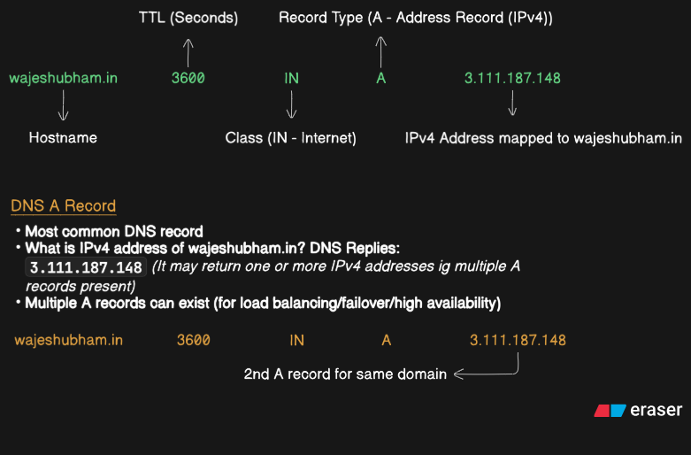

The example is:

```text
wajeshubham.in.  3600  IN  A  3.111.187.148
```

It answers: **“What IPv4 address is published for this hostname?”**

A name can have multiple A records:

```text
www.example.com.  300  IN  A  192.0.2.10
www.example.com.  300  IN  A  192.0.2.11
```

These IPs are documentation examples. Multiple A records may be used for distribution or redundancy, but DNS does not automatically know whether each application server is healthy.

### Does an A record identify the physical website server?

Not necessarily. The IP may belong to a CDN, reverse proxy, load balancer, or hosting platform in front of the application. DNS tells the client where to connect; it does not describe all infrastructure behind that address.

---

## 4. AAAA record: hostname to IPv6

An **AAAA record** maps a DNS name to an IPv6 address. It plays the role for IPv6 that an A record plays for IPv4.

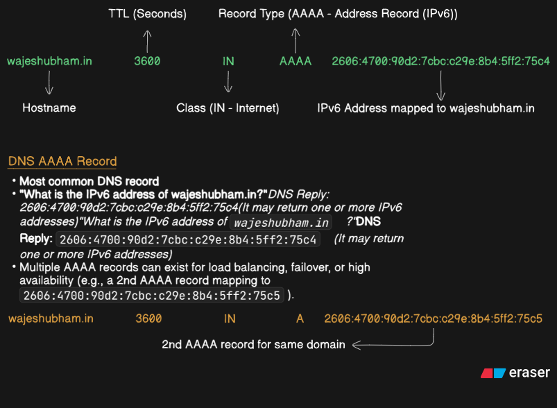

The image gives an example similar to:

```text
wajeshubham.in.  3600  IN  AAAA  2606:4700:90d2:7cbc:c29e:8b4:5ff2:75c4
```

Treat this as an illustrative value, not a verified current answer for the domain.

### Why is it called AAAA?

IPv4 addresses are 32 bits. IPv6 addresses are 128 bits—four times as many bits—so the DNS record type was named AAAA to reflect the larger address.

A domain can publish both A and AAAA records. A client may use IPv4 or IPv6 depending on network support and connection-selection behavior. It can also publish multiple AAAA records.

**Important correction to the diagram:** the second IPv6 record must be labelled `AAAA`, not `A`, because its value is an IPv6 address.

**Remember:** A = IPv4; AAAA = IPv6. Neither record by itself says whether an address is authorized to send email.

---

## 5. MX record: where email should go

An **MX (Mail Exchange) record** tells sending mail systems which mail-server hostnames accept email for a domain. It does not store email messages and does not directly contain the mail server's IP address.

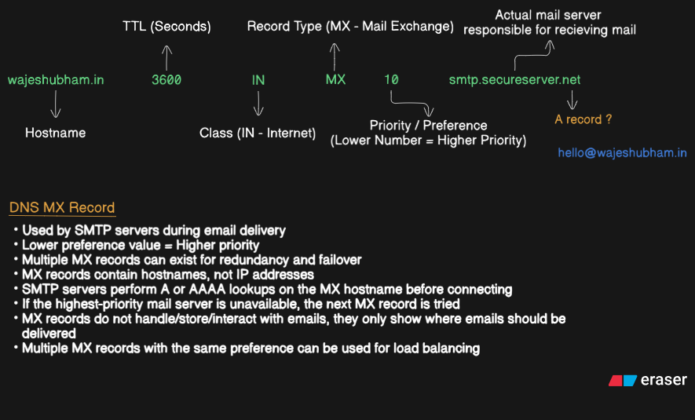

Example:

```text
wajeshubham.in.  3600  IN  MX  10  smtp.secureserver.net.
```

- `wajeshubham.in.` is the domain receiving email.
- `3600` is the TTL.
- `IN` is the Internet class.
- `MX` identifies a mail-exchange record.
- `10` is the preference value.
- `smtp.secureserver.net.` is the destination mail-server hostname.

### Preference: lower number means higher priority

The image shows an example set like:

```text
wajeshubham.in.  3600  IN  MX  10  smtp.secureserver.net.
wajeshubham.in.  3600  IN  MX  20  backup-mail-1.secureserver.net.
wajeshubham.in.  3600  IN  MX  50  backup-mail-2.secureserver.net.
```

The sending system prefers the lowest preference number. It tries the preference-10 destination first. If it cannot deliver to that server, it may try the next eligible MX server, following SMTP retry and delivery behavior.

Multiple MX records do not guarantee equal traffic distribution. Equal-preference records can be used for distribution, but behavior depends on the sender implementation and the mail service's design. A backup is not automatically used merely because the primary is busy; the primary must be unavailable or delivery must otherwise fail to proceed.

### Why does MX contain a hostname, not an IP?

The mail provider can change the IP addresses behind a mail service. MX names the logical destination, then the sender resolves that hostname to an address.

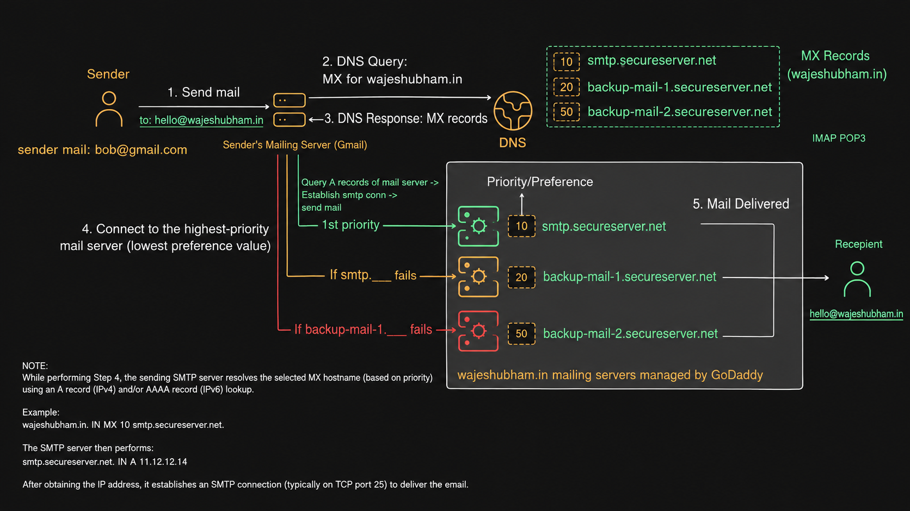

Simplified flow:

1. A sender sends a message to `hello@wajeshubham.in`.
2. The sender's mail server looks up MX records for `wajeshubham.in`.
3. It chooses a mail-server hostname according to preference.
4. It resolves that hostname with A and/or AAAA lookups.
5. It connects to the destination using SMTP and attempts delivery.

Server-to-server SMTP commonly uses TCP port 25, though submission and provider-specific configurations can use other ports.

### Does an MX record point to a mailbox?

No. It routes mail for a domain to a mail server. The mail service then accepts, filters, stores, and delivers the message to the recipient's mailbox. `hello@wajeshubham.in` is the recipient address, not the MX target.

---

## 6. CNAME record: one hostname aliases another

A **CNAME (Canonical Name) record** makes one hostname an alias of another hostname. It does not directly contain an IPv4 or IPv6 address.

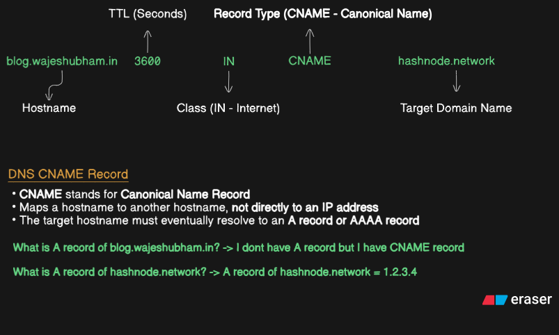

Example:

```text
blog.wajeshubham.in.  3600  IN  CNAME  hashnode.network.
```

This says that `blog.wajeshubham.in` is an alias for `hashnode.network`.

### What happens when someone asks for the alias's IP?

If a client asks for the A record of `blog.wajeshubham.in`:

1. DNS indicates that the name is a CNAME to `hashnode.network`.
2. The resolver follows the target hostname.
3. It obtains the appropriate A record for IPv4, or AAAA record for IPv6, as requested.
4. The resulting address is returned.

The image uses `1.2.3.4` as an illustrative target answer. It is not a verified current IP address for Hashnode.

### Why use CNAME instead of A?

Imagine a blogging platform changes the IP addresses behind its service. If every customer hard-coded those IPs in A records, customers might need to update their DNS. With a CNAME, the customer points a subdomain to the platform's hostname, and the platform manages the addresses behind that hostname.

Use a CNAME when a service gives you a target hostname to alias. Use A/AAAA when you need to publish an address directly.

### CNAME restrictions

Under ordinary DNS rules, a CNAME owner name generally cannot coexist with other ordinary record types at that same name. A CNAME says the name is an alias, rather than an independent owner of its own data.

The zone apex—such as `example.com` itself—normally needs SOA and NS records, so a conventional CNAME cannot be used there. Some DNS providers offer ALIAS/ANAME or CNAME-flattening features as provider-specific solutions.

### Is `hashnode.network` an IP address?

No, it is a hostname. A CNAME points to another name. That target must eventually resolve to an address or otherwise provide the requested DNS answer. Long alias chains are possible but generally undesirable.

---

## 7. NS records: authoritative name servers

An **NS (Name Server) record** identifies name servers associated with a DNS zone or used to delegate a child zone.

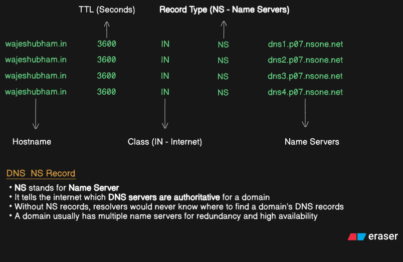

The diagram shows examples such as:

```text
wajeshubham.in.  3600  IN  NS  dns1.p07.nsone.net.
wajeshubham.in.  3600  IN  NS  dns2.p07.nsone.net.
wajeshubham.in.  3600  IN  NS  dns3.p07.nsone.net.
wajeshubham.in.  3600  IN  NS  dns4.p07.nsone.net.
```

These names are examples from the image, not a statement about the domain's current configuration.

### What does authoritative mean?

An authoritative name server is configured to serve DNS data for a zone. An NS record does not give the requested website IP; it helps a resolver discover which DNS servers are responsible for the relevant data.

### Why are there multiple name servers?

Multiple authoritative servers improve redundancy and availability. A resolver can choose among them based on reachability, performance, and implementation behavior; it does not need to query every one for every answer.

---

## 8. DNS delegation

**DNS delegation** means a parent zone identifies another set of authoritative name servers as responsible for a child zone. It delegates DNS authority—not necessarily the website, backend, or physical server.

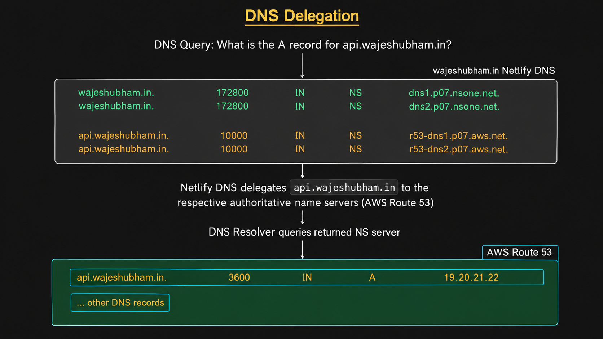

The diagram illustrates this arrangement:

- Netlify DNS manages the parent zone `wajeshubham.in`.
- The child zone `api.wajeshubham.in` is delegated to AWS Route 53.
- Route 53 serves the child zone's records, including an example A record.

Parent-side delegation records may look like:

```text
api.wajeshubham.in.  10000  IN  NS  r53-dns1.p07.aws.net.
api.wajeshubham.in.  10000  IN  NS  r53-dns2.p07.aws.net.
```

The child zone might contain:

```text
api.wajeshubham.in.  3600  IN  A  19.20.21.22
```

The IP is illustrative, not a verified live address.

### Delegation flow

Suppose a resolver needs the A record for `api.wajeshubham.in`.

1. The resolver discovers the DNS authority for the parent domain.
2. The parent-zone data identifies the name servers delegated for `api.wajeshubham.in`.
3. The resolver follows the delegation and asks an authoritative server for the child zone.
4. The child server returns the requested A record.
5. The resolver caches records according to TTL and returns the answer.

The resolver may already have the delegation cached, so it does not need to contact the parent for every query.

### Why not ask the TLD for the A record directly?

The TLD server (such as `.in`) generally provides delegation information for `wajeshubham.in`; it does not hold every A, MX, TXT, and other record for that domain. The authoritative server for the relevant zone serves those records. A resolver follows referrals to find the right server.

### “Netlify is a frontend host. Why is it involved?”

This is the distinction between DNS hosting and application hosting:

- **DNS hosting:** Stores and serves DNS records.
- **Frontend hosting:** Serves the browser-facing application.
- **Backend hosting:** Runs APIs and application logic.
- **Database hosting:** Stores application data.

One provider can offer several roles, but they remain conceptually distinct. Netlify can manage DNS without hosting every part of an application. Delegating `api.wajeshubham.in` to Route 53 does not prove that the API itself runs on AWS; Route 53 is a DNS service.

### Parent-side delegation vs child-zone NS data

The parent zone publishes the delegation telling resolvers where the child zone is hosted. The child zone normally also has apex NS records identifying its authoritative servers. These are related but distinct roles in the hierarchy.

---

## 9. TXT records

A **TXT record** publishes text associated with a DNS name. DNS stores and returns the text; the application or protocol using it decides what the text means.

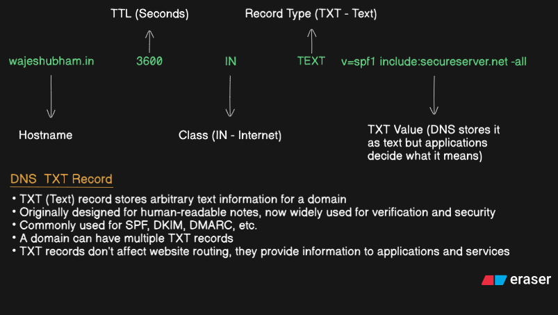

Example:

```text
wajeshubham.in.  3600  IN  TXT  "v=spf1 include:secureserver.net -all"
```

TXT records are used for domain verification, service configuration, and email security systems such as SPF, DKIM, and DMARC. A domain can publish multiple TXT records, though each protocol has its own rules about which records are valid.

### Why not use A records for SPF?

An A record publishes an IPv4 address for a hostname. It has no policy syntax for rules such as “these ranges are authorized, include another provider's policy, and fail all other senders.”

SPF is a policy language, so the SPF policy is published in a TXT record. SPF can use address data indirectly—for example, with its `a` mechanism—but the policy itself remains a TXT record.

### Do TXT records affect website routing?

Usually, TXT records do not direct a browser to an IP. They provide data for other applications and services to interpret. Website address routing is normally driven by A/AAAA records, aliases, and related infrastructure.

---

## 10. SPF (Sender Policy Framework)

**SPF** lets a domain publish a policy describing which sending IP addresses are authorized in the SMTP envelope-sender context.

This matters because the visible email `From` address can be forged. An attacker might send a message that claims to be from `hello@wajeshubham.in` while using an unrelated server.

SPF gives the receiver a published policy to compare against the connecting mail server's IP.

### Example SPF policy

```text
wajeshubham.in.  3600  IN  TXT  "v=spf1 ip4:64.202.168.0/24 ip4:97.74.135.0/24 -all"
```

| Part | Meaning |
|---|---|
| `v=spf1` | Identifies an SPF version 1 policy |
| `ip4:64.202.168.0/24` | Matches IPv4 addresses in this range |
| `ip4:97.74.135.0/24` | Matches IPv4 addresses in this range |
| `-all` | SPF Fail if no preceding mechanism matches |

The `/24` suffix is CIDR notation. `64.202.168.0/24` covers IPv4 addresses from `64.202.168.0` through `64.202.168.255`.

### What does `include:secureserver.net` mean?

```text
v=spf1 include:secureserver.net -all
```

The `include` mechanism tells SPF to evaluate the SPF policy published by `secureserver.net` as part of the authorization check. It does not mean “trust any hostname containing this text.” The included domain's SPF policy is evaluated according to SPF rules.

Only publish a policy appropriate for the systems that actually send email for your domain. A wrong policy can cause legitimate mail to fail. SPF also has DNS lookup limits and other protocol constraints.

### SPF results vs final delivery

SPF can return Pass, Fail, SoftFail, Neutral, or error-related results. A hard fail (`-all`) means the sender did not match the policy and is explicitly marked Fail. It does not force every receiving provider to reject the email: the receiver decides how to handle the message using its own policy and other signals.

---

## 11. Normal SPF verification

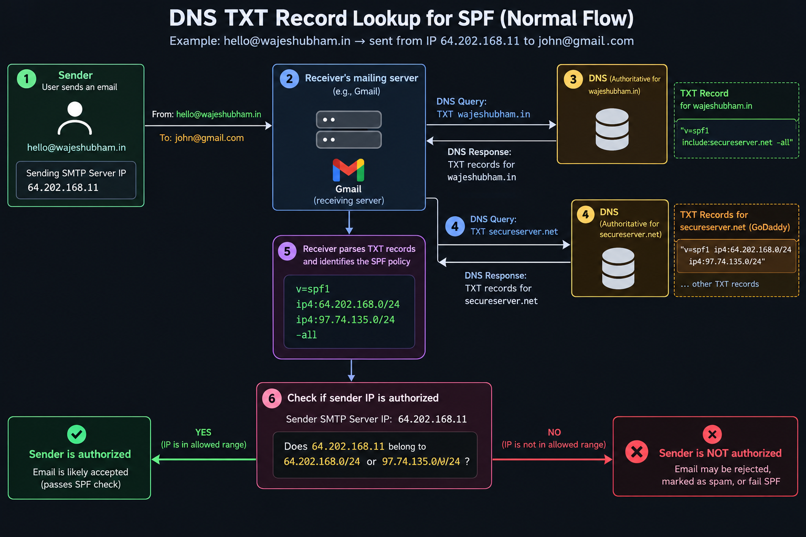

The diagram illustrates a sender using IP `64.202.168.11` and a domain policy authorizing `64.202.168.0/24`.

1. **The email arrives.** The receiver observes the IP address of the connecting SMTP server. The visible `From` text alone is not proof of identity.
2. **The receiver obtains the policy.** It asks DNS for the SPF TXT data for the relevant SMTP envelope-sender domain. It usually asks a recursive resolver, which checks its cache and resolves the record if needed.
3. **The receiver parses the SPF policy.** It evaluates mechanisms in order. If the policy includes another domain, that domain's SPF policy is evaluated as specified by `include`.
4. **The receiver checks the sending IP.** `64.202.168.11` belongs to `64.202.168.0/24`, so it matches the illustrative policy and SPF passes.
5. **The receiver decides what to do.** It may combine SPF with DKIM, DMARC, reputation, content analysis, and other signals.

### Why doesn't the mail server query the TLD directly for SPF?

The TLD server generally points the resolver toward the domain's authoritative DNS servers. The TXT record is served by the authoritative server for the relevant zone. The receiving mail system normally asks a recursive resolver for the TXT record, and the resolver follows DNS referrals as necessary. If the answer is cached, it may not contact the TLD at all.

---

## 12. SPF and email spoofing

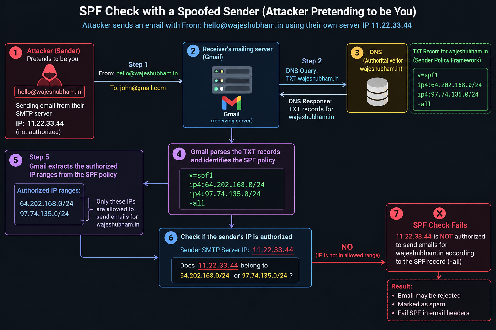

Imagine an attacker sends a message claiming to be:

```text
From: hello@wajeshubham.in
```

But the connecting SMTP server's actual IP is `11.22.33.44`.

The example policy authorizes these ranges:

```text
64.202.168.0/24
97.74.135.0/24
```

The receiver checks the attacker's IP against both ranges. It matches neither, so the final `-all` mechanism yields SPF Fail.

### Why doesn't writing your email address authorize the attacker?

Because the visible `From` field is not proof that the connecting server is authorized. SPF checks the connecting IP against the policy for the relevant SMTP envelope-sender domain (often associated with the Return-Path). This domain can differ from the visible `From` domain.

SPF alone therefore does not guarantee that the visible `From` address is authenticated. DMARC checks alignment between the visible `From` domain and SPF and/or DKIM authentication.

### Does SPF failure always mean rejection?

No. The receiver may reject the email, mark it as spam, or apply other handling. SPF Fail is the authentication result, not a universal delivery instruction.

### SPF, DKIM, and DMARC

- **SPF:** Is the connecting IP authorized by the relevant envelope-sender domain's policy?
- **DKIM:** Does the message have a valid cryptographic signature associated with a domain, and has signed content remained intact?
- **DMARC:** Does SPF and/or DKIM pass with alignment to the visible `From` domain, and what handling policy does the domain publish?

Together they provide stronger email authentication than SPF alone.

---

## 13. PTR record: reverse DNS

A **PTR (Pointer) record** is used for reverse DNS. It maps an IP address to a hostname, the opposite direction from an A or AAAA lookup.

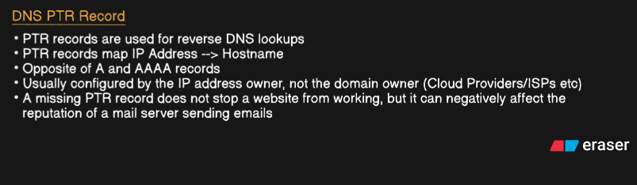

Conceptually:

```text
14.202.168.11  --PTR-->  mail.example.com
```

This is a conceptual mapping, not literal DNS record syntax. IPv4 reverse names live under `in-addr.arpa`; IPv6 reverse names live under `ip6.arpa`. For example, the reverse name for IPv4 address `14.202.168.11` is `11.168.202.14.in-addr.arpa.`

### Who controls PTR records?

PTR records are usually managed by whoever controls the relevant IP allocation—often an ISP, cloud provider, hosting provider, or network operator. A domain owner may manage forward DNS for `mail.example.com` but not control the reverse DNS zone for the IP. The IP provider may offer a way to configure PTR.

### Why is PTR useful for email?

Receiving systems may check reverse DNS as one signal of mail-server configuration and reputation. Missing or suspicious PTR can affect deliverability, depending on the receiving provider's policy. A missing PTR does not normally prevent a website from working.

### Does PTR prove that the hostname owner sent the email?

No. PTR says that reverse DNS for the IP maps to a hostname. It does not prove the sender owns that domain or is authorized to use an email address. That is why forward confirmation and email authentication matter.

---

## 14. Forward-Confirmed Reverse DNS (FCrDNS)

**FCrDNS** checks that a hostname returned by a reverse lookup resolves forward to the original IP address.

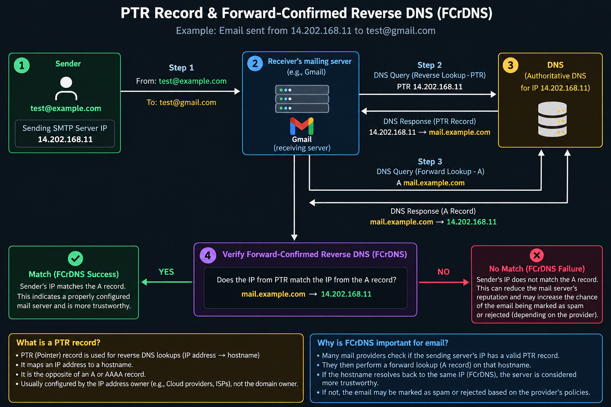

Using the diagram's example:

- Original sending IP: `14.202.168.11`
- PTR response: `mail.example.com`
- A record for `mail.example.com`: `14.202.168.11`

The steps are:

1. The receiver observes the connecting IP `14.202.168.11`.
2. It performs a PTR lookup for that IP.
3. DNS returns `mail.example.com`.
4. The receiver performs a forward lookup for `mail.example.com`.
5. The A result includes `14.202.168.11`.
6. Because the original IP appears in the forward result, FCrDNS succeeds.

For IPv6, the forward confirmation can involve AAAA records. A hostname may have several addresses; the important check is whether the original address appears among the relevant forward results.

### Why do both lookups?

- **PTR lookup:** “Which hostname does reverse DNS associate with this IP?”
- **Forward lookup:** “Does that hostname resolve back to the original IP?”

The forward lookup does not replace PTR because it needs a hostname to test. PTR supplies the name; the forward lookup checks the association.

### What does a successful match prove?

It proves that the reverse and forward DNS mappings are consistent. This can be a useful configuration and trust signal. It does **not** prove that the sender owns the visible email address, that the message is safe, or that SPF/DKIM/DMARC will pass.

---

## 15. PTR attacker scenario

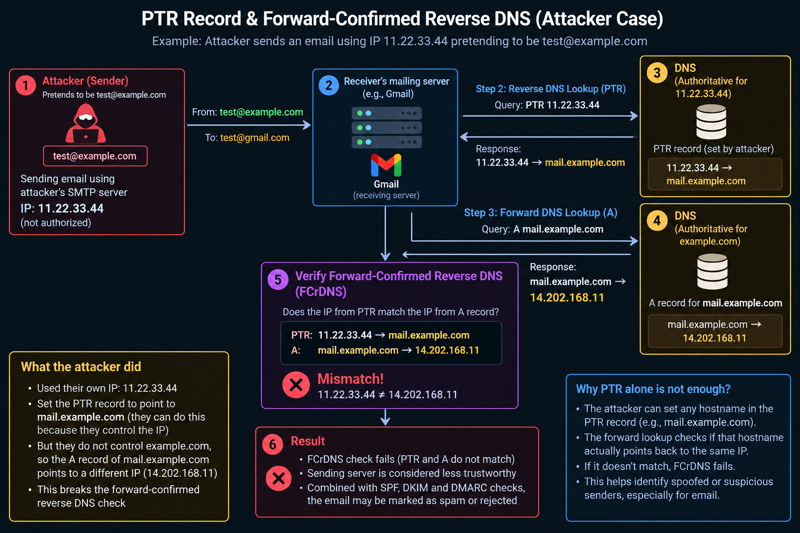

Suppose an attacker sends an email claiming to be `test@example.com` from IP `11.22.33.44`.

The attacker controls their IP's reverse DNS setting and configures a PTR response like:

```text
11.22.33.44  --PTR-->  mail.example.com
```

But the attacker does not control the forward DNS record for `mail.example.com`. Suppose that hostname's A record is:

```text
mail.example.com.  3600  IN  A  14.202.168.11
```

The receiver compares the original IP (`11.22.33.44`) with the forward result (`14.202.168.11`). They do not match, so FCrDNS fails.

### Why can't the attacker just use someone else's hostname?

The attacker may be able to set the PTR hostname for the IP allocation they control, but they generally cannot change the other domain owner's forward DNS. The forward check exposes the mismatch.

### What if the attacker controls both the PTR and the forward hostname?

Then the attacker could configure both mappings to match their own IP. FCrDNS would pass because the DNS data is consistent. That still does not authorize the attacker to send for `example.com` or use `test@example.com`. SPF, DKIM, DMARC, and other checks remain important.

### Why use PTR if forward lookup is the verification?

Because the checks answer different questions. PTR provides the hostname associated with the IP; the forward lookup verifies that hostname resolves back to the same IP. The forward lookup cannot replace PTR because it needs the name supplied by the reverse lookup.

### What are `test@example.com` and `mail.example.com`?

- `test@example.com` is a placeholder **email address**: mailbox name `test`, domain `example.com`.
- `mail.example.com` is a **hostname** under `example.com`, used in the diagram to represent a mail-server hostname.

Neither is evidence of a real mailbox or actual server. `example.com` is reserved for documentation and examples.

### Is `mail.example.com` an authoritative mail domain?

Not necessarily. It is just a hostname. An **authoritative DNS server** is responsible for serving DNS records for a zone. A **mail server** handles email delivery. These are different roles. A mail hostname can be published by an authoritative DNS server without itself being a DNS authority.

---

## 16. Common questions and misconceptions

### Why not use A records for SPF?

A records publish IPv4 addresses; SPF needs a policy language with mechanisms, includes, and failure behavior. That policy is published in a TXT record. SPF can use A/AAAA address data through specific mechanisms, but that does not replace the TXT policy.

### Why doesn't Gmail query the TLD directly for the SPF TXT record?

The TLD usually supplies delegation information. The authoritative server for the relevant zone serves the TXT record. The receiver normally asks a recursive resolver, which follows referrals if it needs to.

### Can an IP owner map their IP to someone else's hostname with PTR?

They may be able to configure a PTR name for an IP allocation they control. But if they do not control the hostname's forward DNS, the A/AAAA lookup may point elsewhere and FCrDNS will fail. Even if both mappings match, that does not prove authorization to send email for the visible domain.

### Why is Netlify involved if the application has a backend elsewhere?

DNS management and application hosting are separate. Netlify can host the frontend, manage DNS, or both. Delegation to Route 53 says who serves DNS for the child zone; it does not identify where the API process runs.

### Does SPF failure automatically reject the message?

No. The receiving provider decides whether to reject, spam-folder, or otherwise handle the message. SPF is one signal among several.

### Does a matching PTR and A record prove a sender is safe?

No. It confirms DNS consistency, not identity or authorization. SPF, DKIM, DMARC, reputation, and other checks still matter.

### Do DNS changes take effect immediately?

Not necessarily. Caches can retain old records until TTL expiry. Different caches refresh at different times.

---

## 17. Practice with `nslookup`

`nslookup` is a DNS query tool. On Windows, open Command Prompt or PowerShell. Use a hostname only, not a full URL with `https://` or a path.

```powershell
# Default lookup
nslookup example.com

# IPv4 A records
nslookup -type=A example.com

# IPv6 AAAA records
nslookup -type=AAAA example.com

# Mail exchangers
nslookup -type=MX example.com

# Name servers
nslookup -type=NS example.com

# TXT records (may include SPF or verification text)
nslookup -type=TXT example.com

# CNAME record
nslookup -type=CNAME www.example.com
```

To ask a specific recursive resolver:

```powershell
nslookup -type=TXT example.com 8.8.8.8
```

This asks Google's public recursive resolver. It does not force a direct query to the authoritative server.

### Reverse lookup

```powershell
nslookup 8.8.8.8
```

This asks for reverse DNS information for that IP. A PTR answer may or may not exist, and the result is not a guarantee of trustworthiness.

### What `nslookup` does and does not show

- It shows the answer returned by the resolver you queried.
- It may show resolver-specific or cached results.
- It does not necessarily list every record in a zone.
- A failed query does not always prove that a record does not exist; configuration, resolver behavior, or transient failures may be involved.
- Investigating delegation precisely may require querying particular authoritative servers or using more specialized DNS tools.

---

## 18. Records at a glance

| Record | Main purpose | Typical value | Question answered |
|---|---|---|---|
| **A** | IPv4 mapping | IPv4 address | What IPv4 address is published for this name? |
| **AAAA** | IPv6 mapping | IPv6 address | What IPv6 address is published for this name? |
| **MX** | Mail routing | Preference + mail hostname | Which mail server should receive email for this domain? |
| **CNAME** | Alias | Target hostname | Which hostname is this name an alias for? |
| **NS** | DNS authority/delegation | Name-server hostname | Which name servers serve or are delegated for this zone? |
| **TXT** | Publish text/policy data | Text string(s) | What text should a protocol or service interpret? |
| **PTR** | Reverse DNS | Hostname | Which hostname is associated with this IP in reverse DNS? |

A domain can have several types at once: A/AAAA for web access, MX for mail routing, NS for DNS authority, and TXT for verification or email policy.

---

## 19. Final mental model

1. **A and AAAA** publish IP addresses for names.
2. **MX** identifies mail-server hostnames; the sender then resolves those hostnames to IP addresses.
3. **CNAME** points one hostname to another hostname.
4. **NS and delegation** guide resolvers to the DNS authority responsible for a zone or child zone.
5. **TXT** publishes text that another protocol or service interprets.
6. **SPF** uses a TXT policy to evaluate whether a sending IP is authorized for the relevant envelope-sender domain.
7. **PTR** maps an IP to a hostname in reverse DNS.
8. **FCrDNS** checks that the PTR hostname resolves forward to the original IP.
9. **No single check proves an email is trustworthy.** SPF, DKIM, DMARC, DNS consistency, reputation, and receiver policy contribute different evidence.

The most useful habit is to ask, for every record:

> **What question is this record designed to answer, and which system uses the answer?**

That question helps keep DNS resolution, application hosting, mail routing, and email authentication separate in your mind.
