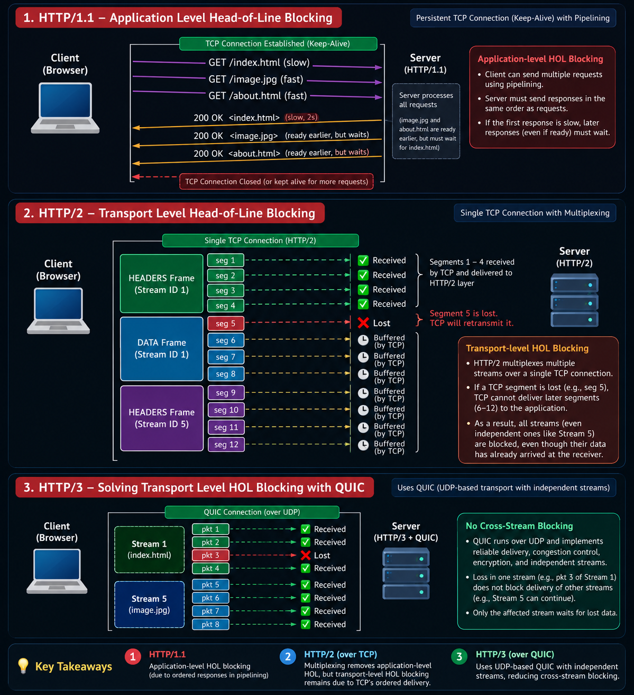

# Head-of-Line (HOL) Blocking in HTTP/1.1, HTTP/2, and HTTP/3

Head-of-Line (HOL) blocking occurs when data or a response is delayed because something that must be delivered or processed before it is not yet available. The exact cause depends on the HTTP version and the transport protocol underneath it.

This note follows the progression from HTTP/1.1 to HTTP/2 and then HTTP/3:

1. **HTTP/1.1:** response ordering can cause application-level HOL blocking when pipelining is used.
2. **HTTP/2:** multiplexing removes HTTP response-order blocking, but TCP can still cause transport-level HOL blocking.
3. **HTTP/3:** QUIC uses independent streams to avoid TCP's cross-stream delivery blocking.

> **Core idea:** HTTP/2 solves one kind of HOL blocking, not every kind. HTTP/3 uses QUIC to reduce the transport-level problem that remains with HTTP/2 over TCP.

---

## 1. HTTP/1.1 — Application-Level HOL Blocking

HTTP/1.1 supports persistent connections (`Keep-Alive`). A browser can reuse one TCP connection to request multiple resources from the same server.

With **HTTP/1.1 pipelining**, a client can send multiple requests without waiting for a response to each request first. However, the server must send pipelined responses in the same order as the corresponding requests.

### Example

Suppose the browser sends these requests in order:

1. `GET /index.html`
2. `GET /image.jpg`
3. `GET /about.html`

Imagine that generating the HTML response takes two seconds, while the image and about-page responses are ready much sooner. With pipelining, the later responses cannot be sent ahead of the first response.

The image and about-page responses therefore wait behind the slow HTML response. This is **application-level HOL blocking**.

### Important distinction

Sequential request-response behavior is not, by itself, the clearest example of pipelining-related HOL blocking. The specific problem is that, when requests are pipelined on one HTTP/1.1 connection, responses must be sent in request order.

---

## 2. HTTP/2 — Multiplexing and Transport-Level HOL Blocking

HTTP/2 introduces **streams** and **multiplexing**. A stream is an independent logical channel within an HTTP/2 connection. Frames carry a stream identifier so the receiver can associate each frame with the correct stream.

For example, a client-initiated stream might use stream ID `1` for an HTML resource and another might use stream ID `5` for an image. Client-initiated HTTP/2 stream IDs are odd-numbered; server-initiated streams use even-numbered IDs.

Frames from different streams can be interleaved over the same TCP connection. HTTP/2 does not require complete responses to finish in request order.

### Why can HOL blocking still happen?

HTTP/2 normally runs over **one TCP connection**. TCP presents an ordered byte stream to the application. If a TCP segment is lost, later bytes may arrive at the receiver but cannot be delivered to the application beyond the missing byte range until the lost data is recovered.

For example:

1. TCP segments 1–4 arrive.
2. Segment 5 is lost.
3. Later segments arrive and may be buffered by TCP.
4. TCP cannot deliver the later bytes past the missing data to the HTTP/2 layer until the missing data is retransmitted.

Those later bytes can contain data for multiple HTTP/2 streams. Consequently, data belonging to an otherwise independent stream can be delayed by loss affecting another part of the same TCP connection. This is **transport-level HOL blocking**.

### Keep the two HTTP/2 layers distinct

- **HTTP/2 layer:** multiplexes independent streams and permits their frames to be interleaved.
- **TCP layer:** delivers one ordered byte stream. A gap caused by packet loss can delay delivery of later bytes, regardless of which HTTP/2 stream those bytes belong to.

TCP does not understand HTTP/2 stream IDs or frame boundaries. The exact mapping of TCP segments to HTTP/2 frames depends on packetization; diagrams simplify this to illustrate the principle.

---

## 3. HTTP/3 — QUIC Reduces Cross-Stream Blocking

HTTP/3 uses **QUIC**, a transport protocol built on top of UDP. UDP alone does not provide reliable, ordered delivery like TCP. QUIC implements the transport features needed by HTTP/3, including reliability, congestion control, connection management, and encrypted communication using TLS 1.3.

QUIC supports independent streams. When data is lost on one stream, the affected stream must wait for recovery of that data, but unrelated streams can generally continue delivering available data without waiting for the lost data on the other stream.

### Why not just use UDP directly?

UDP is a datagram transport and does not, by itself, provide the reliable delivery, congestion control, encryption, or independent reliable streams needed by HTTP/3. QUIC supplies these features while avoiding TCP's single ordered byte stream across the entire connection.

### What HTTP/3 improves

- Loss on one QUIC stream generally does not block delivery of already-received data on other streams.
- QUIC retains reliable delivery for data that must be received.
- QUIC integrates TLS 1.3 for connection security.
- Connection setup can be faster in suitable circumstances, including through resumption and 0-RTT where applicable.

HTTP/3 does **not** eliminate packet loss or all waiting. A stream that needs lost data still has to wait for that data to be recovered. The important improvement is reducing cross-stream blocking.

---

## 4. Comparison Table

| Feature | HTTP/1.1 with pipelining | HTTP/2 over TCP | HTTP/3 over QUIC |
|---|---|---|---|
| Multiple logical streams | No HTTP/2-style multiplexed streams | Yes | Yes |
| Responses must finish in request order | Yes, for pipelined responses | No | No |
| Application-level response-order HOL | Possible | Largely addressed by multiplexing | Largely addressed by multiplexing |
| TCP ordered-byte-stream blocking | TCP is used | Yes | No TCP transport |
| Can loss on one stream delay unrelated streams? | Depends on request/response and connection behavior | Yes, due to TCP's ordered delivery | Generally avoids cross-stream blocking |
| Transport | TCP | TCP | QUIC over UDP |

---

## 5. Key Takeaways

1. **HTTP/1.1:** pipelined responses must be sent in request order. A slow earlier response can delay later responses.
2. **HTTP/2:** streams and multiplexing allow frames and responses to progress independently at the HTTP layer, but all streams still share TCP's ordered byte stream.
3. **HTTP/3:** QUIC provides independent streams over UDP, reducing the cross-stream blocking caused by TCP's ordered delivery.
4. **UDP is not QUIC:** QUIC is a full transport protocol built over UDP, not merely UDP with a small modification.
5. **Loss still matters:** HTTP/3 does not make packet loss disappear; it prevents loss on one stream from unnecessarily blocking unrelated streams.

### One-line revision

**HTTP/1.1:** response-order HOL → **HTTP/2:** multiplexing, but TCP HOL remains → **HTTP/3:** QUIC independent streams reduce cross-stream HOL.\n\n\

This overview infographic summarizes the three stages discussed below. The individual HTTP/1.1 and HTTP/2 diagrams in the relevant sections provide a closer look at each mechanism.

---

