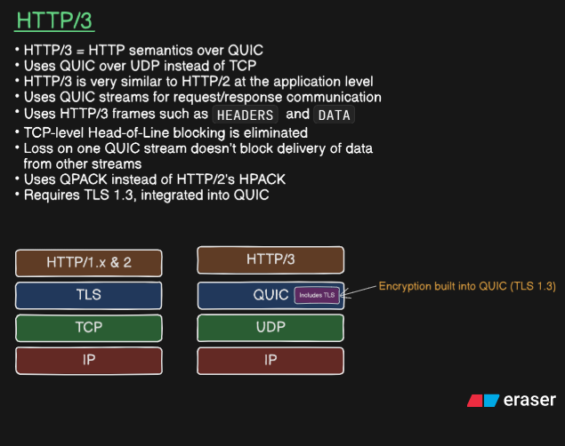
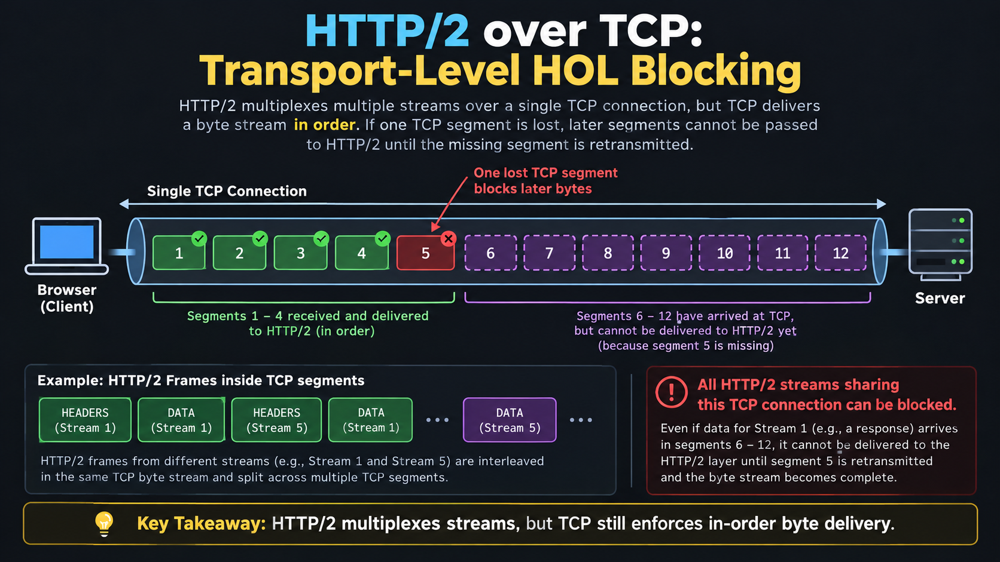
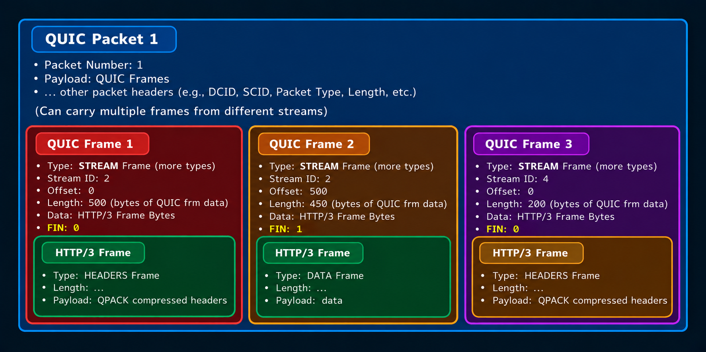
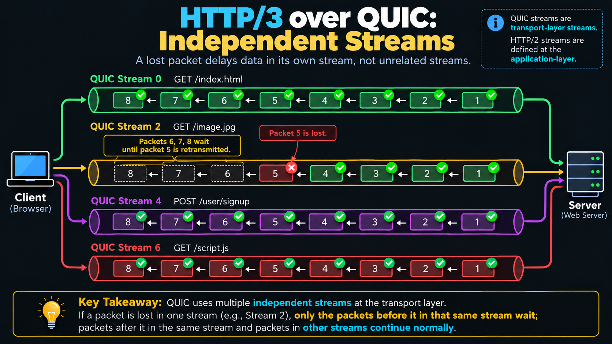
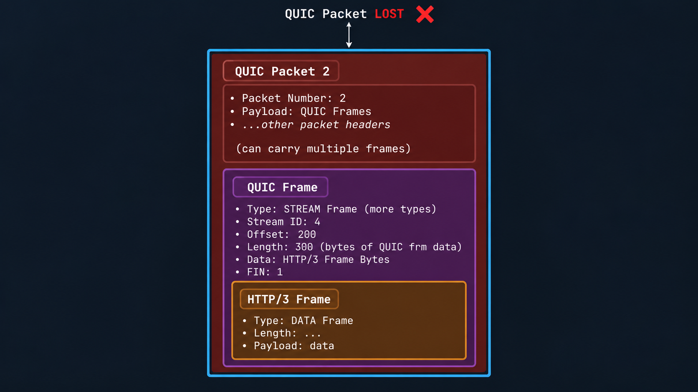
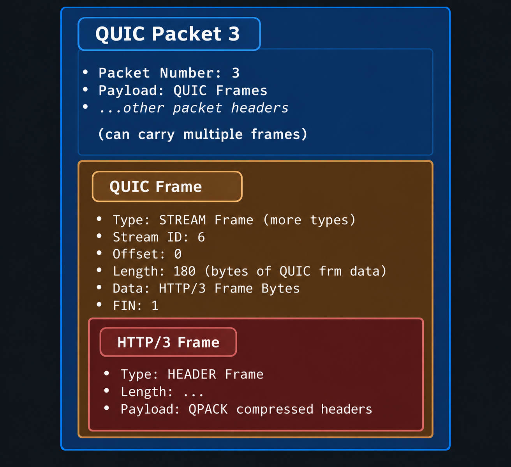
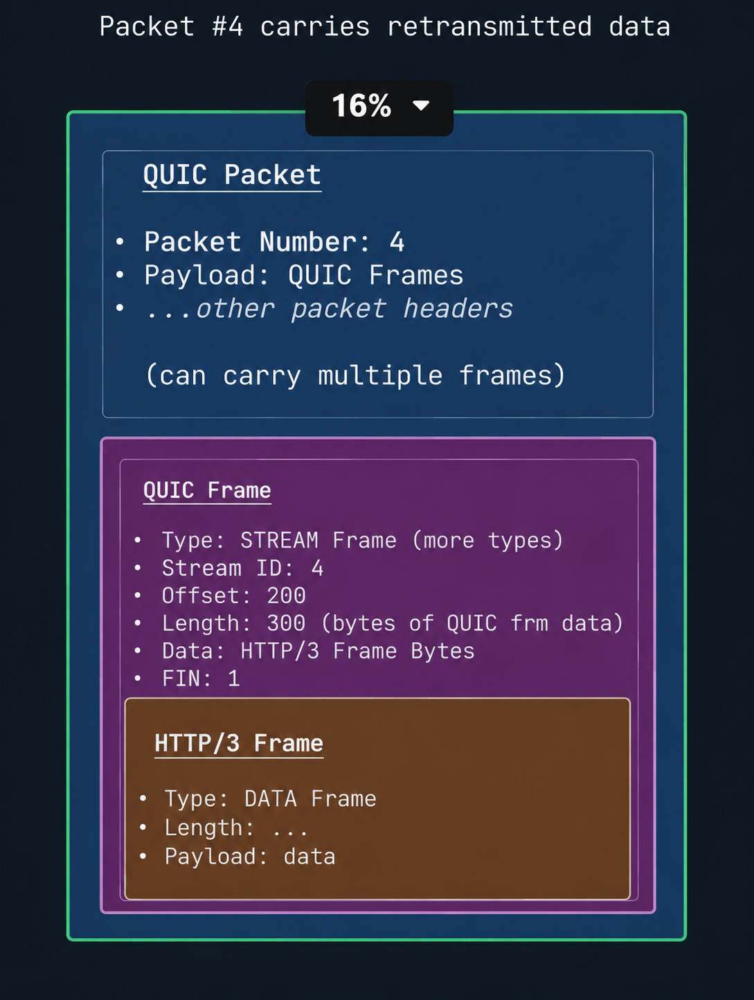
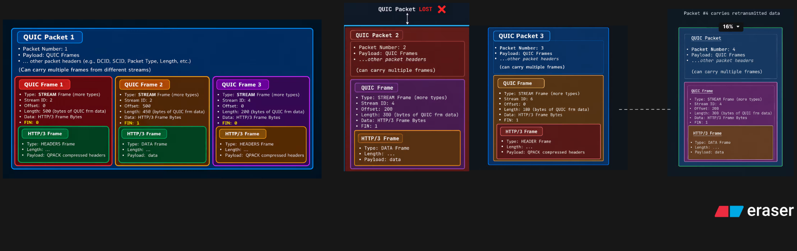

# HTTP/3 over QUIC — Notes and Diagrams

> A practical, visual explanation of HTTP/3, QUIC streams and frames, packet loss, retransmission, and why QUIC avoids **TCP-level head-of-line (HOL) blocking** between independent streams.

**How to use the diagrams:** click any diagram to open its full-resolution image. In GitHub, use the browser's image zoom or open the image in a new tab to inspect small labels.

---

## Contents

- [1. HTTP/3 at a glance](#1-http3-at-a-glance)
- [2. Protocol stack: HTTP/2 vs HTTP/3](#2-protocol-stack-http2-vs-http3)
- [3. What is head-of-line blocking?](#3-what-is-head-of-line-blocking)
- [4. HTTP/2 over TCP: transport-level HOL blocking](#4-http2-over-tcp-transport-level-hol-blocking)
- [5. QUIC's connection, streams, packets, and frames](#5-quics-connection-streams-packets-and-frames)
- [6. Analogy: a system of pipes and deliveries](#6-analogy-a-system-of-pipes-and-deliveries)
- [7. HTTP/3 over QUIC: independent streams](#7-http3-over-quic-independent-streams)
- [8. Packet-by-packet walkthrough](#8-packet-by-packet-walkthrough)
- [9. QUIC frame types to recognize](#9-quic-frame-types-to-recognize)
- [10. QUIC frames vs HTTP/3 frames](#10-quic-frames-vs-http3-frames)
- [11. Retransmission: what is actually resent?](#11-retransmission-what-is-actually-resent)
- [12. TLS 1.3, QPACK, and flow control](#12-tls-13-qpack-and-flow-control)
- [13. Important details and common misconceptions](#13-important-details-and-common-misconceptions)
- [14. Quick revision](#14-quick-revision)

---

## 1. HTTP/3 at a glance

[](images/01-http3-overview.png)

HTTP/3 is the third major version of HTTP. It keeps HTTP's familiar application semantics—requests, responses, methods, status codes, headers, and content—but maps them onto **QUIC** rather than TCP.

Key points:

- HTTP/3 runs over **QUIC**, and QUIC runs over **UDP**.
- HTTP/3 uses QUIC streams to carry request and response data.
- HTTP/3 defines application-layer frames such as `HEADERS` and `DATA`.
- QUIC provides transport features including reliable stream delivery, stream-level ordering, loss recovery, congestion control, and flow control.
- QUIC integrates the TLS 1.3 handshake and cryptographic protection. TLS is **not** a separate layer between QUIC and UDP.
- HTTP/3 uses **QPACK** for header compression. HTTP/2 uses **HPACK**.

HTTP/3 does not mean that all packet loss disappears. It means that loss in one QUIC stream does not inherently stop unrelated streams from delivering their available data.

## 2. Protocol stack: HTTP/2 vs HTTP/3

### HTTP/1.1 and HTTP/2 (simplified)

```text
HTTP/1.1 or HTTP/2
        |
       TLS       (for HTTPS)
        |
       TCP
        |
        IP
```

### HTTP/3

```text
HTTP/3
   |
  QUIC  ── includes the TLS 1.3 handshake and packet protection
   |
  UDP
   |
   IP
```

The diagrams are simplified protocol-stack views. TLS 1.3 supplies cryptographic negotiation and security to QUIC; QUIC handles transport functions such as stream multiplexing, acknowledgements, loss recovery, congestion control, and flow control.

**Why UDP?** QUIC is implemented above UDP so it can define its own transport behavior without depending on the TCP byte-stream abstraction. QUIC still provides reliable delivery for reliable streams; UDP itself does not provide reliability.

## 3. What is head-of-line blocking?

**Head-of-line (HOL) blocking** occurs when something at the front of an ordered sequence is missing or delayed, preventing later items from being delivered or processed even if those later items have arrived.

The layer where ordering is enforced matters:

- **TCP-level HOL blocking:** TCP exposes one ordered byte stream per connection. Missing bytes block delivery of later bytes on that connection.
- **Within-stream ordering in QUIC:** QUIC reliable streams also deliver their bytes in order, so missing data can delay later bytes in that *same* stream.
- **Cross-stream behavior in QUIC:** A missing piece of data in one stream does not, by itself, prevent available data in other streams from being delivered to the application.

QUIC does not eliminate every kind of delay. Congestion, connection-level flow control, CPU limits, or application dependencies can still affect multiple streams. The specific improvement discussed here is avoiding TCP's single ordered byte stream as a connection-wide delivery bottleneck.

## 4. HTTP/2 over TCP: transport-level HOL blocking

[](images/02-http2-tcp-hol-blocking.png)

HTTP/2 multiplexes multiple HTTP/2 streams over one TCP connection. Frames from different HTTP/2 streams can be interleaved in the same TCP byte stream. However, **TCP still delivers bytes to HTTP/2 in order**.

Imagine TCP segments carrying bytes from several HTTP/2 streams:

1. Segments 1–4 arrive, and TCP can deliver the contiguous bytes to HTTP/2.
2. Segment 5 is lost.
3. Segments 6–12 may arrive at the receiving machine, but they contain bytes that come after the missing byte range.
4. TCP cannot deliver bytes past that gap to HTTP/2 until the missing bytes are recovered.
5. Consequently, data for multiple HTTP/2 streams sharing that TCP connection can be delayed—even if some of that data arrived in later segments.

The important point is not that HTTP/2 lacks multiplexing. **HTTP/2 does multiplex streams; TCP's in-order byte delivery is the bottleneck.**

### What the diagram's lower panel means

HTTP/2 frames such as `HEADERS` and `DATA` from Stream 1 and Stream 5 may be interleaved in the TCP byte stream. TCP does not deliver these independently by HTTP/2 stream. It delivers a single ordered byte sequence, so a missing byte range can hold up all later bytes in that connection.

## 5. QUIC's connection, streams, packets, and frames

[](images/04-quic-packet-1.png)

A useful hierarchy is:

```text
QUIC connection
├── QUIC stream 0
├── QUIC stream 2
├── QUIC stream 4
└── QUIC stream 6
      (illustrative stream labels from the overview diagram)

QUIC packet
├── QUIC packet header
└── Payload
    ├── QUIC frame
    ├── QUIC frame
    └── ...
```

These are different concepts:

| Concept | Meaning |
|---|---|
| **QUIC connection** | The logical transport connection between endpoints. One connection can carry multiple streams and many packets over time. |
| **QUIC stream** | A logical, ordered byte stream within a QUIC connection. Different streams can make progress independently. |
| **QUIC packet** | A unit sent over UDP. It has a QUIC header and a protected payload containing one or more QUIC frames. |
| **QUIC frame** | A unit of information inside a QUIC packet, such as `STREAM`, `ACK`, `CRYPTO`, `PING`, or `MAX_DATA`. |
| **QUIC STREAM frame** | A particular QUIC frame type that carries bytes for one stream, along with information such as its stream ID and offset. |
| **HTTP/3 frame** | An application-layer unit, such as `HEADERS` or `DATA`, encoded within the bytes carried by a QUIC stream. |

### Can one QUIC packet contain multiple frames?

Yes. A QUIC packet can contain one or more QUIC frames. For example, it might contain STREAM frames for different streams, or a STREAM frame plus an ACK frame, subject to packet-format and size rules.

A stream's data can also be spread across multiple packets. Therefore:

- One square labelled `DATA` in a teaching diagram is **not necessarily one QUIC packet**.
- One QUIC packet is **not necessarily one stream**.
- Counting visual data blocks does not tell you the exact number of packets sent on the wire.

## 6. Analogy: a system of pipes and deliveries

Use this analogy to remember how the pieces fit together:

| Networking concept | Pipe-system analogy |
|---|---|
| QUIC connection | The whole water-distribution system |
| QUIC stream | One pipe in that system |
| Application bytes | The material flowing through a pipe |
| QUIC packet | A delivery vehicle carrying packaged items |
| QUIC packet header | The delivery information on the vehicle |
| QUIC frame | A packaged unit carried inside the vehicle |
| STREAM frame | A package containing bytes for a particular pipe/stream |
| Lost packet | A delivery vehicle that fails to arrive |
| Retransmission | Sending the missing information again in a later delivery |

The analogy is useful, but not literal. A QUIC packet may carry frames for more than one stream, and a stream's bytes may be divided across multiple packets. The stream is a logical flow of bytes, not a physical packet or a single box.

## 7. HTTP/3 over QUIC: independent streams

[](images/03-http3-quic-independent-streams.png)

The diagram shows several streams sharing one QUIC connection:

- Stream 0: `GET /index.html`
- Stream 2: `GET /image.jpg`
- Stream 4: `POST /user/signup`
- Stream 6: `GET /script.js`

These stream IDs and request labels are used to explain the idea. Actual HTTP/3 request streams must follow QUIC's stream-ID rules; the example labels should not be treated as a normative mapping of HTTP requests to stream IDs.

Suppose packet 5 contains bytes for the image stream and is lost:

- Data that arrived before the missing range can be delivered in order.
- Later bytes in that same reliable stream cannot be delivered to the application as a complete, contiguous byte sequence until the gap is recovered.
- The other streams can continue delivering their available data, provided they are not independently blocked by flow control, congestion, or application dependencies.

This is the key difference from TCP-level HOL blocking: QUIC does not put all streams behind one shared, ordered TCP byte stream.

### Follow the arrows and numbering

In the supplied stream diagram, packet labels are shown from **1 on the right toward 8 on the left**. In the affected stream, packets 1–4 are shown as received, packet 5 is lost, and packets 6–8 wait behind the missing data in that stream. The other streams continue.

The numbering and placement are explanatory artwork, not a universal rule for packet direction or packet-number assignment.

## 8. Packet-by-packet walkthrough

The following four diagrams zoom into the example packet contents. Click a diagram to open the original image at full resolution.

### Packet 1 — multiple QUIC STREAM frames

[](images/04-quic-packet-1.png)

Packet 1 illustrates a single QUIC packet containing three STREAM frames:

| Frame | Stream ID (diagram) | Offset | Length | FIN | Illustrative HTTP/3 content |
|---|---:|---:|---:|---:|---|
| QUIC Frame 1 | 2 | 0 | 500 bytes | 0 | `HEADERS` frame bytes |
| QUIC Frame 2 | 2 | 500 | 450 bytes | 1 | `DATA` frame bytes |
| QUIC Frame 3 | 4 | 0 | 200 bytes | 0 | `HEADERS` frame bytes |

**How to read this:**

- Frames 1 and 2 belong to the same stream, Stream ID 2, and their offsets indicate consecutive byte ranges: 0–499 and 500–949.
- `FIN = 1` on Frame 2 means the sender is indicating the end of that stream's byte sequence after the data in that frame.
- Frame 3 belongs to Stream ID 4 and begins at offset 0.
- The packet can carry frames from more than one stream.

`FIN` is a flag on a QUIC STREAM frame. `FIN = 1` means that the frame marks the final stream data; it does **not** mean the QUIC connection itself is closed.

### Packet 2 — the lost packet

[](images/05-quic-packet-2-lost.png)

Packet 2 illustrates one STREAM frame:

| Field | Value in the diagram |
|---|---|
| Packet number | 2 |
| Frame type | STREAM |
| Stream ID | 4 |
| Offset | 200 |
| Length | 300 bytes |
| FIN | 1 |
| Illustrative HTTP/3 content | `DATA` frame bytes |

This packet carries the next range of Stream ID 4 after Packet 1's frame at offset 0 with length 200. Its byte range is 200–499. Because Packet 2 is lost, the receiver has a gap in Stream ID 4. Later bytes from that same stream cannot be delivered in order past the gap until the missing bytes are recovered.

The diagram shows one frame inside Packet 2 to keep the example focused. Real QUIC packets can contain more than one frame.

### Packet 3 — another stream continues

[](images/06-quic-packet-3.png)

Packet 3 illustrates a STREAM frame for Stream ID 6:

| Field | Value in the diagram |
|---|---|
| Packet number | 3 |
| Stream ID | 6 |
| Offset | 0 |
| Length | 180 bytes |
| FIN | 1 |
| Illustrative HTTP/3 content | `HEADERS` frame bytes |

Packet 3 belongs to a different stream from the lost data in Stream ID 4. Its arrival can allow that stream's bytes to be delivered independently of the missing bytes in Stream ID 4, assuming no other blocking condition.

### Packet 4 — retransmitting the missing information

[](images/07-quic-packet-4-retransmission.png)

Packet 4 illustrates recovery of the missing Stream ID 4 data:

| Field | Value in the diagram |
|---|---|
| Packet number | 4 |
| Stream ID | 4 |
| Offset | 200 |
| Length | 300 bytes |
| FIN | 1 |
| Illustrative HTTP/3 content | `DATA` frame bytes |

The crucial point is that **the missing stream data is retransmitted in a new QUIC packet**. QUIC does not need to resend the original packet byte-for-byte or reuse its packet number. The retransmitted STREAM frame identifies the stream and byte range that need to be recovered.

After the missing bytes are received, Stream ID 4 can continue delivering its byte sequence in order. Meanwhile, unrelated streams did not have to wait for this recovery.

### All four packet diagrams together

[](images/08-all-four-quic-packets.png)

Use this combined view to compare Packet 1, the lost Packet 2, Packet 3 on another stream, and Packet 4 carrying retransmitted data.

## 9. QUIC frame types to recognize

QUIC payloads contain QUIC frames. The following are useful examples:

| QUIC frame type | Purpose |
|---|---|
| `STREAM` | Carries bytes for a QUIC stream. |
| `ACK` | Reports which QUIC packets have been received. |
| `CRYPTO` | Carries cryptographic handshake data during connection establishment and related cryptographic operations. |
| `PING` | A small frame used to elicit acknowledgement and help confirm that a path/connection is responsive. |
| `MAX_DATA` | Advertises a connection-level flow-control limit. |

This is a short list, not a complete inventory of QUIC frame types.

### A note about ACKs

ACK frames acknowledge **QUIC packets**, not individual HTTP/3 `DATA` frames. If a packet containing stream data is lost, QUIC loss recovery can arrange for the missing stream bytes to be sent again in a new packet.

## 10. QUIC frames vs HTTP/3 frames

This distinction is essential.

```text
QUIC packet
├── QUIC header
└── QUIC payload
    └── QUIC STREAM frame
        └── Stream bytes
            └── HTTP/3 frame(s), encoded in those bytes
                ├── HEADERS
                └── DATA
```

| Layer | Example | What it does |
|---|---|---|
| QUIC transport layer | `STREAM` frame | Carries a stream ID, offset, and stream bytes. |
| HTTP/3 application layer | `HEADERS` frame | Carries HTTP field-section data, using QPACK for compression. |
| HTTP/3 application layer | `DATA` frame | Carries HTTP message content. |

A QUIC STREAM frame is **not** the same thing as an HTTP/3 DATA frame. A STREAM frame transports bytes; those bytes are parsed by HTTP/3 and can contain HTTP/3 frame encodings.

The packet diagrams use nested boxes to show this relationship conceptually. In real packets, HTTP/3 frame boundaries do not necessarily line up with QUIC STREAM-frame or QUIC-packet boundaries: an HTTP/3 frame may span multiple QUIC packets, and a QUIC STREAM frame can carry bytes that include parts of or multiple HTTP/3 frames.

## 11. Retransmission: what is actually resent?

QUIC packet numbers identify transmitted QUIC packets. When a packet is lost, the sender generally sends the necessary information again in one or more **new** QUIC packets with new packet numbers.

For stream data, recovery is based on the stream's byte ranges:

- Stream ID identifies which stream the bytes belong to.
- Offset identifies where those bytes belong in that stream.
- Length indicates how many bytes are carried.
- FIN indicates that the frame marks the end of the stream's byte sequence.

For the example:

```text
Stream ID 4
Packet 1: offset 0,   length 200  -> bytes 0–199 received
Packet 2: offset 200, length 300  -> bytes 200–499 LOST
Packet 4: offset 200, length 300  -> bytes 200–499 sent again
```

The packet number changes for the new transmission, but the stream ID and byte range identify the missing stream data. This is why it is more accurate to say **“QUIC retransmits the missing information”** rather than “QUIC retransmits the same packet.”

## 12. TLS 1.3, QPACK, and flow control

### TLS 1.3

QUIC uses TLS 1.3 for the handshake and cryptographic security. QUIC integrates the TLS handshake into its connection establishment and protects QUIC packets. It is not arranged as a separate TLS record layer underneath HTTP/3 in the same way HTTPS is commonly shown over TCP.

### QPACK vs HPACK

- **HPACK** is the header compression mechanism used by HTTP/2.
- **QPACK** is the header compression mechanism used by HTTP/3.

QPACK was designed for HTTP/3's multiplexed operation over QUIC and manages dependencies on dynamic table state differently from HPACK to avoid recreating problematic cross-stream blocking behavior at the header-compression layer. QPACK can still have dependencies and waiting conditions when a header block references table entries that are not yet available.

### Flow control

QUIC has both stream-level and connection-level flow control:

- **Stream-level flow control** limits how much data a sender may transmit on a particular stream before receiving additional credit.
- **Connection-level flow control** limits the aggregate amount of stream data across the connection.

Therefore, independent streams do not mean unlimited data or guaranteed progress in every situation. A connection-level limit, congestion, or an application-level dependency can still affect progress.

## 13. Important details and common misconceptions

1. **“HTTP/2 does not multiplex.” — Incorrect.** HTTP/2 multiplexes application streams; TCP's single ordered byte stream is what causes transport-level HOL blocking.
2. **“QUIC removes all head-of-line blocking.” — Too broad.** QUIC avoids TCP-level cross-stream HOL blocking. Ordering still applies within each reliable QUIC stream, and other constraints can delay progress.
3. **“One data square equals one QUIC packet.” — Not necessarily.** The squares are conceptual data chunks; packet boundaries may differ.
4. **“A QUIC packet contains only one frame.” — Incorrect.** A packet can contain multiple QUIC frames.
5. **“A QUIC STREAM frame is an HTTP/3 DATA frame.” — Incorrect.** STREAM is a QUIC transport frame; DATA is an HTTP/3 application frame carried within stream bytes.
6. **“Packet 2 itself is retransmitted unchanged as Packet 4.” — Incorrect.** The missing information is sent in a new packet, with a new packet number.
7. **“FIN closes the whole QUIC connection.” — Incorrect.** FIN marks the end of a stream's byte sequence.
8. **“If one stream is blocked, every other stream must stop.” — Incorrect as a general rule.** Independent streams can make progress separately, although shared congestion control, connection-level flow control, or application dependencies can affect them.
9. **“The sample stream IDs are a universal HTTP/3 mapping.” — Incorrect.** The IDs in the diagrams are illustrative. QUIC stream IDs encode initiator and direction, and actual HTTP/3 stream usage follows protocol rules.

## 14. Quick revision

### The core idea in one minute

- HTTP/2 multiplexes streams over TCP, but TCP delivers one ordered byte stream. A lost TCP segment can hold back later bytes from every HTTP/2 stream sharing that connection.
- HTTP/3 maps HTTP semantics onto QUIC, which runs over UDP.
- QUIC provides multiple independently ordered streams within a connection.
- A QUIC packet has a header and a payload containing QUIC frames.
- A QUIC STREAM frame carries bytes for one stream, identified by stream ID and offset.
- HTTP/3 `HEADERS` and `DATA` frames are encoded in the bytes carried by QUIC streams.
- If a packet is lost, QUIC recovers the missing information by sending it in new packet(s).
- Loss in one stream does not inherently block unrelated streams.

### Final takeaway

> **HTTP/2 multiplexes at the application layer, but TCP still enforces in-order delivery across one connection-wide byte stream. HTTP/3 uses QUIC's independent transport streams, so loss in one stream does not inherently stop unrelated streams from making progress.**
