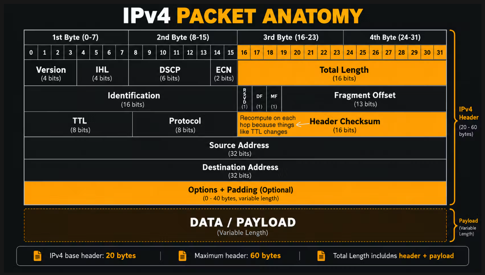
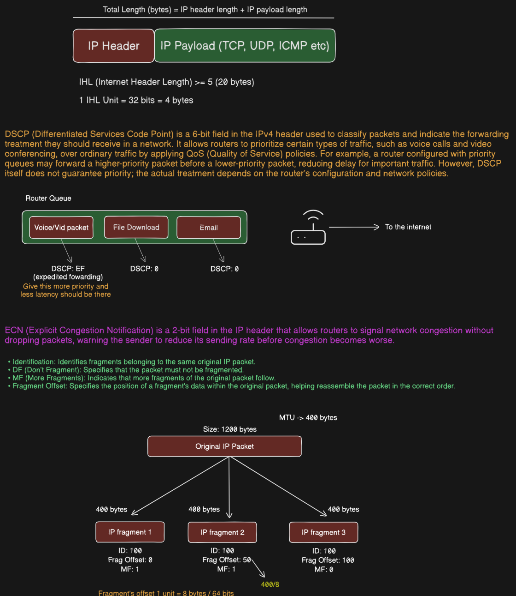

# Computer Networks: IPv4 Protocol, Packet Anatomy, QoS & Fragmentation

A comprehensive technical reference covering the IPv4 packet structure, 32-bit word alignment, Quality of Service (DSCP/ECN), Time to Live (TTL), and packet fragmentation/reassembly mechanics.

## Table of Contents

* [1. IPv4 Packet Header Structure](#1-ipv4-packet-header-structure)

* [2. Detailed Header Field Definitions](#2-detailed-header-field-definitions)

* [3. Traffic Management & Quality of Service (QoS)](#3-traffic-management--quality-of-service-qos)

* [4. IP Packet Fragmentation & Reassembly](#4-ip-packet-fragmentation--reassembly)

* [5. Step-by-Step Fragmentation Numerical Walkthrough](#5-step-by-step-fragmentation-numerical-walkthrough)

## 1. IPv4 Packet Header Structure

The Internet Protocol Version 4 (IPv4) header is formatted in 32-bit (4-byte) rows. 



### Key Dimensions

* **Base Header Size:** 20 bytes (when no options are present).

* **Maximum Header Size:** 60 bytes (with a maximum of 40 bytes of Options and Padding).

* **Header Length Range:** $20 \text{ bytes} \le \text{Header Size} \le 60 \text{ bytes}$.

* **Total Packet Size Formula:**

$$
\text{Total Length} = \text{IP Header Length} + \text{IP Payload Length}
$$

## 2. Detailed Header Field Definitions

### Row 1 (Bits 0–31)

1. **Version (4 bits):** Indicates the protocol version. Always `4` (`0100` in binary) for IPv4.

2. **Internet Header Length / IHL (4 bits):** Specifies the header length in **32-bit (4-byte) words**.

   * Minimum value = `5` ($5 \times 4 = 20 \text{ bytes}$).

   * Maximum value = `15` ($15 \times 4 = 60 \text{ bytes}$).

3. **DSCP / Differentiated Services Code Point (6 bits):** Used for Quality of Service (QoS) packet classification.

4. **ECN / Explicit Congestion Notification (2 bits):** Allows routers to notify endpoints of impending network congestion without dropping packets.

5. **Total Length (16 bits):** Entire packet length (Header + Payload) measured in bytes.

   * Theoretical maximum packet size: $2^{16} - 1 = 65,535 \text{ bytes}$.

### Row 2 (Bits 32–63) — Fragmentation Control

1. **Identification (16 bits):** Unique integer assigned to a packet to group fragments originating from the same IP datagram.

2. **Flags (3 bits):**

   * **Bit 0 (RSVD):** Reserved bit; must always be `0`.

   * **Bit 1 (DF - Don't Fragment):** If set to `1`, instructs routers not to fragment this packet. If MTU is exceeded, the router drops it and sends back an ICMP Type 3 Code 4 message (*Fragmentation Needed*).

   * **Bit 2 (MF - More Fragments):** Set to `1` for all fragments except the final fragment, which has `MF = 0`.

3. **Fragment Offset (13 bits):** Indicates where the fragment's payload fits relative to the original unfragmented payload, measured in **8-byte (64-bit) blocks**.

### Row 3 (Bits 64–95)

1. **Time to Live / TTL (8 bits):** Hop counter decremented by 1 at every router processing step. Prevents routing loops. If $\text{TTL} = 0$, the packet is discarded and an ICMP *Time Exceeded* message is sent back to the source.

2. **Protocol (8 bits):** Specifies the upper-layer protocol encapsulated in the payload:

   * `1` = ICMP

   * `6` = TCP

   * `17` = UDP

3. **Header Checksum (16 bits):** Error-detection field covering the IP header only.

   > ⚠️ **Hop-by-Hop Recomputation:** The Header Checksum **must be recomputed at every router hop** because fields like TTL decrement, causing the checksum value to change.

### Row 4 & 5 (Bits 96–159)

* **Source IP Address (32 bits):** The IPv4 address of the sender.

* **Destination IP Address (32 bits):** The IPv4 address of the intended recipient.

### Options & Padding (Variable, 0–40 bytes)

* Used for testing, security, source routing, or timestamping.

* **Padding:** Adds zeroes to ensure the header aligns to a 32-bit boundary so that IHL calculations remain whole numbers.

---

## 3. Traffic Management & Quality of Service (QoS)



### DSCP Traffic Prioritization

Routers use the 6-bit **DSCP** field to prioritize queue processing when bandwidth is constrained.

```
                  ┌───────────────────────────────┐
                  │         Router Queue          │
                  └───────────────┬───────────────┘
                                  │
         ┌────────────────────────┼────────────────────────┐
         ▼                        ▼                        ▼
┌──────────────────┐    ┌──────────────────┐    ┌──────────────────┐
│ Voice / Video    │    │  File Download   │    │      Email       │
│ DSCP: EF (Class) │    │   DSCP: 0 (BE)   │    │   DSCP: 0 (BE)   │
└────────┬─────────┘    └────────┬─────────┘    └────────┬─────────┘
         │                       │                       │
         ▼                       ▼                       ▼
  (High Priority /        (Best Effort /          (Best Effort /
   Low Latency)            Normal Queue)           Normal Queue)

```

* **Expedited Forwarding (EF):** High priority, low-latency queue assignment (e.g., VoIP calls, video conferencing).

* **Best Effort (BE - DSCP 0):** Default queue assignment for non-time-sensitive data (e.g., web traffic, email, file downloads).

### ECN Congestion Signaling

Explicit Congestion Notification (ECN) prevents unnecessary packet drops during network bottlenecking:

1. A router experiencing queue buildup marks the 2-bit ECN field in the IP header as `11` (Congestion Encountered).

2. The receiver echoes this signal back to the sender in the TCP ACK header (using the ECE flag).

3. The sender proactively reduces its transmission rate before actual buffer overflows occur.

---

## 4. IP Packet Fragmentation & Reassembly

When an IP datagram's size exceeds the **Maximum Transmission Unit (MTU)** of an intermediate link, the router breaks the payload into smaller fragments.

### Core Rules of Fragmentation

1. **Reassembly Location:** Fragments are **only reassembled at the final destination**, not at intermediate router hops.

2. **Offset Scale Factor:** The **Fragment Offset** field measures payload placement in units of **8 bytes** ($64 \text{ bits}$). Therefore, all non-final fragment payload sizes **must be divisible by 8**.

3. **Formula for Fragment Offset:**

$$
\text{Fragment Offset} = \frac{\text{Bytes Transmitted Prior to Current Fragment}}{8}
$$

---

## 5. Step-by-Step Fragmentation Numerical Walkthrough

### Scenario Constraints

* **Original IP Packet Size:** 1,200 bytes

* **Path Link MTU:** 400 bytes

* **Identification Number:** `100`

### Step 1: Fragment Calculation Matrix

Assuming a standard 20-byte IP header per packet, each fragment can carry up to $400 - 20 = 380 \text{ bytes}$ of payload. However, since fragment payloads must be multiples of 8:

$$
\lfloor 380 / 8 \rfloor \times 8 = 47 \times 8 = 376 \text{ bytes per fragment}
$$

*(Using the simplified boundary example where each fragment contains 400 total bytes including headers/payloads):*

```
                 ┌────────────────────────────────┐
                 │       Original IP Packet       │
                 │          1,200 Bytes           │
                 └───────────────┬────────────────┘
                                 │
         ┌───────────────────────┼───────────────────────┐
         ▼                       ▼                       ▼
┌──────────────────┐    ┌──────────────────┐    ┌──────────────────┐
│   IP Fragment 1  │    │   IP Fragment 2  │    │   IP Fragment 3  │
│    400 Bytes     │    │    400 Bytes     │    │    400 Bytes     │
│  ID: 100         │    │  ID: 100         │    │  ID: 100         │
│  Frag Offset: 0  │    │  Frag Offset: 50 │    │  Frag Offset: 100│
│  MF: 1           │    │  MF: 1           │    │  MF: 0           │
└──────────────────┘    └──────────────────┘    └──────────────────┘

```

### Step 2: Final Header Parameter Table

| Fragment Number | Total Packet Size | Identification | Payload Bytes Carried | Fragment Offset Field | MF Flag | Offset Calculation |
| :--- | :--- | :--- | :--- | :--- | :--- | :--- |
| **Fragment 1** | $400 \text{ bytes}$ | `100` | $0 - 399$ | **`0`** | **`1`** | $0 / 8 = \mathbf{0}$ |
| **Fragment 2** | $400 \text{ bytes}$ | `100` | $400 - 799$ | **`50`** | **`1`** | $400 / 8 = \mathbf{50}$ |
| **Fragment 3** | $400 \text{ bytes}$ | `100` | $800 - 1199$ | **`100`** | **`0`** | $800 / 8 = \mathbf{100}$ |

* **Reassembly at Destination:** The destination host receives fragments with `ID = 100`, sorts them using `Fragment Offset`, and knows reassembly is complete when it receives the fragment with `MF = 0`.