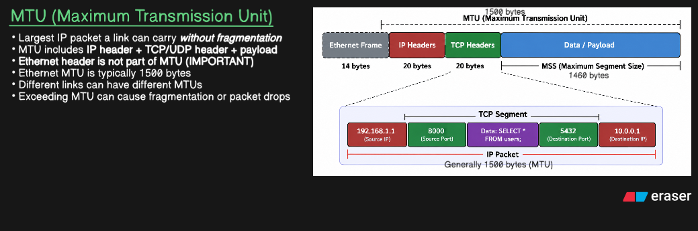
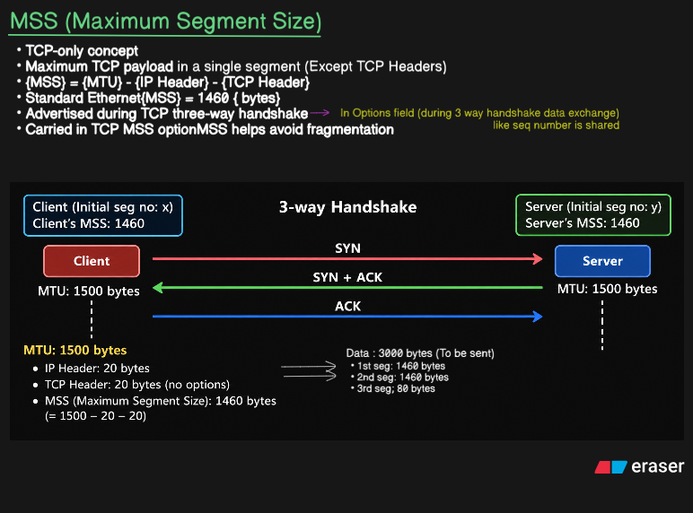
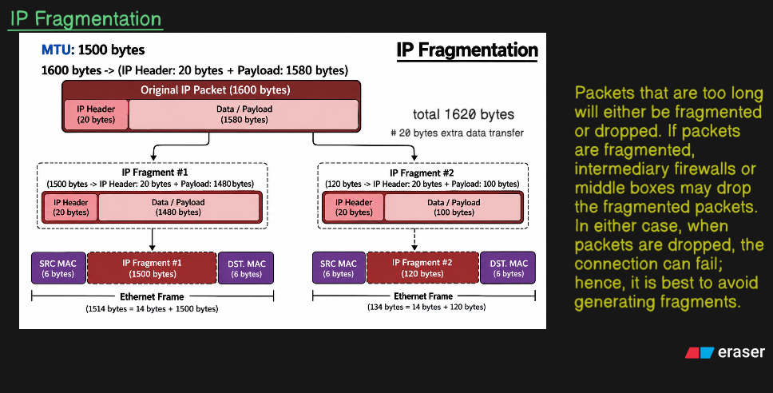
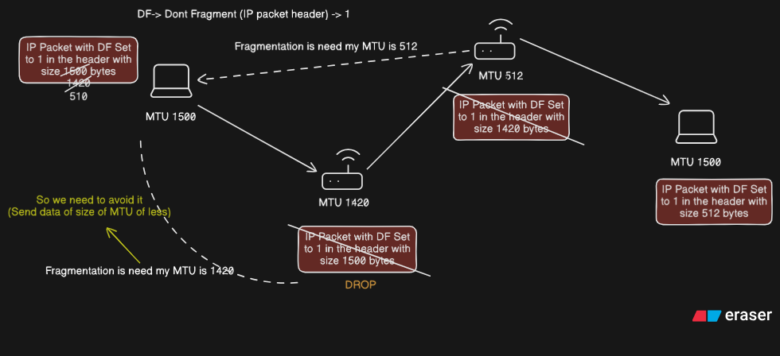

# MTU, MSS & IP Fragmentation

A practical guide to understanding **MTU, MSS, IP fragmentation, TCP segmentation, Path MTU (PMTU), and Path MTU Discovery (PMTUD)**, with examples showing how packet size is determined and what happens when a packet is larger than the MTU of a network link.

---

## 📚 Table of Contents

- [1. MTU — Maximum Transmission Unit](#1-mtu--maximum-transmission-unit)
- [2. Understanding Packet Size](#2-understanding-packet-size)
- [3. MSS — Maximum Segment Size](#3-mss--maximum-segment-size)
- [4. TCP 3-Way Handshake and MSS](#4-tcp-3-way-handshake-and-mss)
- [5. IP Fragmentation](#5-ip-fragmentation)
- [6. Path MTU](#6-path-mtu)
- [7. PMTUD — Path MTU Discovery](#7-pmtud--path-mtu-discovery)
- [8. PMTUD Practical Example](#8-pmtud-practical-example)
- [9. MTU vs MSS vs PMTU vs PMTUD](#9-mtu-vs-mss-vs-pmtu-vs-pmtud)
- [10. Summary](#10-summary)

---

# 1. MTU — Maximum Transmission Unit

**MTU (Maximum Transmission Unit)** is the maximum size of an **IP packet** that can be transmitted over a particular network link without requiring IP fragmentation.

For a typical Ethernet network:

```text
MTU = 1500 bytes
```

An IPv4 packet can therefore be up to **1500 bytes**, including:

```text
IP Header + TCP Header + Application Data
```

For a TCP packet with a normal 20-byte IPv4 header and 20-byte TCP header:

```text
1500 bytes
 ├── 20 bytes  → IP Header
 ├── 20 bytes  → TCP Header
 └── 1460 bytes → TCP Payload
```

Therefore:

```text
MSS = 1500 - 20 - 20
    = 1460 bytes
```



---

# 2. Understanding Packet Size

It is important to distinguish between the different layers.

A simplified packet looks like:

```text
┌───────────────────────────────────────────────┐
│                 IP Packet                    │
├───────────────┬───────────────┬───────────────┤
│  IP Header    │  TCP Header   │ TCP Payload   │
│   20 bytes    │   20 bytes    │   1460 bytes  │
└───────────────┴───────────────┴───────────────┘
                     Total = 1500 bytes
```

The **MTU applies to the IP packet**, not just the application data.

So with:

```text
MTU = 1500
IP Header = 20
TCP Header = 20
```

the maximum TCP payload is:

```text
1500 - 20 - 20 = 1460 bytes
```

That 1460-byte value is the **MSS**.

### Important distinction

```text
MTU → maximum size of the IP packet

MSS → maximum TCP payload inside that IP packet
```

---

# 3. MSS — Maximum Segment Size

**MSS (Maximum Segment Size)** is the maximum amount of **application data that TCP will place into a single TCP segment**.

MSS does **not** include:

- IP header
- TCP header

For a standard Ethernet path:

```text
MTU = 1500 bytes

IPv4 Header = 20 bytes
TCP Header  = 20 bytes

MSS = 1500 - 20 - 20
    = 1460 bytes
```

So a TCP segment can contain:

```text
TCP Header
+
1460 bytes of application data
```

The corresponding IP packet is:

```text
20-byte IP Header
+
20-byte TCP Header
+
1460-byte TCP Payload

= 1500 bytes
```

---

# 4. TCP 3-Way Handshake and MSS

TCP uses a **3-way handshake** to establish a connection.

The basic sequence is:

```text
Client                         Server
  │                              │
  │ -------- SYN --------------> │
  │                              │
  │ <----- SYN + ACK ----------- │
  │                              │
  │ -------- ACK --------------> │
  │                              │
  │       Connection Established │
```

During the handshake, each side can advertise its **MSS**.

For example:

```text
Client MSS = 1460
Server MSS = 1460
```

This tells the other side the largest TCP payload that the sender should transmit in a single segment.

### Example

Suppose the application wants to send:

```text
3000 bytes
```

And:

```text
MSS = 1460 bytes
```

TCP can divide the data into:

```text
Segment 1 → 1460 bytes
Segment 2 → 1460 bytes
Segment 3 → 80 bytes
```

Therefore:

```text
3000 = 1460 + 1460 + 80
```

Each segment is then encapsulated inside an IP packet.



---

# 5. IP Fragmentation

**IP fragmentation** occurs when an IP packet is larger than the MTU of the next network link and fragmentation is permitted.

Consider:

```text
Original IP Packet = 1600 bytes
Link MTU           = 1500 bytes
```

The packet cannot pass through that link as a single packet.

For IPv4, the packet may be divided into multiple fragments.

Conceptually:

```text
Original Packet
      │
      ▼
┌────────────────┐
│   1600 bytes   │
└────────────────┘
      │
      ▼
 ┌───────────────┐
 │ Fragment #1   │
 │ 1500 bytes    │
 └───────────────┘

 ┌───────────────┐
 │ Fragment #2   │
 │ remaining     │
 └───────────────┘
```

The fragments are later reassembled by the destination.

### Why fragmentation can be problematic

Fragmentation introduces additional complexity:

- More packets must be transmitted.
- Losing one fragment can prevent successful reassembly.
- Routers and middleboxes may handle fragments differently.
- Fragmentation can increase processing overhead.
- Some networks intentionally drop fragmented traffic.



---

# 6. Path MTU

The **Path MTU (PMTU)** is the smallest MTU of all the links between the source and destination.

Consider this path:

```text
Client
  │
  │ MTU = 1500
  ▼
Router 1
  │
  │ MTU = 1420
  ▼
Router 2
  │
  │ MTU = 512
  ▼
Router 3
  │
  │ MTU = 1500
  ▼
Server
```

The MTUs are:

```text
1500
1420
512
1500
```

Therefore:

```text
PMTU = min(1500, 1420, 512, 1500)

PMTU = 512 bytes
```

The **smallest MTU determines the maximum packet size that can safely traverse the entire path without fragmentation**.

---

# 7. PMTUD — Path MTU Discovery

**PMTUD (Path MTU Discovery)** is the process of discovering the **Path MTU** between two endpoints.

The basic idea is:

```text
Sender
   │
   │ Packet
   ▼
Router
   │
   │ Packet too large?
   ▼
  Yes
   │
   ▼
Packet cannot be forwarded
```

For IPv4, PMTUD commonly relies on the **DF (Don't Fragment)** bit.

When DF is set:

```text
DF = 1
```

a router cannot simply fragment the packet.

If the packet is too large for the outgoing interface, the router can discard it and send an ICMP message back to the sender indicating that fragmentation is required.

Conceptually:

```text
Sender
  │
  │ 1500-byte packet
  │ DF = 1
  ▼
Router
  │
  │ Outgoing MTU = 1420
  │
  │ Packet too large
  ▼
DROP
  │
  │ ICMP notification
  ▼
Sender
```

The sender can then adjust the packet size.

### Why PMTUD is useful

Without PMTUD, a sender may continuously send packets that are too large for some part of the path.

PMTUD allows the sender to determine an appropriate packet size for the path.

---

# 8. PMTUD Practical Example

Consider:

```text
Sender
  │
  │ MTU = 1500
  ▼
Router 1
  │
  │ MTU = 1420
  ▼
Router 2
  │
  │ MTU = 512
  ▼
Router 3
  │
  │ MTU = 1500
  ▼
Destination
```

The sender initially believes:

```text
MTU = 1500
```

But the packet encounters a link with:

```text
MTU = 1420
```

and later another link with:

```text
MTU = 512
```

If:

```text
DF = 1
```

the routers cannot fragment the packet.

A packet larger than the outgoing MTU may therefore be dropped, with an ICMP message used to communicate the problem in IPv4 PMTUD.

The sender can then reduce its packet size.

Ultimately:

```text
PMTU = 512 bytes
```

So packets should be kept within the discovered path MTU.



---

# 9. MTU vs MSS vs PMTU vs PMTUD

| Term | Meaning |
|---|---|
| **MTU** | Maximum IP packet size that can be transmitted over a particular link |
| **MSS** | Maximum TCP payload that can be carried in one TCP segment |
| **PMTU** | Smallest MTU across the complete path between source and destination |
| **PMTUD** | Process used to discover the PMTU |

### Simple relationship

```text
                 Network Path
                      │
       ┌──────────────┼──────────────┐
       ▼              ▼              ▼
     MTU 1500       MTU 1420       MTU 512
       │              │              │
       └──────────────┼──────────────┘
                      │
                      ▼
                   PMTU = 512
```

For a typical IPv4 + TCP connection:

```text
MTU
 │
 ├── IP Header
 │
 ├── TCP Header
 │
 └── MSS (TCP Payload)
```

Therefore:

```text
MSS ≈ MTU - IP Header - TCP Header
```

For the common case:

```text
MTU = 1500
IP Header = 20
TCP Header = 20

MSS = 1460
```

> **Note:** The exact relationship can change when IP/TCP options or other encapsulation overhead are present.

---

# 10. Summary

- **MTU:** Maximum IP packet size on a link.
- **MSS:** Maximum TCP payload in a segment.
- **PMTU:** Smallest MTU along the path.
- **PMTUD:** Process of discovering that PMTU.
- A typical Ethernet MTU is **1500 bytes**.
- With a 20-byte IPv4 header and 20-byte TCP header, the corresponding TCP MSS is **1460 bytes**.
- TCP can split large application data into multiple segments according to the MSS.
- IPv4 can fragment oversized packets when fragmentation is permitted.
- With **DF = 1**, an IPv4 router cannot fragment the packet.
- PMTUD helps endpoints discover a packet size that can traverse the path without fragmentation.

---

## 🔑 The Core Idea

```text
MTU
 ↓
Maximum IP packet size on one link
 ↓
MSS
 ↓
Maximum TCP payload inside that packet
 ↓
Different links may have different MTUs
 ↓
Smallest MTU = PMTU
 ↓
PMTUD discovers that PMTU
```

This gives the complete relationship:

**MTU → MSS → Fragmentation → PMTU → PMTUD**.