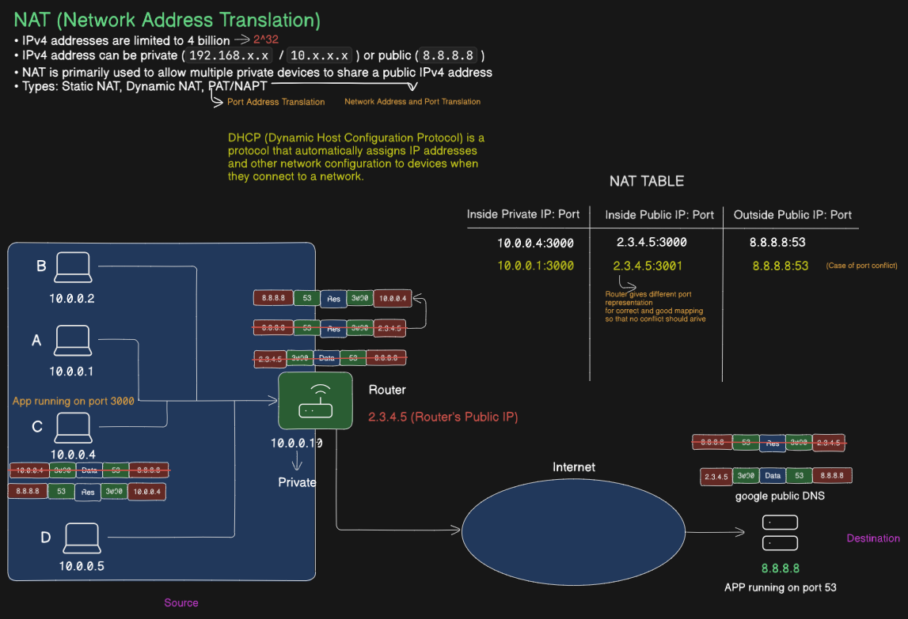

# Computer Networks: Network Address Translation (NAT) & PAT/NAPT Architecture

A comprehensive technical reference covering Network Address Translation (NAT), Port Address Translation (PAT/NAPT), packet rewriting mechanics, NAT classification models, NAT traversal algorithms (STUN/TURN/ICE), Carrier-Grade NAT (CGNAT), and operational trade-offs.

---

## Table of Contents

* [1. Core Problem & Address Space Architecture](#1-core-problem--address-space-architecture)
* [2. Classification of NAT Implementations](#2-classification-of-nat-implementations)
* [3. SNAT vs. DNAT & Packet Header Rewriting Mechanics](#3-snat-vs-dnat--packet-header-rewriting-mechanics)
* [4. PAT / NAPT & State Machine Deep Dive](#4-pat--napt--state-machine-deep-dive)
* [5. Behavioral Taxonomy of NATs (Cone vs. Symmetric)](#5-behavioral-taxonomy-of-nats-cone-vs-symmetric)
* [6. NAT Traversal in Peer-to-Peer Networks](#6-nat-traversal-in-peer-to-peer-networks)
* [7. Carrier-Grade NAT (CGNAT) & Dual-Stack Lite](#7-carrier-grade-nat-cgnat--dual-stack-lite)
* [8. Performance Overhead & Protocol Complications](#8-performance-overhead--protocol-complications)

---

## 1. Core Problem & Address Space Architecture

Network Address Translation (NAT) was standardized in **RFC 1631** (and later updated in **RFC 3022**) as a short-term mitigation strategy for IPv4 address exhaustion while IPv6 was being developed.

### The IPv4 Address Space Constraint

An IPv4 address is a 32-bit integer, yielding a theoretical address space of:

$$2^{32} = 4,294,967,296 \text{ addresses}$$

Due to classful routing overhead, loopback reservations, multicast ranges, and subnetting inefficiencies, the allocation pool fell short of global device demand.

### RFC 1918 Private IP Address Space

To separate local private routing from global Internet routing, **RFC 1918** reserved three distinct IPv4 blocks strictly for internal use:

| Class | Subnet CIDR Block | IP Address Range | Total Addresses | Typical Use Case |
| :--- | :--- | :--- | :--- | :--- |
| **Class A** | `10.0.0.0/8` | `10.0.0.0` – `10.255.255.255` | 16,777,216 | Large Enterprises & Cloud VPCs |
| **Class B** | `172.16.0.0/12` | `172.16.0.0` – `172.31.255.255` | 1,048,576 | Medium Networks, Docker Subnets |
| **Class C** | `192.168.0.0/16` | `192.168.0.0` – `192.168.255.255` | 65,536 | Home & Consumer Routers |

> ⚠️ **Routing Rule:** Core Internet routers (BGP backbones) are configured to drop any packet containing an RFC 1918 private address as either source or destination. A translation boundary is strictly mandatory before packets hit the public WAN.

---

## 2. Classification of NAT Implementations

NAT operates primarily at **Layer 3 (Network)** and **Layer 4 (Transport)** of the OSI model.

```
                         ┌─────────────────────────────────┐
                         │   NAT Implementations Taxonomy   │
                         └────────────────┬────────────────┘
                                          │
         ┌────────────────────────────────┼────────────────────────────────┐
         ▼                                ▼                                ▼
┌─────────────────┐              ┌─────────────────┐              ┌─────────────────┐
│   Static NAT    │              │   Dynamic NAT   │              │   PAT / NAPT    │
│  (1-to-1 IP)    │              │  (M-to-N Pool)  │              │  (Many-to-1)    │
└─────────────────┘              └─────────────────┘              └─────────────────┘
```

### 1. Static NAT (1-to-1 IP Mapping)
* **Mechanism:** A single private IP is permanently mapped to a dedicated public IP address.
* **Header Translation:** Modifies IP headers only (Layer 3). Transport layer ports remain untouched.
* **Equation:**
  $$\text{Private IP}_A \Longleftrightarrow \text{Public IP}_A$$
* **Primary Use Case:** Hosting web servers, mail servers, or VPN gateways in a DMZ that require a static inbound reachability from the Internet.

### 2. Dynamic NAT (Many-to-Many / Pool-Based)
* **Mechanism:** A private network host is dynamically assigned an available public IP address from a pre-allocated pool of public IPs on a first-come, first-served basis.
* **Header Translation:** Layer 3 IP substitution.
* **Constraint:** If the pool has $N$ public IPs, only $N$ internal hosts can access the Internet simultaneously. If host $N+1$ tries to initiate a session, its packets are dropped until a lease expires.

### 3. PAT / NAPT (Port Address Translation / Many-to-1)
* **Mechanism:** Multiple internal hosts share a single public IP address by multiplexing Layer 4 source port numbers (TCP/UDP).
* **Header Translation:** Translates both Layer 3 (IP) and Layer 4 (Port) headers simultaneously.
* **Scale Capability:** A single public IP can theoretically multiplex up to $65,535$ concurrent TCP and $65,535$ concurrent UDP sessions (minus system-reserved ports $0-1023$).

---

## 3. SNAT vs. DNAT & Packet Header Rewriting Mechanics

NAT operations are asymmetrical depending on which party initiates the TCP/UDP state.

```
       [ LAN / Private Network ]                       [ WAN / Public Internet ]
  
┌───────────────────────────────┐               ┌───────────────────────────────┐
│ Device C                      │               │ Public Target                 │
│ Private IP: 10.0.0.4          │               │ IP: 8.8.8.8                   │
│ Port: 3000                    │               │ Port: 53                      │
└───────────────┬───────────────┘               └───────────────▲───────────────┘
                │                                               │
                │  Outbound Packet                              │ Forwarded Packet
                │  Src: 10.0.0.4:3000                           │ Src: 2.3.4.5:3000
                │  Dst: 8.8.8.8:53                              │ Dst: 8.8.8.8:53
                ▼                                               │
      ┌─────────────────────────────────────────────────────────┴─┐
      │                       NAT Router                          │
      │                       Public WAN IP: 2.3.4.5              │
      └───────────────────────────────────────────────────────────┘
```

### Source NAT (SNAT) — Outbound Initiated
SNAT modifies the **Source IP Address** (and optionally Source Port) of an outbound packet. It is used when a private host initiates a request to an external server.

* **Original Packet (Internal Interface):**
  $$\text{Src: } \texttt{10.0.0.4:3000} \longrightarrow \text{Dst: } \texttt{8.8.8.8:53}$$
* **SNAT Rewritten Packet (WAN Interface):**
  $$\text{Src: } \texttt{2.3.4.5:3000} \longrightarrow \text{Dst: } \texttt{8.8.8.8:53}$$

### Destination NAT (DNAT) — Inbound Initiated (Port Forwarding)
DNAT modifies the **Destination IP Address** (and optionally Destination Port) of an inbound packet before routing it to an internal network.

* **Incoming External Packet (WAN Interface):**
  $$\text{Src: } \texttt{198.51.100.10:45210} \longrightarrow \text{Dst: } \texttt{2.3.4.5:80}$$
* **DNAT Rewritten Packet (LAN Interface):**
  $$\text{Src: } \texttt{198.51.100.10:45210} \longrightarrow \text{Dst: } \texttt{10.0.0.20:8080}$$

---

## 4. PAT / NAPT & State Machine Deep Dive

### High-Resolution NAT Architecture Diagram



When multiple internal devices send packets using identical source ports, the router resolves collisions by assigning distinct public-facing egress ports.

### Detailed Step-by-Step Flow

1. **Local Packet Generation:** 
   * Device A (`10.0.0.1`) and Device C (`10.0.0.4`) both open sockets using local port `3000` to contact Google DNS (`8.8.8.8:53`).

2. **Router Interception & Port Collision Resolution:**
   * Device C's packet arrives first: Router binds `10.0.0.4:3000` $\rightarrow$ `2.3.4.5:3000`.
   * Device A's packet arrives second: Router detects that public port `3000` is already bound to `8.8.8.8:53` in its active state table. It allocates an unused port (`3001`).

3. **NAT Translation State Table Structure:**

| Inside Private IP : Port | Inside Public IP : Port | Outside Target IP : Port | Protocol | Session Timeout |
| :--- | :--- | :--- | :--- | :--- |
| `10.0.0.4:3000` | `2.3.4.5:3000` | `8.8.8.8:53` | UDP | 30 seconds |
| `10.0.0.1:3000` | `2.3.4.5:3001` | `8.8.8.8:53` | UDP | 30 seconds |
| `10.0.0.2:49152` | `2.3.4.5:49152` | `142.250.190.46:443` | TCP | 86400 secs (EST) |

4. **Inbound Demultiplexing:**
   * When Google DNS responds to `2.3.4.5:3001`, the router matches `2.3.4.5:3001` in the table, replaces the destination header with `10.0.0.1:3000`, and pushes the packet onto the LAN segment.

---

## 5. Behavioral Taxonomy of NATs (Cone vs. Symmetric)

**RFC 3489** and **RFC 4787** classify NAT implementations based on how strictly they map outbound sockets and filter incoming unsolicited packets.

```
                         ┌───────────────────────────────┐
                         │    NAT Mapping Behavior       │
                         └───────────────┬───────────────┘
                                         │
                 ┌───────────────────────┴───────────────────────┐
                 ▼                                               ▼
      ┌─────────────────────┐                         ┌─────────────────────┐
      │   Cone NAT Variants │                         │    Symmetric NAT    │
      │ (Same Public Port)  │                         │ (Diff Public Ports) │
      └─────────────────────┘                         └─────────────────────┘
```

### 1. Full-Cone NAT (One-to-One Port Mapping)
* **Mapping:** All requests from `Internal_IP:Port` are mapped to the same `Public_IP:Public_Port`.
* **Filtering:** *Any* external endpoint can send packets to `Public_IP:Public_Port`, and they will be forwarded to the internal host.

### 2. Restricted-Cone NAT (Address-Restricted)
* **Mapping:** `Internal_IP:Port` $\rightarrow$ `Public_IP:Public_Port`.
* **Filtering:** An external endpoint (`External_IP:Any_Port`) can send packets to `Public_IP:Public_Port` **only if** the internal host has previously sent a packet to `External_IP`.

### 3. Port-Restricted Cone NAT
* **Mapping:** `Internal_IP:Port` $\rightarrow$ `Public_IP:Public_Port`.
* **Filtering:** An external host (`External_IP:External_Port`) can send packets to `Public_IP:Public_Port` **only if** the internal host has previously sent a packet to that exact `External_IP:External_Port`.

### 4. Symmetric NAT (Most Restrictive)
* **Mapping:** Every distinct external destination (`External_IP:External_Port`) receives a **different** dynamic public port mapping, even if sent from the same internal socket `Internal_IP:Port`.
* **Filtering:** Only the specific destination endpoint receiving the outbound packet can send a packet back.
* **Impact:** **Breaks standard P2P UDP Hole Punching.**

---

## 6. NAT Traversal in Peer-to-Peer Networks

Because NAT routers block unsolicited inbound traffic, direct peer-to-peer applications (VoIP, WebRTC, gaming) require specialized NAT Traversal protocols.

```
       [ Peer A ] ────► [ STUN Server ] ◄──── [ Peer B ]
  (Discovers Public IP)                   (Discovers Public IP)
           │                                       │
           └──────────────► [ ICE ] ◄──────────────┘
                    (Establish P2P Direct)
                               │
                      (If Symmetric NAT)
                               │
                               ▼
                        [ TURN Relay ]
```

### 1. STUN (Session Traversal Utilities for NAT — RFC 5389)
* **Mechanism:** A client sends a request to a public STUN server. The STUN server inspects the incoming packet and tells the client its observed **Public IP and Port**.
* **Limitation:** Works across Full-Cone, Restricted-Cone, and Port-Restricted NATs, but **fails completely on Symmetric NATs**.

### 2. TURN (Traversal Using Relays around NAT — RFC 5766)
* **Mechanism:** When direct P2P establishment fails (e.g., both clients are behind Symmetric NATs), media traffic is relayed through a dedicated, publicly accessible **TURN Server**.
* **Trade-off:** 100% success rate, but introduces higher latency and high server bandwidth costs.

### 3. ICE (Interactive Connectivity Establishment — RFC 8445)
* **Mechanism:** A framework used by WebRTC that combines STUN and TURN to systematically discover all viable connection paths (Host candidates, Server Reflexive candidates, and Relay candidates) and selects the most efficient path.

---

## 7. Carrier-Grade NAT (CGNAT) & Dual-Stack Lite

As ISPs ran out of public IPv4 addresses for residential subscribers, they implemented a multi-tiered translation architecture known as **CGNAT** (Carrier-Grade NAT / NAT444), standardized in **RFC 6598**.

```
[ Customer LAN ]            [ ISP Access Network ]               [ Internet ]
192.168.1.5:4000  ──►  CPE Router (100.64.0.10)  ──►  CGNAT Router  ──►  8.8.8.8
                       (Residential Gateway)        (203.0.113.1)
```

### The Shared CGNAT Address Space (`100.64.0.0/10`)
* **RFC 6598** reserved `100.64.0.0/10` (`100.64.0.0` – `100.127.255.255`) strictly for ISP-to-Customer premises translation.
* **Double NAT (NAT444):** Packets undergo translation twice:
  1. **Customer Router:** Translates local LAN (`192.168.1.x`) $\rightarrow$ CGNAT IP (`100.64.x.x`).
  2. **ISP CGNAT Gateway:** Translates CGNAT IP (`100.64.x.x`) $\rightarrow$ ISP Public IP (`203.0.113.x`).

### Architectural Drawbacks of CGNAT
* **No Inbound Port Forwarding:** Subscribers cannot host home web servers or self-hosted services without a VPN or third-party tunnel (e.g., Cloudflare Tunnels).
* **IP Reputation Poisoning:** Bad actors on the same ISP public IP can cause IP bans affecting thousands of innocent sub-users on services like Wikipedia, gaming servers, or CAPTCHA providers.

---

## 8. Performance Overhead & Protocol Complications

### 1. Checksum Recalculation & Hardware Offloading
Whenever a NAT router modifies IP and Port headers, it must recalculate checksums:
* **IPv4 Header Checksum:** Layer 3 header modification requires recalculating the IPv4 header checksum.
* **Transport Checksum:** TCP and UDP checksum calculations include a **pseudo-header** containing the Source and Destination IP addresses. Altering the IP address requires recalculating the Layer 4 checksum for every single packet.
* *Solution:* Modern routers rely on hardware ASIC/SoC **Network Acceleration Units** to perform wire-speed checksum updates without burning CPU cycles.

### 2. Application Level Gateways (ALG)
Protocols that embed IP addresses inside their application payload (Layer 7)—such as FTP (`PORT` command), SIP (VoIP signaling), or FTP-DATA—break under standard NAT.

* **Fix:** NAT routers use an **Application Level Gateway (ALG)** inspects and rewrites Layer 7 payload IP strings on the fly.
* **Common Issue:** Misconfigured ALGs frequently corrupt SIP signaling, causing one-way audio issues in VoIP calls.

### 3. Summary Comparison: IPv4 NAT vs. Native IPv6

| Metric | IPv4 with PAT/NAPT | Native IPv6 |
| :--- | :--- | :--- |
| **Address Reachability** | Asymmetric (Outbound initiated) | Symmetric End-to-End reachability |
| **Header Processing Overhead** | High (Checksum recalculation, State table lookup) | Low (Fixed 40-byte header, No NAT recalculation) |
| **P2P Connection Setup** | Complex (Requires STUN/TURN/ICE) | Direct socket-to-socket communication |
| **State Table Limits** | Constrained by hardware memory (RAM) | Stateless routing at edge routers |