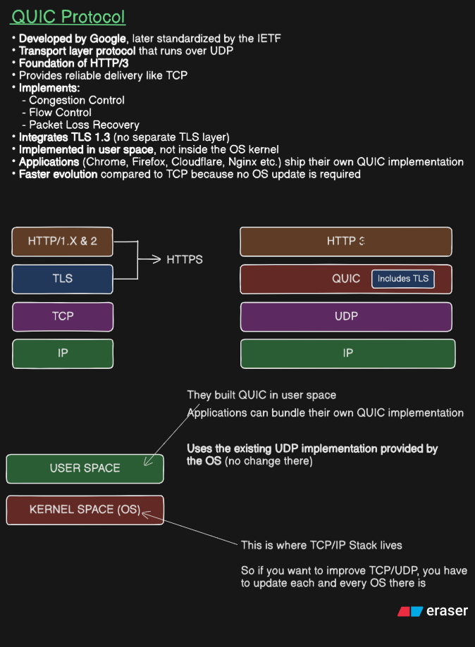
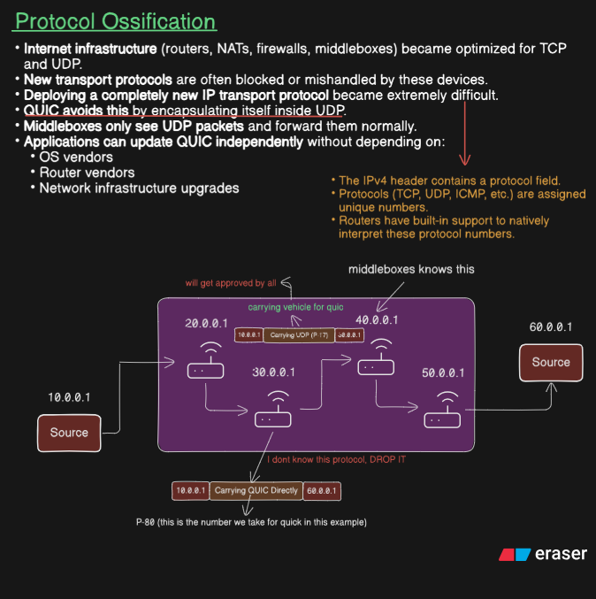
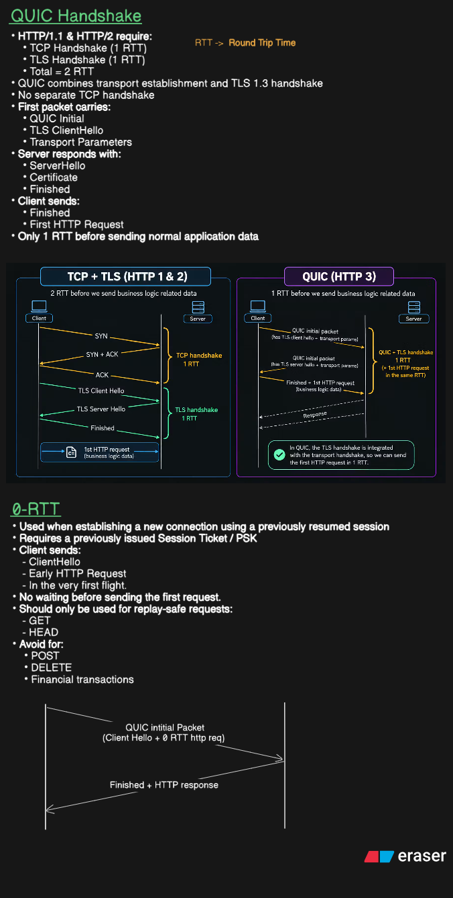
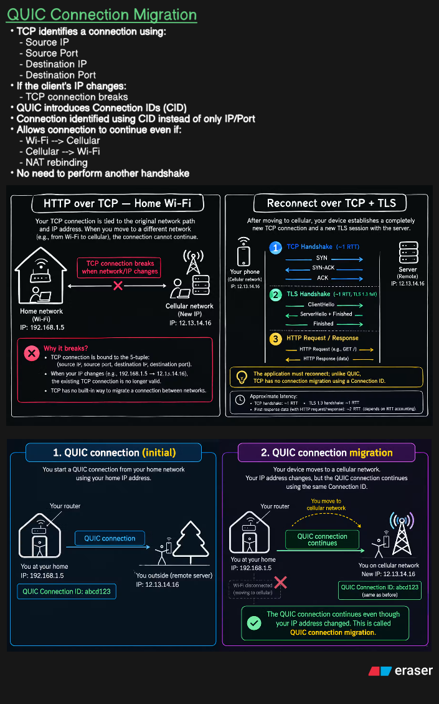

# QUIC Protocol --- Detailed Notes

> **Topics:** QUIC architecture, protocol ossification, QUIC/TLS
> handshakes, 0-RTT resumption, replay attacks, and connection
> migration.\
> **Purpose:** Understand why QUIC powers HTTP/3, how it reduces
> connection setup delay, and how it handles network changes.

## Table of Contents

1.  [What is QUIC?](#1-what-is-quic)
2.  [QUIC Protocol Stack](#2-quic-protocol-stack)
3.  [Why QUIC Uses UDP](#3-why-quic-uses-udp)
4.  [Protocol Ossification](#4-protocol-ossification)
5.  [QUIC Handshake](#5-quic-handshake)
6.  [Understanding RTT](#6-understanding-rtt)
7.  [0-RTT Connection Resumption](#7-0-rtt-connection-resumption)
8.  [Replay Attacks and Early Data](#8-replay-attacks-and-early-data)
9.  [QUIC Connection Migration](#9-quic-connection-migration)
10. [TCP vs QUIC: Network Changes](#10-tcp-vs-quic-network-changes)
11. [Quick Revision](#11-quick-revision)
12. [Common Misconceptions](#12-common-misconceptions)
13. [Useful Standards](#13-useful-standards)

------------------------------------------------------------------------

## 1. What is QUIC?



**QUIC** is a modern transport protocol that runs over UDP. It was
originally developed at Google and was standardized by the **IETF**.
HTTP/3 uses QUIC as its transport.

QUIC aims to provide the transport features applications need while
improving connection setup, stream handling, security integration, and
behavior when a device changes networks.

### What QUIC provides

-   **Reliable delivery:** QUIC can detect lost data and retransmit the
    information that needs to be delivered.
-   **Congestion control:** It adjusts sending behavior to avoid
    overwhelming the network.
-   **Flow control:** It prevents a sender from overwhelming the
    receiver's ability to buffer stream data.
-   **Loss detection and recovery:** It detects missing packets and
    recovers lost stream data.
-   **Multiplexed streams:** Multiple independent streams can share one
    QUIC connection.
-   **TLS 1.3 security:** QUIC incorporates TLS 1.3 for authentication
    and key establishment.
-   **Connection migration:** A connection can often continue when a
    client's network path or IP address changes.

### QUIC and HTTP/3

HTTP is an application-layer protocol. QUIC is a transport protocol.
**HTTP/3 runs over QUIC**, whereas HTTP/1.1 and HTTP/2 commonly run over
TCP, with TLS used for HTTPS.

QUIC is not simply "HTTP over UDP." It implements transport functions
such as reliability, congestion control, stream multiplexing, and
connection management above UDP.

## 2. QUIC Protocol Stack

The image compares the traditional HTTPS stack with the HTTP/3 stack.

### HTTPS with HTTP/1.1 or HTTP/2

A simplified view:

``` text
HTTP/1.1 or HTTP/2
        TLS
        TCP
         IP
```

TCP provides reliable, ordered byte-stream delivery. TLS provides
encryption and peer authentication for HTTPS. The TCP connection is
established separately from the TLS handshake.

### HTTP/3 over QUIC

``` text
        HTTP/3
         QUIC  ← includes transport features and integrates TLS 1.3
          UDP
           IP
```

QUIC uses UDP as its underlying datagram delivery mechanism, but QUIC
itself supplies transport capabilities that applications usually
associate with TCP.

### Why QUIC can evolve quickly

TCP is commonly implemented in the operating-system kernel. Improving
TCP behavior may require operating-system changes and deployment across
many devices.

QUIC implementations often live in user space---for example, in a
browser or a server's networking library. This allows the QUIC
implementation to be updated with an application or library release,
without waiting for every operating system to update its kernel TCP
stack.

**Important nuance:** UDP itself is still provided by the operating
system, and user-space QUIC does not mean every implementation is
identical or that deployment is completely frictionless.

## 3. Why QUIC Uses UDP

UDP provides a small, connectionless datagram service. It does not
itself provide TCP-style reliability, ordered byte-stream delivery, or
congestion control.

QUIC builds the features it needs on top of UDP. This gives QUIC control
over its transport behavior while benefiting from the widespread support
for UDP forwarding across IP networks.

  -----------------------------------------------------------------------
  Feature           TCP               UDP by itself     QUIC over UDP
  ----------------- ----------------- ----------------- -----------------
  Reliable delivery Yes               No                Yes, for QUIC
                                                        stream data

  Ordered byte      Yes               No                Ordered data
  stream                                                within each
                                                        stream

  Congestion        Yes               Not provided by   Yes
  control                             UDP itself        

  Multiple          Not natively as   Not provided      Yes
  independent       separate                            
  streams           transport streams                   

  TLS 1.3           No; TLS is        No                Yes
  integrated into   layered above TCP                   
  transport setup                                       

  Connection        No native         No                Supported,
  migration using   equivalent                          subject to
  QUIC Connection                                       validation and
  IDs                                                   implementation
                                                        behavior
  -----------------------------------------------------------------------

### Stream multiplexing and head-of-line blocking

QUIC supports multiple streams within one connection. If a packet
carrying data for one stream is lost, delivery of that stream's missing
data can be delayed, but data on other streams can continue when their
required packets have arrived.

This helps avoid **transport-level head-of-line blocking across all
streams** that can occur with TCP, where missing bytes block later bytes
in the same ordered TCP byte stream. It does not mean QUIC eliminates
every possible source of application-level or stream-level blocking.

## 4. Protocol Ossification



**Protocol ossification** occurs when network infrastructure becomes so
dependent on existing protocol details that introducing or changing
protocols becomes difficult.

Internet paths may include routers, NATs, firewalls, and middleboxes.
Some inspect traffic and apply rules based on known protocol formats. A
new transport protocol may be blocked, mishandled, or treated
differently if those devices do not recognize it.

### The IP protocol field

In IPv4, the Protocol field identifies the payload protocol, for
example:

-   TCP: protocol number **6**
-   UDP: protocol number **17**

In IPv6, the corresponding role is performed by the Next Header field
(with extension headers possible).

A network device may be designed to handle TCP and UDP traffic
specially. If a new transport protocol uses a different IP protocol
number, it may encounter compatibility problems on existing networks.

### How QUIC helps

QUIC packets are carried inside UDP datagrams. A middlebox that only
needs to forward the packet can generally process the outer IP and UDP
headers without understanding QUIC's internal packet format.

This does **not** mean all middleboxes ignore or freely pass all UDP
traffic. Firewalls can block UDP, NATs have timeouts, and some devices
inspect or restrict QUIC traffic. QUIC's encapsulation helps deployment,
but does not guarantee universal compatibility.

### The key idea

QUIC makes it easier to evolve transport behavior in user space and
carries its packets over a widely supported protocol. This reduces some
deployment barriers associated with introducing a brand-new IP transport
protocol.

## 5. QUIC Handshake



A handshake establishes the connection's cryptographic keys and
negotiates protocol parameters. QUIC integrates its transport setup with
TLS 1.3 rather than establishing a separate TCP connection first.

### Traditional TCP + TLS 1.3

For a new HTTPS connection using TCP and a full TLS 1.3 handshake, a
simplified sequence is:

1.  **TCP handshake:** `SYN` → `SYN-ACK` → `ACK` (about 1 RTT).
2.  **TLS handshake:** ClientHello and server handshake messages
    establish security (about 1 RTT for a full TLS 1.3 handshake).
3.  **HTTP exchange:** The client sends its request and receives the
    response.

The common simplified estimate to receive the first response is
approximately **3 RTT**: 1 RTT for TCP setup + 1 RTT for TLS setup +
about 1 RTT for the request/response. Exact timing depends on message
scheduling, server processing, and whether data can be sent earlier
under a particular setup.

### QUIC with a new connection

QUIC combines transport establishment and TLS 1.3 handshake processing:

1.  **Client sends QUIC Initial packet(s):** Includes a TLS ClientHello
    and QUIC transport parameters.
2.  **Server responds:** Sends its TLS handshake messages, including
    ServerHello and authentication material such as a certificate when
    required, along with QUIC transport information.
3.  **Client completes the handshake:** The client validates the server
    and sends the appropriate handshake confirmation messages.
4.  **HTTP/3 data can be sent:** The client can send application data
    when the protocol's encryption level and handshake state permit it.

For a typical full handshake, QUIC can allow the client to send its
first HTTP request after about **1 RTT**, instead of first spending one
RTT on TCP and then another on TLS.

### Simplified comparison

  -----------------------------------------------------------------------
  Setup                           Approximate time before client can send
                                                        its first request
  ------------------------------ ----------------------------------------
  New TCP + full TLS 1.3                                      About 2 RTT
  handshake                      

  New QUIC connection, full                                   About 1 RTT
  handshake                      

  Resumed QUIC connection with       Client can send early request in the
  accepted 0-RTT                                             first flight
  -----------------------------------------------------------------------

These are simplified setup estimates, not universal end-to-end response
times. Receiving the server's response adds network travel and server
processing. The QUIC handshake also has details that depend on whether
the connection is new, resumed, or uses other supported optimizations.

### What does "integrates TLS" mean?

QUIC does **not** remove TLS. It uses TLS 1.3 handshake messages and key
derivation, while QUIC defines how those cryptographic secrets protect
QUIC packets. QUIC also has transport parameters negotiated as part of
the handshake.

## 6. Understanding RTT

**RTT** stands for **Round-Trip Time**: approximately the time for a
signal to travel from the sender to the receiver and for a response to
travel back.

For example, if the RTT between a browser and server is 40 ms:

-   1 RTT ≈ 40 ms
-   2 RTT ≈ 80 ms
-   3 RTT ≈ 120 ms

This is a simplified calculation; actual application latency also
includes server processing, packet loss, scheduling, and other delays.

Reducing handshake RTTs matters because a browser may need to establish
a connection before it can request the page or resource it needs.

## 7. 0-RTT Connection Resumption

0-RTT allows a client to send **early application data** while
attempting to resume a previously established TLS session. It does not
mean the client has no handshake or that the request is sent without
encryption.

### What must be available?

A previous connection may result in the server issuing a **session
ticket**. The client can use the ticket and associated resumption
information, commonly described using a **pre-shared key (PSK)**, to
attempt session resumption later.

The client must have suitable resumption credentials, and the server
must accept early data for 0-RTT to work as intended.

### First connection

1.  The client and server establish a QUIC connection and complete TLS
    1.3.
2.  The server may issue a session ticket for future resumption.
3.  The client stores the resumption information.

### Later connection

The client opens a new connection attempt and can send, in the first
flight:

-   A new `ClientHello` with resumption information.
-   An early HTTP request, such as `GET /homepage`.

The request is **new application data**. The client is not required to
repeat the exact HTTP request it made on the previous connection. It may
request another resource, provided the server permits that early
request.

### What 0-RTT does not mean

-   It does not mean the old connection is still open.
-   It does not mean the browser resends an old page request
    automatically.
-   It does not guarantee the server will accept early data.
-   It does not guarantee that all future connections can use 0-RTT.
-   It does not mean the session ticket itself authorizes access to
    private resources.

If a connection is still open and usable, the client can send another
request over that existing connection without performing a new
handshake. That is **connection reuse**, not 0-RTT.

## 8. Replay Attacks and Early Data

0-RTT introduces a security consideration: early data can be vulnerable
to replay. An attacker who captures an early request may, in some
circumstances, cause the same early data to be submitted again. Protocol
and server protections can reduce this risk, but applications must not
assume that early data is processed exactly once.

### Replay is not the same as a new request

Imagine your browser first requests:

``` http
GET /homepage
```

Later, you visit the site again and request the homepage. That is a
**new request**, even if the URL is the same.

A **replay** is when a previously sent early request is resent by an
attacker or otherwise submitted again, potentially causing duplicate
processing.

### Why request semantics matter

  ------------------------------------------------------------------------
  Request                  Typical behavior        0-RTT consideration
  ------------------------ ----------------------- -----------------------
  `GET /articles`          Retrieves information   Often replay-safe if
                                                   the application follows
                                                   HTTP semantics

  `HEAD /articles`         Retrieves response      Often replay-safe if
                           metadata                implemented correctly

  `POST /payments`         May create a payment    Dangerous if duplicate
                                                   processing causes
                                                   duplicate charges

  `DELETE /account/item`   May delete a resource   Can have unintended
                                                   consequences if
                                                   repeated
  ------------------------------------------------------------------------

The HTTP method is not a magical safety switch. A badly designed `GET`
endpoint that changes account state may be unsafe for early data. A
state-changing request may need idempotency protections and server-side
controls, but those safeguards do not automatically guarantee that the
server will accept it in 0-RTT.

### Personal data and 0-RTT

A request can be private **and** replay-safe. For example,
`GET /account/balance` can retrieve sensitive information without
changing the balance. Privacy and replay safety are separate questions.

-   **Confidentiality:** Is the request/response protected from
    unauthorized observation?
-   **Authentication and authorization:** Is this client allowed to
    access this account?
-   **Replay safety:** Would processing the same early request more than
    once cause harmful side effects?

A session ticket is not, by itself, permission to access every account.
The server must still enforce authentication and authorization. A server
may also choose to reject early data for sensitive endpoints.

**Practical rule:** Do not use 0-RTT for non-idempotent or otherwise
non-replay-safe operations unless the application and server are
deliberately designed to handle the risk.

## 9. QUIC Connection Migration



Connection migration is a major QUIC feature that can allow a connection
to continue when a client changes its network path---for example, when a
phone moves from home Wi-Fi to cellular data.

### Why TCP connections can break after an IP change

A TCP connection is identified by a four-tuple:

1.  Source IP address
2.  Source port
3.  Destination IP address
4.  Destination port

Suppose the device starts using Wi-Fi with a local IP address such as
`192.168.1.5`. It then moves to a cellular network and gets a different
network address.

The packets now use a different network path and often a different
source address or port. The existing TCP connection's four-tuple no
longer matches the old connection, so the application commonly needs to
establish a new TCP connection. For HTTPS, it may also need a new TLS
connection/session setup, depending on the protocol and resumption
behavior.

The exact addresses visible to the remote server may be
public/NAT-translated addresses rather than the device's private local
IP address. The IPs in the diagram are illustrative.

### How QUIC helps: Connection IDs

QUIC supports **Connection IDs (CIDs)**. These identify a QUIC
connection independently of the exact network path and IP/port tuple.

Example:

``` text
Before:
Network = Home Wi-Fi
Client path = old IP/port
QUIC Connection ID = abcd123

After:
Network = Cellular
Client path = new IP/port
QUIC Connection ID = abcd123
```

The network path changes, but the connection may continue using the same
QUIC connection ID.

### Does a CID guarantee migration?

No. A Connection ID helps identify the connection, but migration is not
guaranteed in every circumstance. QUIC endpoints must handle the new
path securely, including **path validation** to verify reachability.
Network policies, NAT behavior, server implementation, and connection
state can affect whether migration succeeds.

QUIC also supports issuing and using different Connection IDs in
appropriate circumstances; a connection is not necessarily tied forever
to one fixed CID.

### What happens during migration?

1.  The device changes from Wi-Fi to cellular, or otherwise changes its
    network path.
2.  Packets begin arriving from a new address/port.
3.  QUIC can associate valid packets with the existing connection using
    its Connection ID.
4.  The endpoint validates the new path where required.
5.  If migration succeeds, communication continues without creating a
    completely new QUIC connection.

## 10. TCP vs QUIC: Network Changes

  -----------------------------------------------------------------------
  Situation               HTTP over TCP + TLS     HTTP/3 over QUIC
  ----------------------- ----------------------- -----------------------
  Device stays on the     Reuses the connection   Reuses the connection
  same network            while it remains usable while it remains usable

  Device changes Wi-Fi to Existing TCP path       May migrate the
  cellular                commonly breaks;        connection to the new
                          reconnect may be needed path

  Connection              TCP four-tuple          QUIC Connection ID plus
  identification                                  network-path
                                                  information

  Must a new handshake    A new TCP connection    Successful migration
  always occur after a    requires a new TCP      can preserve the
  path change?            handshake; TLS setup    existing connection
                          may use resumption      without a full new
                                                  handshake

  Is success guaranteed?  Depends on network and  No; migration and path
                          connection state        validation must succeed
  -----------------------------------------------------------------------

### Why migration can improve user experience

Without migration, a network change can interrupt an active download,
call, or web session while a new connection is established. QUIC's
migration support can reduce disruption by preserving connection state
across a path change.

This is especially useful for mobile devices that regularly move between
Wi-Fi and cellular networks.

## 11. Quick Revision

-   **QUIC:** A transport protocol over UDP used by HTTP/3.
-   **HTTP/3:** The HTTP version that runs over QUIC.
-   **TLS 1.3:** Provides cryptographic handshake and security; QUIC
    integrates it into connection establishment.
-   **Protocol ossification:** Existing infrastructure can make new
    protocols difficult to deploy.
-   **RTT:** Round-trip time between endpoints.
-   **1-RTT QUIC handshake:** A new QUIC connection can generally let
    the client send its first request after about one RTT.
-   **0-RTT:** Early application data sent during a resumed connection
    attempt using suitable resumption credentials.
-   **Replay:** Previously sent early data may be submitted again;
    unsafe side effects must be prevented.
-   **Connection ID:** Helps identify a QUIC connection independently of
    the exact IP/port path.
-   **Connection migration:** QUIC may continue an existing connection
    when the client changes network paths, subject to validation and
    implementation behavior.

## 12. Common Misconceptions

### "QUIC is just HTTP over UDP."

No. QUIC supplies transport features such as reliability, congestion
control, stream multiplexing, and connection management above UDP.

### "QUIC has no TLS."

No. QUIC integrates TLS 1.3 handshake mechanisms; it does not eliminate
TLS.

### "Every connection can use 0-RTT."

No. 0-RTT depends on suitable session-resumption information and server
acceptance of early data.

### "0-RTT repeats the previous GET request."

No. The client can send a new request for any suitable resource. Replay
is a separate risk where previously sent early data is submitted again.

### "Every GET request is safe for 0-RTT."

No. GET should be safe by HTTP semantics, but applications can be
incorrectly implemented. The server and application must consider replay
risk.

### "A QUIC Connection ID guarantees migration."

No. CIDs help identify the connection across network-path changes, but
successful migration also depends on path validation and other
conditions.

### "TCP always needs a full TLS handshake after reconnecting."

Not necessarily. A new TCP connection requires a TCP handshake, but TLS
session resumption may reduce TLS setup work. The exact latency depends
on the setup.

## 13. Useful Standards

-   [RFC 9000 --- QUIC: A UDP-Based Multiplexed and Secure
    Transport](https://www.rfc-editor.org/rfc/rfc9000)
-   [RFC 9001 --- Using TLS to Secure
    QUIC](https://www.rfc-editor.org/rfc/rfc9001)
-   [RFC 9114 --- HTTP/3](https://www.rfc-editor.org/rfc/rfc9114)
-   [RFC 8446 --- The Transport Layer Security (TLS) Protocol Version
    1.3](https://www.rfc-editor.org/rfc/rfc8446)
-   [RFC 9002 --- QUIC Loss Detection and Congestion
    Control](https://www.rfc-editor.org/rfc/rfc9002)

------------------------------------------------------------------------

**Final mental model:** QUIC uses UDP to make a transport protocol that
can evolve in user space, integrates TLS 1.3 to reduce setup delay,
supports 0-RTT resumption with replay-risk trade-offs, and can migrate
connections across network changes using Connection IDs and path
validation.
