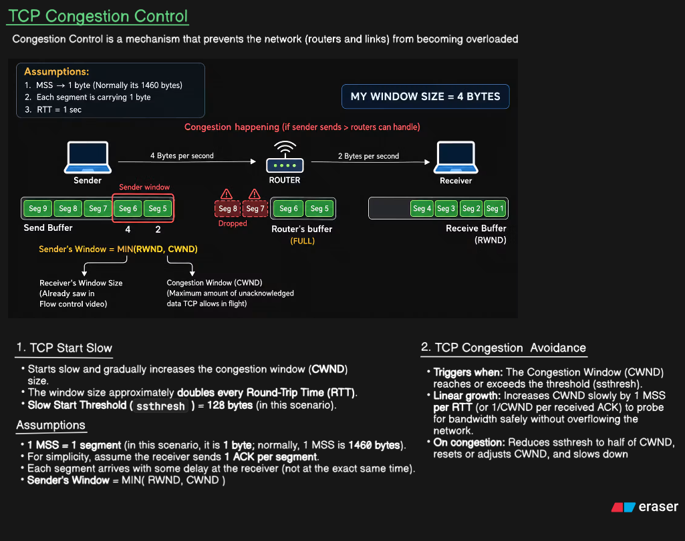
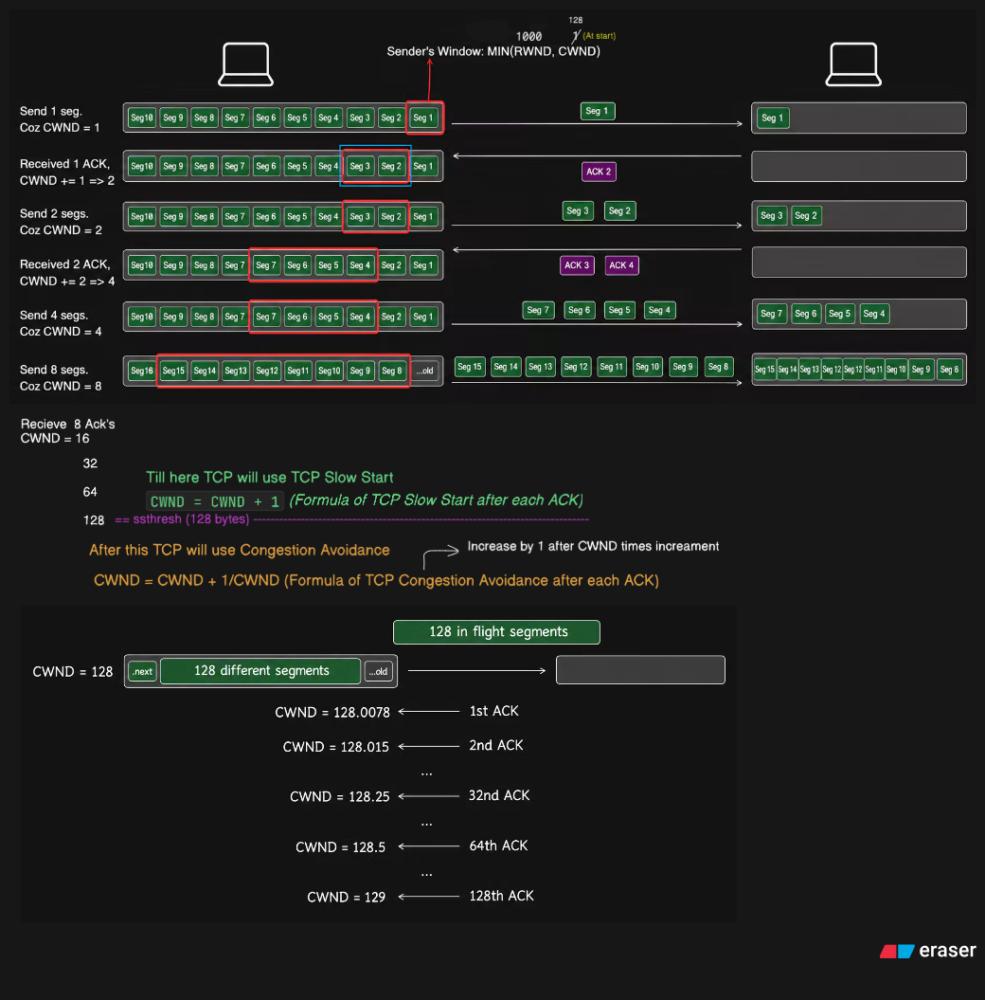
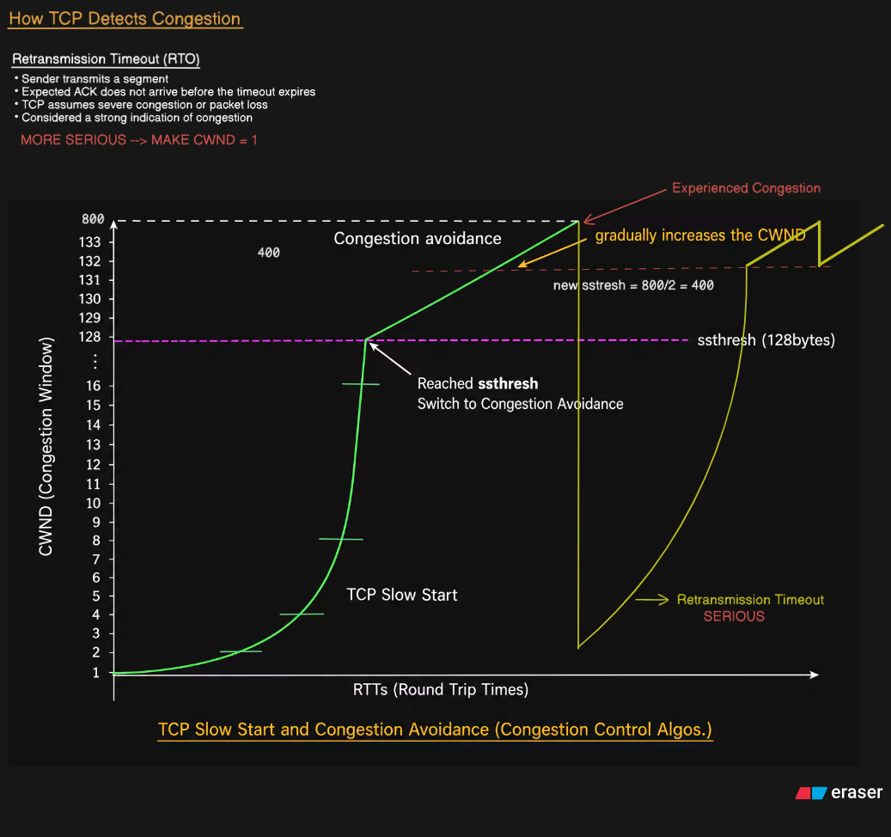
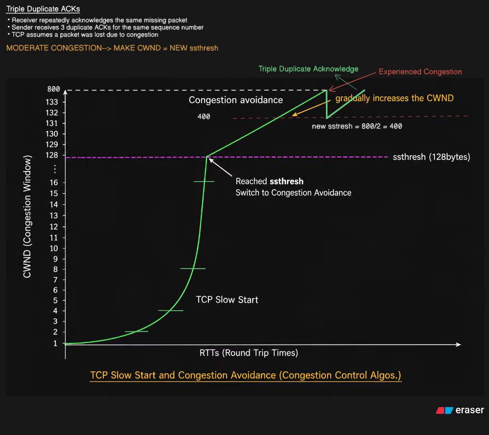
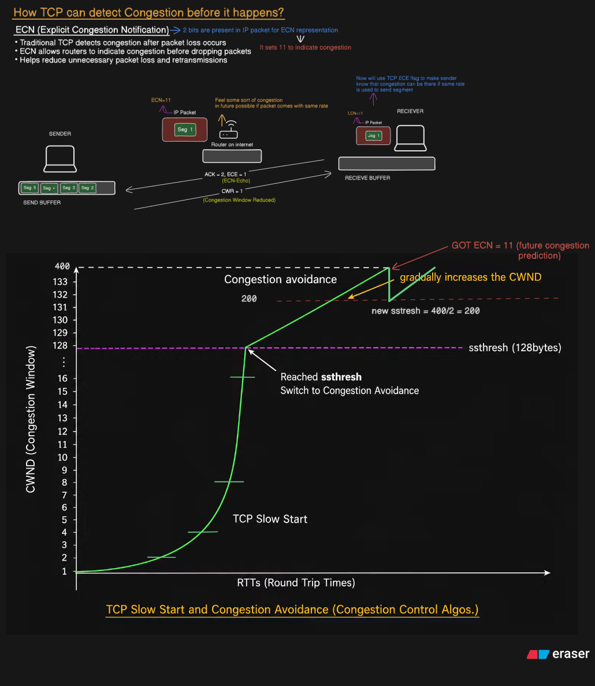

# TCP Congestion Control

> **Source:** Lecture notes and the five diagrams created during the lecture.  
> This README explains the concepts **using the diagrams as the primary reference**.

TCP Congestion Control is the mechanism used by TCP to prevent the network — especially routers and links — from becoming overloaded.

The main idea covered in these notes is:

- TCP controls the amount of data that can be in flight using **CWND**.
- The sender's usable window is limited by both **RWND** and **CWND**.
- TCP initially increases CWND using **Slow Start**.
- After reaching **SSTHRESH**, TCP switches to **Congestion Avoidance**.
- When congestion is detected, TCP reduces its sending rate.
- The lecture covers three congestion signals:
  - **Retransmission Timeout (RTO)**
  - **Triple Duplicate ACKs**
  - **ECN (Explicit Congestion Notification)**

---

# 1. TCP Congestion Control — Overview



This first diagram establishes the basic problem that TCP Congestion Control is trying to solve.

## 1.1 What is congestion?

The diagram shows a sender transmitting data toward a receiver through a router.

In the example:

- Sender → Router: **4 bytes per second**
- Router → Receiver: **2 bytes per second**

Therefore, the sender is putting data into the network faster than the router can forward it.

The diagram labels this as:

> **Congestion happening (if sender sends > routers can handle)**

The router therefore starts accumulating packets in its buffer.

If the buffer becomes full, newly arriving packets cannot be stored and may be **dropped**.

The diagram explicitly shows:

```text
Router's buffer
(FULL)
```

and two segments being dropped.

The important idea is:

> If the sender sends faster than the network can forward the data, queues/buffers can fill up and packet loss can occur.

---

## 1.2 Sender Buffer, Router Buffer and Receiver Buffer

The diagram shows buffers at different points.

### Sender

The sender has a **Send Buffer** containing segments waiting to be transmitted.

The sender window determines which part of the data can currently be sent.

### Router

The router temporarily stores packets in its buffer while they wait to be forwarded.

If packets arrive faster than the router can forward them, this buffer fills.

### Receiver

The receiver has a **Receive Buffer**.

The receiver advertises how much buffer space it has available using the **Receive Window (RWND)**.

---

# 2. RWND and CWND

The first diagram gives the important relationship:

```text
Sender's Window = MIN(RWND, CWND)
```

The sender therefore has two different constraints.

## RWND — Receiver Window

The diagram describes RWND as:

> Receiver's Window Size

RWND is related to **flow control**.

Its purpose is to prevent the sender from overwhelming the receiver's receive buffer.

So:

```text
RWND → protects the receiver
```

## CWND — Congestion Window

The diagram describes CWND as:

> Maximum amount of unacknowledged data TCP allows in flight

CWND is related to **congestion control**.

Its purpose is to control how much data TCP puts into the network before receiving acknowledgements.

So:

```text
CWND → protects the network
```

Therefore:

```text
Sender Window = MIN(RWND, CWND)
```

The smaller of the two limits the sender.

---

# 3. Assumptions Used in These Diagrams

The diagrams use simplified values so that the behavior is easy to calculate and visualize.

The first diagram states:

- **MSS = 1 byte** for the simplified example
- Normally, MSS is around **1460 bytes** in the example's context
- Each segment carries **1 byte**
- **RTT = 1 second**

The later diagrams also use:

> **1 MSS = 1 segment**

and assume:

> The receiver sends **1 ACK per segment**.

These are simplifications for understanding the growth of CWND. They are not meant to imply that real TCP always has a 1-byte MSS.

---

# 4. TCP Slow Start and Congestion Avoidance



The second diagram goes deeper into how CWND actually grows.

The important transition shown is:

```text
TCP Slow Start
       ↓
CWND reaches SSTHRESH
       ↓
TCP Congestion Avoidance
```

In the diagram:

```text
ssthresh = 128 bytes
```

---

# 5. TCP Slow Start — The Segment-by-Segment Example

At the beginning:

```text
CWND = 1
```

The sender sends:

```text
1 segment
```

The receiver acknowledges it.

The diagram shows:

```text
Received 1 ACK
CWND += 1 → 2
```

So CWND becomes:

```text
1 → 2
```

---

## 5.1 CWND = 2

The sender now has:

```text
CWND = 2
```

so it sends:

```text
2 segments
```

The receiver sends 2 ACKs.

The diagram shows:

```text
Received 2 ACK
CWND += 2 → 4
```

Therefore:

```text
2 → 4
```

---

## 5.2 CWND = 4

Now:

```text
CWND = 4
```

The sender sends 4 segments.

After receiving 4 ACKs:

```text
CWND = 8
```

---

## 5.3 CWND = 8

The sender sends 8 segments.

After receiving 8 ACKs:

```text
CWND = 16
```

The diagram therefore demonstrates:

```text
1 → 2 → 4 → 8 → 16
```

and the same pattern continues.

---

# 6. Why Slow Start Approximately Doubles CWND

The diagram explicitly gives the Slow Start formula:

```text
CWND = CWND + 1
```

after each ACK, using the simplified assumption that:

```text
1 MSS = 1 segment
```

Suppose:

```text
CWND = 8
```

Then approximately 8 segments are sent.

The receiver sends 8 ACKs.

Each ACK increases CWND by 1:

```text
8 ACKs × 1 = 8
```

Therefore:

```text
CWND = 8 + 8
     = 16
```

That is why the diagram shows CWND approximately doubling over an RTT.

So the important behavior is:

```text
1 → 2 → 4 → 8 → 16 → 32 → 64 → 128
```

This is the **exponential growth** of TCP Slow Start.

---

# 7. SSTHRESH

The second diagram marks:

```text
128 == ssthresh (128 bytes)
```

This is the **Slow Start Threshold**.

The diagram states:

> Till here TCP will use TCP Slow Start

and then:

> After this TCP will use Congestion Avoidance

Therefore, in this example:

```text
CWND < 128
    ↓
Slow Start

CWND reaches 128
    ↓
Congestion Avoidance
```

The important thing to remember is that `ssthresh` is the point where the growth behavior changes.

---

# 8. Congestion Avoidance — Why the Growth Becomes Slow

After reaching:

```text
CWND = 128
```

TCP stops using the exponential Slow Start growth.

The diagram gives the formula:

```text
CWND = CWND + 1/CWND
```

for each ACK.

This produces much slower growth.

The diagram gives the example:

```text
CWND = 128
```

There are approximately 128 segments in flight.

After the first ACK:

```text
CWND = 128.0078
```

After the second ACK:

```text
CWND = 128.015
```

The diagram continues this calculation until:

```text
32nd ACK  → CWND = 128.25
64th ACK  → CWND = 128.5
128th ACK → CWND = 129
```

So after approximately one whole window of ACKs:

```text
128 → 129
```

This is why the diagram describes Congestion Avoidance as increasing CWND **linearly**.

---

# 9. Slow Start vs Congestion Avoidance

From the second diagram:

| | Slow Start | Congestion Avoidance |
|---|---|---|
| CWND growth | Exponential | Linear |
| Growth behavior | Rapid | Gradual |
| Formula shown in notes | `CWND = CWND + 1` per ACK | `CWND = CWND + 1/CWND` per ACK |
| Transition point | Before `ssthresh` | At/after `ssthresh` |
| Example | `1 → 2 → 4 → 8 → 16...` | `128 → 129 → 130...` |

The easiest distinction is:

> **Slow Start grows quickly; Congestion Avoidance grows carefully.**

---

# 10. How TCP Detects Congestion — RTO



The third diagram introduces the first congestion-detection mechanism:

# Retransmission Timeout (RTO)

The diagram explains:

1. Sender transmits a segment.
2. An ACK is expected.
3. The expected ACK does not arrive before the timeout expires.
4. TCP assumes congestion or packet loss.
5. The diagram treats this as a **strong indication of congestion**.

It explicitly labels:

> **MORE SERIOUS → MAKE CWND = 1**

---

# 11. What Happens After a Retransmission Timeout?

The graph in the third image shows the complete sequence.

Initially, TCP performs:

```text
Slow Start
```

CWND grows rapidly until it reaches:

```text
ssthresh = 128
```

Then TCP switches to:

```text
Congestion Avoidance
```

and CWND grows gradually.

The graph then shows CWND reaching a much larger value:

```text
CWND = 800
```

At this point, a congestion event occurs.

The diagram shows:

```text
new ssthresh = 800/2 = 400
```

and, because the event is a retransmission timeout:

```text
CWND → 1
```

So the sequence shown is:

```text
CWND = 800
     ↓
Retransmission Timeout
     ↓
new ssthresh = 400
     ↓
CWND = 1
     ↓
Slow Start begins again
```

CWND then grows again.

Once it reaches the new `ssthresh`:

```text
400
```

TCP switches back to:

```text
Congestion Avoidance
```

and CWND starts increasing gradually again.

---

# 12. The RTO Graph — What to Notice

The graph in the third image is important because it shows the complete cycle:

### First part

```text
TCP Slow Start
```

CWND rises rapidly.

### At 128

```text
Reached ssthresh
Switch to Congestion Avoidance
```

### Next part

CWND increases gradually.

### Congestion

The graph reaches:

```text
CWND = 800
```

and then shows a severe drop.

### After RTO

```text
new ssthresh = 400
CWND = 1
```

Then the process starts again.

So this one graph connects all the earlier concepts together.

---

# 13. Triple Duplicate ACKs



The fourth diagram covers a different way TCP can detect congestion:

# Triple Duplicate ACKs

The diagram explains:

- The receiver repeatedly acknowledges the same missing packet.
- The sender receives **3 duplicate ACKs** for the same sequence number.
- TCP assumes that a packet was lost, potentially because of congestion.

The diagram labels this:

> **MODERATE CONGESTION → MAKE CWND = NEW ssthresh**

This is intentionally different from the RTO case.

---

# 14. Why Are Triple Duplicate ACKs Different From RTO?

With a timeout, TCP stops hearing the expected ACK before the timer expires.

With duplicate ACKs, TCP is **still receiving ACKs**.

That means the receiver is still communicating with the sender.

The repeated duplicate ACKs indicate that something is missing, but the network is still delivering packets.

Therefore, in the behavior represented in these notes, TCP treats it as **moderate congestion**, rather than the more serious condition represented by an RTO.

---

# 15. Triple Duplicate ACK — Graph

The fourth image uses the same general CWND graph as the RTO example.

The connection starts with:

```text
TCP Slow Start
```

Then:

```text
CWND reaches 128
```

so TCP switches to:

```text
Congestion Avoidance
```

CWND continues increasing.

The graph reaches:

```text
CWND = 800
```

Then the diagram marks:

> **Triple Duplicate Acknowledge**

The new threshold is calculated:

```text
new ssthresh = 800/2 = 400
```

The diagram then shows CWND being reduced to the new threshold rather than dropping all the way to 1.

So the behavior represented in the notes is:

```text
CWND = 800
     ↓
3 Duplicate ACKs
     ↓
new ssthresh = 400
     ↓
CWND = new ssthresh
     ↓
Congestion Avoidance continues
     ↓
CWND gradually increases
```

This is less aggressive than the RTO response shown in the previous image.

---

# 16. RTO vs Triple Duplicate ACK

The two diagrams should be understood together.

### Retransmission Timeout

The third image shows:

```text
CWND = 800
       ↓
RTO
       ↓
ssthresh = 400
       ↓
CWND = 1
```

### Triple Duplicate ACK

The fourth image shows:

```text
CWND = 800
       ↓
3 Duplicate ACKs
       ↓
ssthresh = 400
       ↓
CWND = 400
```

So the key difference in these notes is:

> **RTO → much more severe reduction**
>
> **Triple Duplicate ACK → moderate reduction**

---

# 17. ECN — Explicit Congestion Notification



The fifth image introduces ECN.

The heading asks:

> **How TCP can detect Congestion before it happens?**

The answer shown is:

> **ECN (Explicit Congestion Notification)**

This is different from the previous two mechanisms because ECN allows the network to communicate congestion information **before relying on packet loss**.

---

# 18. What Problem Does ECN Solve?

The diagram explains:

- Traditional TCP detects congestion after packet loss occurs.
- ECN allows routers to indicate congestion **before dropping packets**.
- This can reduce unnecessary packet loss and retransmissions.

The key idea is:

```text
Traditional approach:

Congestion
   ↓
Packet loss
   ↓
TCP detects the problem
```

ECN instead allows:

```text
Congestion developing
   ↓
Router marks packet
   ↓
Receiver learns about congestion
   ↓
Sender is informed
   ↓
Sender reduces sending rate
```

The important point is that the router can provide an **early warning**.

---

# 19. ECN Bits in the Diagram

The fifth image specifically notes:

> **2 bits are present in IP packet for ECN representation**

It also shows:

```text
ECN = 11
```

The diagram labels this as indicating congestion.

So, within the simplified explanation in these notes, the router detects congestion and marks the IP packet with the ECN indication.

---

# 20. ECN Flow Shown in the Image

The diagram shows the flow between:

```text
SENDER → ROUTER → RECEIVER
```

The sender sends an IP packet.

The router detects congestion and marks the packet:

```text
ECN = 11
```

The marked packet reaches the receiver.

The receiver then communicates the congestion information back toward the sender.

The diagram shows:

```text
ACK = 2, ECE = 1
```

and then:

```text
CWR = 1
```

with the note:

> Congestion Window Reduced

The exact packet/flag mechanics are represented in the diagram; the main concept to remember from this lecture is:

> **The router can tell the endpoints that congestion is being experienced without first needing to drop the packet.**

---

# 21. ECN and CWND

The graph at the bottom of the fifth image shows the congestion-control response.

The graph starts with:

```text
ssthresh = 128
```

TCP enters Congestion Avoidance after reaching that threshold.

CWND then grows gradually.

The graph reaches:

```text
CWND = 400
```

At that point the diagram marks:

> **GOT ECN = 11 (future congestion prediction)**

The new threshold is shown as:

```text
new ssthresh = 400/2 = 200
```

Therefore, the diagram demonstrates that ECN causes TCP to react to the congestion warning by reducing its congestion-control parameters before the situation becomes worse.

---

# 22. The Three Congestion Signals in Your Notes

The final three images represent three different ways TCP can learn about congestion.

## 1. Retransmission Timeout

From Image 3:

```text
RTO
↓
Strong indication of congestion
↓
new ssthresh = old CWND / 2
↓
CWND = 1
```

---

## 2. Triple Duplicate ACKs

From Image 4:

```text
3 Duplicate ACKs
↓
Moderate indication of congestion
↓
new ssthresh = old CWND / 2
↓
CWND = new ssthresh
```

---

## 3. ECN

From Image 5:

```text
Router detects congestion
↓
Router marks packet with ECN
↓
Receiver learns about congestion
↓
Sender is informed
↓
TCP reduces its sending rate / congestion window
```

The important conceptual difference is that ECN provides a **congestion warning from the network itself**, rather than waiting for packet loss or a timeout.

---

# 23. How All Five Images Connect

The five images are not five unrelated topics.

They form one continuous story.

### Image 1 — The Problem

The first image explains **why congestion control is needed**.

A sender can transmit faster than a router can forward:

```text
Sender: 4 bytes/sec
Router → Receiver: 2 bytes/sec
```

The router buffer fills and packets can be dropped.

It also introduces:

```text
Sender Window = MIN(RWND, CWND)
```

---

### Image 2 — How TCP Increases CWND

Once the problem is understood, the second image explains how TCP controls its sending rate.

It starts with:

```text
CWND = 1
```

and uses Slow Start:

```text
1 → 2 → 4 → 8 → ...
```

until:

```text
CWND = ssthresh
```

Then TCP changes to Congestion Avoidance:

```text
128 → 129 → 130 → ...
```

---

### Image 3 — What Happens After a Timeout

The third image asks:

> What if congestion becomes serious enough that an expected ACK does not arrive?

That produces an:

```text
RTO
```

The diagram shows:

```text
CWND = 800
↓
ssthresh = 400
↓
CWND = 1
```

and TCP starts Slow Start again.

---

### Image 4 — What Happens With Triple Duplicate ACKs

The fourth image asks:

> What if TCP receives three duplicate ACKs instead?

The network is still responding, so the diagram treats this as moderate congestion.

It shows:

```text
CWND = 800
↓
ssthresh = 400
↓
CWND = 400
```

rather than reducing CWND to 1.

---

### Image 5 — What If the Network Warns TCP Early?

The fifth image introduces:

```text
ECN
```

Instead of waiting for packet loss, the router can mark a packet to indicate congestion.

The sender is informed and can reduce its sending rate.

The diagram shows:

```text
CWND = 400
↓
ECN = 11
↓
new ssthresh = 200
```

---

# 24. Complete Lecture Flow

The complete sequence represented by your five diagrams is:

```text
TCP wants to send data
        ↓
Network has limited capacity
        ↓
TCP uses CWND to control data in flight
        ↓
Slow Start
        ↓
CWND grows exponentially
        ↓
Reach SSTHRESH
        ↓
Congestion Avoidance
        ↓
CWND grows linearly
        ↓
Congestion may occur
        ↓
How is it detected?
        ↓
 ┌───────────────┬──────────────────┬──────────────┐
 │               │                  │
 RTO        Triple Duplicate ACKs    ECN
 │               │                  │
 Serious        Moderate            Early
 congestion     congestion          warning
 │               │                  │
 CWND = 1       CWND = new          Reduce sending
                ssthresh             rate
 │               │                  │
 └───────────────┴──────────────────┘
                 ↓
        TCP becomes more cautious
```

The code block above is only a **textual summary of the five diagrams**; it is not an additional diagram or concept.

---

# 25. What You Should Remember From These Notes

## Congestion Control

Prevents the network from becoming overloaded.

## RWND

Receiver-side limitation.

```text
Protects receiver
```

## CWND

Network-side limitation.

```text
Protects network
```

## Sender Window

```text
MIN(RWND, CWND)
```

## Slow Start

```text
CWND = CWND + 1
```

per ACK in the simplified example.

Result:

```text
1 → 2 → 4 → 8 → 16 → ...
```

So growth is approximately **exponential**.

## SSTHRESH

Marks the transition from:

```text
Slow Start
```

to:

```text
Congestion Avoidance
```

## Congestion Avoidance

```text
CWND = CWND + 1/CWND
```

per ACK in the simplified example.

Result:

```text
128 → 129 → 130 → ...
```

So growth is approximately **linear**.

## RTO

Strong congestion indication.

In the diagram:

```text
new ssthresh = old CWND / 2
CWND = 1
```

## Triple Duplicate ACK

Moderate congestion indication.

In the diagram:

```text
new ssthresh = old CWND / 2
CWND = new ssthresh
```

## ECN

The network explicitly indicates congestion.

The diagram shows:

```text
Router marks packet
↓
Receiver receives congestion indication
↓
Sender is informed
↓
TCP reduces its sending rate
```

---

# 26. Final Memory Chain

If you want to recall this lecture later, remember the chain:

```text
RWND + CWND
      ↓
Sender Window = MIN(RWND, CWND)
      ↓
Slow Start
      ↓
1 → 2 → 4 → 8 → ...
      ↓
SSTHRESH
      ↓
Congestion Avoidance
      ↓
128 → 129 → 130 → ...
      ↓
Congestion
      ↓
RTO / Triple Duplicate ACK / ECN
      ↓
Reduce sending rate
      ↓
Continue cautiously
```

The central idea of the entire lecture is:

> **TCP increases CWND to discover how much traffic the network can handle, changes from exponential to linear growth at SSTHRESH, and reduces its sending rate when congestion is detected.**
