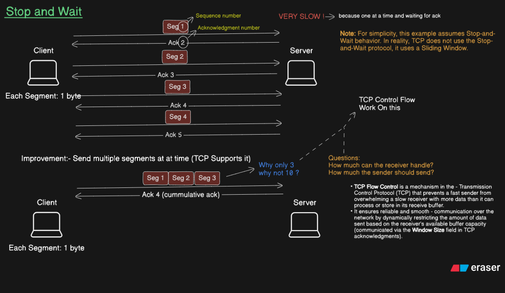
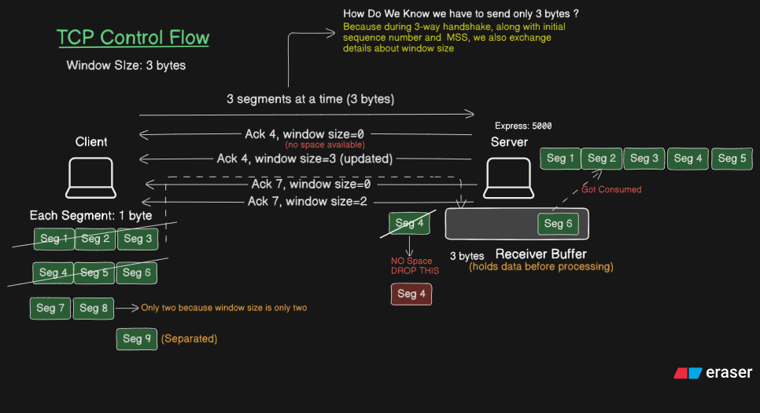
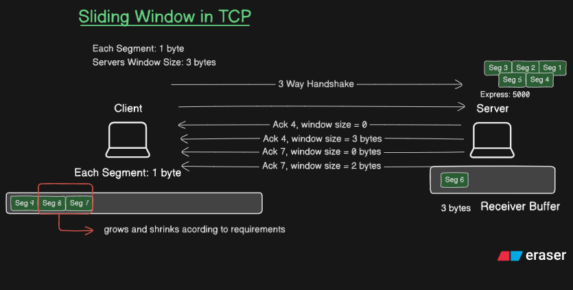
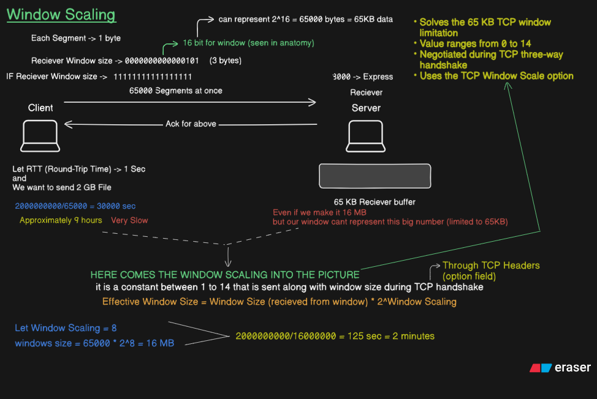

# TCP Flow Control, Sliding Window & Window Scaling

TCP provides reliable and ordered delivery of data between two endpoints.  
One important problem TCP needs to solve is controlling how much data can be sent before the sender needs to slow down and wait for the receiver.

This note covers the progression from a simple **Stop-and-Wait** mechanism to the **Sliding Window** mechanism used by TCP, and finally explains how **TCP Window Scaling** allows TCP to work with receive windows larger than the traditional 65 KB limit.

The topics covered are:

1. **Stop and Wait**
2. **TCP Flow Control**
3. **Sliding Window in TCP**
4. **TCP Window Scaling**

---

## Table of Contents

- [1. Stop and Wait](#1-stop-and-wait)
  - [Basic Idea](#basic-idea)
  - [How Stop and Wait Works](#how-stop-and-wait-works)
  - [Sequence Number and Acknowledgement Number](#sequence-number-and-acknowledgement-number)
  - [Why Stop and Wait Is Slow](#why-stop-and-wait-is-slow)
  - [Sending Multiple Segments](#sending-multiple-segments)
- [2. TCP Flow Control](#2-tcp-flow-control)
  - [Why Flow Control Is Needed](#why-flow-control-is-needed)
  - [Receiver Buffer](#receiver-buffer)
  - [Receive Window](#receive-window)
  - [Advertised Window](#advertised-window)
  - [How the Receive Window Changes](#how-the-receive-window-changes)
  - [How Flow Control Works](#how-flow-control-works)
- [3. Sliding Window in TCP](#3-sliding-window-in-tcp)
  - [Basic Idea](#sliding-window-basic-idea)
  - [Multiple Segments in Flight](#multiple-segments-in-flight)
  - [Why It Is Called a Sliding Window](#why-it-is-called-a-sliding-window)
  - [Cumulative Acknowledgement](#cumulative-acknowledgement)
  - [Window Movement](#window-movement)
  - [Stop and Wait vs Sliding Window](#stop-and-wait-vs-sliding-window)
- [4. TCP Window Scaling](#4-tcp-window-scaling)
  - [The 16-bit Window Limitation](#the-16-bit-window-limitation)
  - [Why the 65 KB Limit Can Be a Problem](#why-the-65-kb-limit-can-be-a-problem)
  - [Window Scaling Option](#window-scaling-option)
  - [Window Scaling Formula](#window-scaling-formula)
  - [Window Scaling Example](#window-scaling-example)
  - [When Window Scaling Is Negotiated](#when-window-scaling-is-negotiated)
- [5. Complete Conceptual Flow](#5-complete-conceptual-flow)
- [6. Key Terminology](#6-key-terminology)
- [7. Key Takeaways](#7-key-takeaways)

---

# 1. Stop and Wait

## Basic Idea

The simplest way to reliably transfer data is to send one segment and wait for its acknowledgement before sending the next segment.

This mechanism is called **Stop and Wait**.

The basic process is:

```text
Send Segment
     ↓
Wait for ACK
     ↓
Send Next Segment
     ↓
Wait for ACK
     ↓
Continue...
```

Only one segment is being sent at a time.

---

## How Stop and Wait Works

Suppose each segment contains 1 byte.

The communication can look like:

```text
Client                                      Server

  Seg 1  ------------------------------->

          <------------------------------ ACK

  Seg 2  ------------------------------->

          <------------------------------ ACK

  Seg 3  ------------------------------->

          <------------------------------ ACK

  Seg 4  ------------------------------->
```

The sender sends a segment and then stops transmitting until it receives an acknowledgement.

This makes the mechanism simple and easy to understand, but it can be very slow.

---

## Sequence Number and Acknowledgement Number

TCP uses **sequence numbers** and **acknowledgement numbers** to keep track of the data being transmitted.

For a simplified example where every segment contains 1 byte:

```text
Segment 1
Segment 2
Segment 3
```

The receiver sends acknowledgements indicating the next data it expects.

For example:

```text
ACK 2
```

can mean:

> The receiver has received the data up to this point and is expecting the next byte beginning at sequence number 2.

Similarly:

```text
ACK 4
```

means that the receiver is expecting sequence number 4 next.

This allows TCP to keep track of which data has already been received.

---

## Why Stop and Wait Is Slow

The main problem with Stop and Wait is the waiting time.

Suppose:

```text
Each Segment = 1 byte
RTT = 1 second
```

The sender sends:

```text
1 byte
```

and then waits for the acknowledgement.

Only after receiving the acknowledgement can it send the next segment.

Therefore, a large amount of time can be spent waiting instead of transmitting data.

Conceptually:

```text
Send
  ↓
Wait
  ↓
Send
  ↓
Wait
  ↓
Send
  ↓
Wait
```

This becomes especially inefficient when the communication has a large round-trip time.

---

## Sending Multiple Segments

A natural improvement is to allow multiple segments to be sent before waiting for acknowledgements.

Instead of:

```text
Seg 1
  ↓
Wait
  ↓
Seg 2
  ↓
Wait
  ↓
Seg 3
```

we can send:

```text
Seg 1   Seg 2   Seg 3
  |       |       |
  +-------+-------+
          |
          v
       Receiver
```

Now multiple segments can be in transit at the same time.

This idea leads to the **Sliding Window** mechanism used by TCP.

---

### Diagram



---

# 2. TCP Flow Control

## Why Flow Control Is Needed

Sending multiple segments improves efficiency, but another problem appears:

> **How much data should the sender be allowed to send?**

The receiver has a limited amount of memory available to temporarily hold incoming data.

If the sender sends data faster than the receiver can currently accept it, the receiver's buffer can become full.

Therefore, TCP needs a mechanism to prevent the sender from sending more data than the receiver can currently handle.

This mechanism is called:

> **Flow Control**

### Definition

**TCP Flow Control is the mechanism that prevents the sender from sending more data than the receiver is currently willing and able to accept.**

The receiver communicates its current receiving capacity to the sender using the **Receive Window (`rwnd`)**.

---

# Receiver Buffer

The receiver has a buffer where incoming TCP data can be temporarily stored before being processed by the receiving application.

Conceptually:

```text
             Receiver Buffer
        +-----------------------+
        |                       |
        |   Incoming TCP Data   |
        |                       |
        |                       |
        +-----------------------+
```

The amount of free space in this buffer can change.

For example:

```text
Data arrives
     ↓
Buffer fills
     ↓
Less space available
```

When the receiving application consumes some of the data:

```text
Application processes data
     ↓
Buffer space becomes available
     ↓
Receiver can accept more data
```

Therefore, the amount of data the receiver can currently accept is not necessarily constant.

---

# Receive Window

The **Receive Window (`rwnd`)** represents the amount of additional TCP data that the receiver is currently willing and able to accept.

The receiver advertises this information to the sender through the TCP Window Size field.

For example:

```text
Receive Window = 3 bytes
```

means that the receiver is currently advertising that it can accept up to 3 more bytes of TCP data.

If each segment contains 1 byte:

```text
Receive Window = 3 bytes

        ↓

3 segments can be accepted
```

So:

```text
Seg 1 + Seg 2 + Seg 3
       = 3 bytes
```

---

# Advertised Window

The receiver communicates its current receive window through TCP acknowledgements.

For example:

```text
ACK 4, Window Size = 3
```

Conceptually, this tells the sender:

> "I have acknowledged the data received so far, and I currently have room for 3 more bytes."

The sender must respect this advertised receive window.

Therefore:

```text
Receiver
   |
   | Advertises Receive Window
   ↓
Sender
   |
   | Sends only within the
   | allowed receiving capacity
   ↓
Receiver
```

---

# How the Receive Window Changes

The receive window can grow or shrink depending on the available space in the receiver's buffer.

For example:

```text
Initial:

Window = 3 bytes
```

Later, after the receiver processes some data:

```text
Window = 5 bytes
```

If the receiver becomes busy and less buffer space is available:

```text
Window = 2 bytes
```

Therefore:

```text
Receive Window
      |
      +----> can grow
      |
      +----> can shrink
```

This allows TCP to dynamically control the amount of data being sent according to the receiver's current capacity.

---

# How Flow Control Works

Suppose:

```text
Each Segment = 1 byte

Receive Window = 3 bytes
```

The sender can send:

```text
Seg 1
Seg 2
Seg 3
```

because:

```text
3 segments × 1 byte
= 3 bytes
```

The sender cannot simply continue sending unlimited data.

It must respect the receive window advertised by the receiver.

After the receiver processes some data, it can advertise a new window.

For example:

```text
Window = 3
       ↓
Data is consumed
       ↓
Window = 2
       ↓
More data is consumed
       ↓
Window = 5
```

This is the basic idea behind TCP Flow Control.

---

### Diagram



---

# 3. Sliding Window in TCP

## Sliding Window: Basic Idea

Stop and Wait sends one segment and waits for its acknowledgement.

TCP improves this by allowing multiple segments to be sent before waiting.

This mechanism is called the **Sliding Window**.

For example:

```text
[ Seg 1 ][ Seg 2 ][ Seg 3 ]
```

All three segments can be in transit before the sender needs to wait for further window availability.

This makes much better use of the communication path.

---

# Multiple Segments in Flight

Suppose:

```text
Each Segment = 1 byte

Receive Window = 3 bytes
```

The sender can send:

```text
Seg 1
Seg 2
Seg 3
```

without waiting after every individual segment.

The communication can look like:

```text
Client                                      Server

Seg 1  ----------------------------------->

Seg 2  ----------------------------------->

Seg 3  ----------------------------------->

       <----------------------------- ACK
```

The important difference from Stop and Wait is that the sender does not stop after every individual segment.

---

# Why It Is Called a Sliding Window

Suppose the sender has the following data:

```text
Seg 1  Seg 2  Seg 3  Seg 4  Seg 5  Seg 6  Seg 7
```

Suppose the current window allows three segments:

```text
[ Seg 1 ][ Seg 2 ][ Seg 3 ]  Seg 4  Seg 5  Seg 6  Seg 7
  <------------->
     Window
```

The sender can transmit the segments inside the current window.

After the receiver acknowledges the data, the window moves forward.

For example:

```text
Seg 1  Seg 2  Seg 3  [ Seg 4 ][ Seg 5 ][ Seg 6 ]  Seg 7
                     <----------------->
                           Window
```

The window has moved from:

```text
Seg 1 → Seg 2 → Seg 3
```

to:

```text
Seg 4 → Seg 5 → Seg 6
```

This movement is why it is called a:

> **Sliding Window**

---

# Cumulative Acknowledgement

TCP can use **cumulative acknowledgements**.

Suppose the sender sends:

```text
Seg 1
Seg 2
Seg 3
```

The receiver can acknowledge the data collectively.

For example:

```text
ACK 4
```

Conceptually, this means:

> The receiver has received the data up to this point and is expecting the next byte beginning at sequence number 4.

Therefore, TCP does not necessarily need a separate acknowledgement for every individual segment.

This makes the communication more efficient than a simple one-segment-at-a-time approach.

---

# Window Movement

The sender's usable sending range moves forward as previously transmitted data is acknowledged and the receiver makes more window space available.

For example:

```text
Before acknowledgement:

[ Seg 1 ][ Seg 2 ][ Seg 3 ] Seg 4 Seg 5
  <----------->
      Window
```

After the first data is acknowledged:

```text
Seg 1 Seg 2 [ Seg 3 ][ Seg 4 ][ Seg 5 ]
             <---------------->
                 Window
```

The window has moved forward.

This continuous movement of the sending range is the core idea behind the Sliding Window mechanism.

---

# Stop and Wait vs Sliding Window

| Feature | Stop and Wait | Sliding Window |
|---|---|---|
| Segments sent before waiting | One | Multiple |
| Waiting after every segment | Yes | No |
| Segments in flight | One at a time | Multiple |
| Network utilization | Lower | Higher |
| Acknowledgements | Individual in simple model | Can be cumulative |
| Main idea | Send → Wait → Send | Send multiple → ACK → Slide |

The progression is:

```text
Stop and Wait

Send Segment
     ↓
Wait for ACK
     ↓
Send Next Segment
```

versus:

```text
Sliding Window

Send Seg 1
Send Seg 2
Send Seg 3
     ↓
Receive ACK
     ↓
Slide Window
     ↓
Send More
```

---

### Diagram



---

# 4. TCP Window Scaling

Now we reach a limitation of the traditional TCP Window Size field.

The TCP header contains a:

```text
16-bit Window Size field
```

A 16-bit field can represent:

```text
2^16
```

different values.

Therefore, the maximum value that can be directly represented is:

```text
2^16 - 1
= 65,535 bytes
```

Approximately:

```text
65 KB
```

This creates the traditional **65 KB TCP receive-window limitation**.

---

# The 16-bit Window Limitation

Suppose the receiver has a large amount of available buffer space:

```text
Receiver Buffer = 16 MB
```

However, the normal TCP Window Size field can directly represent only:

```text
Maximum ≈ 65 KB
```

Therefore, the receiver cannot directly advertise the entire 16 MB using the unscaled 16-bit field.

This is where **TCP Window Scaling** becomes useful.

---

# Why the 65 KB Limit Can Be a Problem

Consider a simplified example:

```text
File size = 2 GB

Maximum window ≈ 65 KB

RTT = 1 second
```

A simplified calculation:

```text
2,000,000,000
----------------
65,000

≈ 30,769
```

If each window-sized transfer were treated as requiring approximately one second:

```text
30,769 × 1 second
≈ 30,769 seconds
```

Which is approximately:

```text
8.5 hours
```

This is only a **conceptual illustration** of why a small receive window can become a limitation.

Real TCP data transfer involves many other factors, so actual transfer time cannot be calculated using this simple formula alone.

The important idea is:

> A small receive window can limit how much data can be outstanding on a connection.

Therefore, TCP needs a way to represent a much larger effective receive window.

---

# Window Scaling Option

TCP solves the 16-bit window limitation using the:

> **TCP Window Scale Option**

Window Scaling does **not** increase the size of the Window Size field itself.

The TCP Window Size field remains:

```text
16 bits
```

Instead, TCP uses an additional scaling factor.

The receiver advertises:

```text
Window Size
```

along with:

```text
Window Scale
```

The sender can then calculate the larger **effective receive window**.

---

# Window Scaling Formula

The effective window size is:

```text
Effective Window Size
=
Advertised Window Size × 2^Window Scale
```

The Window Scale value is a shift count.

The allowed Window Scale values range from:

```text
0 to 14
```

Therefore, the scaling factor can be:

```text
2^0
```

up to:

```text
2^14
```

The important point is that the original 16-bit field is still present, but its value can be interpreted with the negotiated scaling factor to obtain a much larger effective window.

---

# Window Scaling Example

Suppose:

```text
Advertised Window Size = 65,000 bytes

Window Scale = 8
```

Using:

```text
Effective Window Size
=
Advertised Window Size × 2^Window Scale
```

we get:

```text
= 65,000 × 2^8

= 65,000 × 256

= 16,640,000 bytes
```

Approximately:

```text
16 MB
```

Therefore, a relatively small 16-bit advertised value can represent a much larger effective receive window.

---

# Example With a 2 GB File

Suppose:

```text
File size = 2,000,000,000 bytes

Effective Window ≈ 16,000,000 bytes
```

A simplified calculation gives:

```text
2,000,000,000
----------------
16,000,000

≈ 125
```

If we again use the simplified assumption of:

```text
RTT = 1 second
```

then:

```text
125 × 1 second
= 125 seconds
```

Approximately:

```text
2 minutes
```

This illustrates the difference between having an effective window of roughly:

```text
65 KB
```

and:

```text
16 MB
```

The calculation is only intended to demonstrate the effect of window size. It is not a complete model of real TCP transfer performance.

---

# When Window Scaling Is Negotiated

The TCP Window Scale option is negotiated during the **TCP Three-Way Handshake**.

The basic TCP handshake is:

```text
Client                         Server

SYN -------------------------->

     <------------------------- SYN-ACK

ACK -------------------------->
```

TCP options can be included in the SYN and SYN-ACK packets.

The Window Scale option is negotiated during this connection-establishment process.

After the connection is established, the TCP Window Size value can be interpreted using the negotiated scaling factor.

Conceptually:

```text
TCP Three-Way Handshake
          |
          ↓
Window Scale Option negotiated
          |
          ↓
Connection established
          |
          ↓
Scaled Receive Window
```

---

### Diagram



---

# 5. Complete Conceptual Flow

The four topics studied in this lecture are connected.

## Step 1 — Stop and Wait

The simplest approach is:

```text
Send one segment
       ↓
Wait for ACK
       ↓
Send next segment
```

This works, but it involves a lot of waiting.

---

## Step 2 — Sliding Window

Instead of waiting after every segment, TCP can allow multiple segments to be in flight:

```text
Seg 1
Seg 2
Seg 3
Seg 4
```

This improves the efficiency of data transmission.

---

## Step 3 — Flow Control

However, the receiver has a limited buffer.

Therefore, the receiver tells the sender how much additional data it can currently accept.

This is the:

```text
Receive Window (rwnd)
```

The receive window can change as the receiver's available buffer space changes.

---

## Step 4 — Window Scaling

The traditional Window Size field is only 16 bits:

```text
Maximum = 65,535 bytes
        ≈ 65 KB
```

For larger receive windows, TCP can use the Window Scale option.

```text
Effective Window
=
Window Size × 2^Window Scale
```

This allows the effective receive window to be much larger than 65 KB.

---

# Complete Conceptual Diagram

```text
                    TCP DATA TRANSFER
                           |
                           ↓
                    Stop and Wait
                           |
                           |
                  One segment at a time
                           |
                           ↓
                  Too much waiting
                           |
                           ↓
                  Sliding Window
                           |
                           |
                Multiple segments
                  can be in flight
                           |
                           ↓
                   Flow Control
                           |
                           |
             Receiver has limited buffer
                           |
                           ↓
                  Receive Window
                       (rwnd)
                           |
                           |
              16-bit Window Size field
                           |
                           ↓
                    ~65 KB limit
                           |
                           ↓
                  Window Scaling
                           |
                           |
                 Larger effective
                   receive window
```

---

# 6. Key Terminology

| Term | Meaning |
|---|---|
| **TCP Segment** | A unit of data carried by TCP |
| **Sequence Number** | Identifies the position of data in the TCP byte stream |
| **Acknowledgement Number** | Indicates the next byte the receiver expects |
| **Receiver Buffer** | Memory used to temporarily hold incoming TCP data |
| **Receive Window (`rwnd`)** | Amount of additional TCP data the receiver currently advertises that it can accept |
| **Advertised Window** | The receive-window value communicated by the receiver to the sender |
| **Flow Control** | Mechanism that prevents the sender from overwhelming the receiver |
| **Sliding Window** | Mechanism that allows multiple segments to be in flight while the sending range moves forward as data is acknowledged |
| **Cumulative ACK** | An acknowledgement that confirms receipt up to a particular point and indicates the next expected data |
| **Window Size** | The 16-bit field in the TCP header used to advertise receive-window capacity |
| **Window Scaling** | TCP option that allows the effective receive window to be larger than the direct 16-bit value |
| **Window Scale** | The scaling/shift value used with the advertised Window Size |

---

# 7. Key Takeaways

### 1. Stop and Wait

```text
Send one segment
       ↓
Wait for ACK
       ↓
Send next segment
```

It is simple but can be slow because the sender waits after every segment.

---

### 2. Sliding Window

```text
Send multiple segments
       ↓
Receive acknowledgements
       ↓
Move the window forward
       ↓
Send more segments
```

This allows multiple segments to be in flight at the same time.

---

### 3. Flow Control

Flow control prevents the sender from sending more data than the receiver can currently accept.

The receiver communicates its capacity using the:

```text
Receive Window (rwnd)
```

---

### 4. Receive Window

The Receive Window is:

> **The amount of additional TCP data that the receiver is currently willing and able to accept.**

It is related to the available space in the receiver's buffer and is advertised by the receiver to the sender.

The value can change as the receiver's available buffer space changes.

---

### 5. 16-bit Window Limitation

The traditional TCP Window Size field is:

```text
16 bits
```

Therefore:

```text
Maximum value
= 2^16 - 1
= 65,535 bytes
≈ 65 KB
```

---

### 6. Window Scaling

Window Scaling solves the 65 KB limitation by allowing the 16-bit advertised value to represent a much larger effective receive window.

```text
Effective Window Size
=
Advertised Window Size × 2^Window Scale
```

The Window Scale value ranges from:

```text
0 to 14
```

and is negotiated during the TCP Three-Way Handshake.

---

# Final Learning Progression

The entire topic can be remembered as:

```text
Stop and Wait
      ↓
Why wait after every segment?
      ↓
Sliding Window
      ↓
How many segments can be sent?
      ↓
Flow Control
      ↓
How much can the receiver currently accept?
      ↓
Receive Window
      ↓
Why is the normal window limited to ~65 KB?
      ↓
16-bit Window Size
      ↓
Window Scaling
      ↓
Larger Effective Receive Window
```

This progression connects the four concepts:

**Stop and Wait → Sliding Window → Flow Control → Window Scaling**