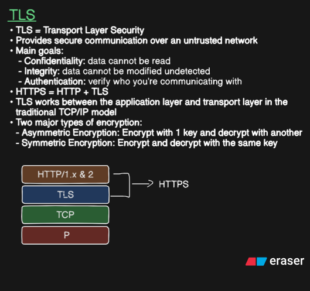
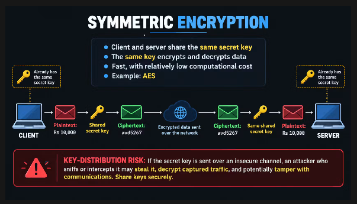
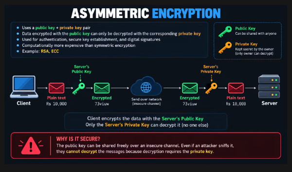
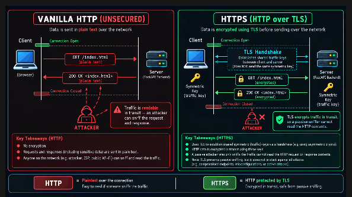

# Computer Networks: Transport Layer Security (TLS)

A comprehensive guide to understanding Transport Layer Security (TLS), encryption primitives, and the difference between plain HTTP and HTTPS.

---

## Table of Contents

- [1. TLS Foundations](#1-tls-foundations)
- [2. Symmetric Encryption](#2-symmetric-encryption)
- [3. Asymmetric Encryption](#3-asymmetric-encryption)
- [4. Vanilla HTTP vs. HTTPS](#4-vanilla-http-vs-https)

---

## 1. TLS Foundations

**TLS (Transport Layer Security)** is a cryptographic protocol designed to provide secure communication over an untrusted network.

### Core Security Goals
* **Confidentiality:** Ensures data cannot be read by unauthorized parties during transit.
* **Integrity:** Guarantees that data cannot be modified or tampered with undetected.
* **Authentication:** Verifies the true identity of the parties communicating over the network.

### Protocol Formula
$$\text{HTTPS} = \text{HTTP} + \text{TLS}$$

### TCP/IP Architecture Layering
TLS operates between the **Application Layer** and the **Transport Layer** in the traditional TCP/IP stack:

1. **Application Layer:** HTTP/1.x & HTTP/2
2. **Security Layer:** TLS
3. **Transport Layer:** TCP
4. **Network Layer:** IP

---

## 2. Symmetric Encryption

Symmetric encryption uses a single secret key for both scrambling and unscrambling data.

### Key Characteristics
* **Shared Key:** Both client and server hold the exact same secret key.
* **Dual Function:** The same key performs both encryption and decryption.
* **Performance:** High speed with low computational overhead.
* **Primary Example:** AES (Advanced Encryption Standard).

### Data Flow
1. **Client:** Takes Plaintext (e.g., `Rs 10,000`), encrypts it with the **Shared Secret Key**, producing Ciphertext (e.g., `avd5267`).
2. **Transit:** Encrypted Ciphertext is sent across the untrusted network.
3. **Server:** Receives Ciphertext (`avd5267`), applies the same **Shared Secret Key**, and decrypts it back to Plaintext (`Rs 10,000`).

> ⚠️ **Key-Distribution Risk:**  
> If the secret key is transmitted over an insecure channel, an attacker who sniffs or intercepts the key can steal it, decrypt captured traffic, and potentially tamper with communications. Keys must be established securely.

---

## 3. Asymmetric Encryption

Asymmetric encryption solves the key distribution problem by using a pair of mathematically linked keys.

### Key Characteristics
* **Key Pair System:**
  * **Public Key:** Can be shared freely with anyone.
  * **Private Key:** Must be kept strictly secret by the owner.
* **Mathematical Binding:** Data encrypted with the **Public Key** can *only* be decrypted by the corresponding **Private Key**.
* **Use Cases:** Authentication, secure key exchange/establishment, and digital signatures.
* **Performance:** Computationally more expensive than symmetric encryption.
* **Primary Examples:** RSA, ECC (Elliptic Curve Cryptography).

### Data Flow
1. **Client:** Takes Plaintext (e.g., `Rs 10,000`), encrypts it with the **Server's Public Key**, producing Encrypted Ciphertext (e.g., `73viuw`).
2. **Transit:** Encrypted Ciphertext travels across the network safely.
3. **Server:** Uses the **Server's Private Key** to decrypt the message back into Plaintext (`Rs 10,000`).

> 🔒 **Why Is It Secure?**  
> The public key can be shared freely over an insecure channel. Even if an attacker intercepts the public key and encrypted traffic, they **cannot decrypt** the messages because decryption strictly requires the owner's private key.

---

## 4. Vanilla HTTP vs. HTTPS

A side-by-side comparison of unencrypted HTTP communication versus TLS-secured HTTPS.

### Comparison Summary

| Metric / Feature | Vanilla HTTP (Unsecured) | HTTPS (HTTP over TLS) |
| :--- | :--- | :--- |
| **Data Format** | Plaintext | Encrypted via TLS |
| **Passive Sniffing** | Vulnerable (anyone on Wi-Fi/ISP can read) | Protected (content is unreadable) |
| **Handshake** | TCP Handshake only | TCP Handshake + TLS Handshake |
| **Traffic Keys** | None | Shared symmetric traffic keys derived securely |

### Key Takeaways

* **HTTP ($\text{Plaintext over connection}$):**
  * Requests (`GET /index.html`) and responses (`200 OK`) travel in plain text.
  * Anyone intercepting the connection can view sensitive payload data.
* **HTTPS ($\text{HTTP protected by TLS}$):**
  * Employs asymmetric cryptography during the **TLS Handshake** to establish shared symmetric traffic keys.
  * Subsequent HTTP requests and responses are encrypted using these symmetric keys.
  * *Note:* TLS prevents passive sniffing in transit, but does not protect against endpoint compromise or server misconfigurations.