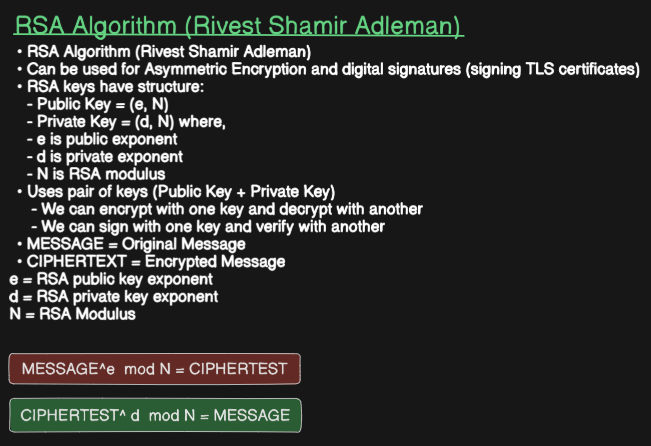
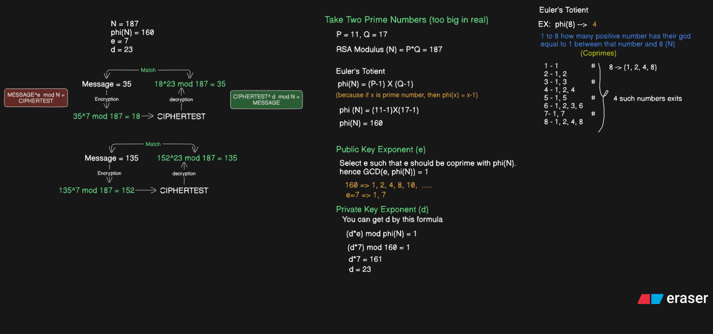

# Computer Networks: RSA Cryptosystem & Mathematics

A detailed breakdown of the RSA (Rivest–Shamir–Adleman) asymmetric algorithm, including Euler's Totient function, key generation steps, and a complete mathematical walkthrough.

## Table of Contents

* [1. RSA Algorithm Overview](#1-rsa-algorithm-overview)
* [2. Euler's Totient Function $\phi(N)$](#2-eulers-totient-function-phin)
* [3. Step-by-Step Key Generation](#3-step-by-step-key-generation)
* [4. Mathematical Execution Walkthrough](#4-mathematical-execution-walkthrough)

---

## 1. RSA Algorithm Overview

The **RSA Algorithm** (named after Rivest, Shamir, and Adleman) is a foundational asymmetric cryptographic protocol widely used for securing data transmission and creating digital signatures (such as signing TLS certificates).

### Key Structure & Components

An RSA setup produces two distinct keys derived from a shared modulus $N$:

* **Public Key:** $(e, N)$ — Used for **Encryption** and **Signature Verification**.
* **Private Key:** $(d, N)$ — Used for **Decryption** and **Digital Signing**.

Where:
* $e$ = RSA public exponent
* $d$ = RSA private exponent
* $N$ = RSA modulus

### Core Mathematical Formulas

* **Encryption Formula:**
  $$ \text{MESSAGE}^e \pmod N = \text{CIPHERTEXT} $$

* **Decryption Formula:**
  $$ \text{CIPHERTEXT}^d \pmod N = \text{MESSAGE} $$

---

## 2. Euler's Totient Function $\phi(N)$

Euler's Totient function, denoted as $\phi(N)$, measures the number of positive integers up to $N$ that are **coprime** with $N$ (i.e., integers $x$ such that $\gcd(x, N) = 1$).

### Key Totient Properties

1. **Prime Property:** If $x$ is a prime number, every positive integer less than $x$ is coprime to it:
   $$ \phi(x) = x - 1 $$
2. **Product of Two Primes:** If $N = P \times Q$ where $P$ and $Q$ are prime:
   $$ \phi(N) = (P - 1) \times (Q - 1) $$

### Example: Calculating $\phi(8)$

To find $\phi(8)$, check all integers from $1$ to $8$:

* $1 \rightarrow \gcd(1, 8) = 1$ ✅ *(Coprime)*
* $2 \rightarrow \gcd(2, 8) = 2$
* $3 \rightarrow \gcd(3, 8) = 1$ ✅ *(Coprime)*
* $4 \rightarrow \gcd(4, 8) = 4$
* $5 \rightarrow \gcd(5, 8) = 1$ ✅ *(Coprime)*
* $6 \rightarrow \gcd(6, 8) = 2$
* $7 \rightarrow \gcd(7, 8) = 1$ ✅ *(Coprime)*
* $8 \rightarrow \gcd(8, 8) = 8$

There are **4** numbers coprime to $8$ ($1, 3, 5, 7$), so **$\phi(8) = 4$**.

---

## 3. Step-by-Step Key Generation

Here is how RSA keys are calculated step by step:

1. **Select Two Prime Numbers ($P$ and $Q$):**  
   *(In production, these are hundreds of digits long)*  
   Let $P = 11$, $Q = 17$

2. **Compute Modulus ($N$):**  
   $$ N = P \times Q = 11 \times 17 = 187 $$

3. **Compute Euler's Totient $\phi(N)$:**  
   $$ \phi(N) = (P - 1) \times (Q - 1) = (11 - 1) \times (17 - 1) = 10 \times 16 = 160 $$

4. **Select Public Exponent ($e$):**  
   Choose an integer $e$ such that $1 < e < \phi(N)$ and $\gcd(e, \phi(N)) = 1$ (coprime).  
   For $\phi(N) = 160$, pick $e = 7$ since $\gcd(7, 160) = 1$.

5. **Calculate Private Exponent ($d$):**  
   Find $d$ such that $(d \times e) \pmod{\phi(N)} = 1$:  
   $ (d \times 7) \pmod{160} = 1 $  
   $ d \times 7 = 161 \implies d = 23 $

---

## 4. Mathematical Execution Walkthrough

Given key setup:
* **Public Key:** $(e=7, N=187)$
* **Private Key:** $(d=23, N=187)$

### Test Case 1: Original Message = 35

* **Encryption Process (Public Key):**
  $$ 35^7 \pmod{187} = 18 \implies \text{CIPHERTEXT} = 18 $$
* **Decryption Process (Private Key):**
  $$ 18^{23} \pmod{187} = 35 \implies \text{RECOVERED MESSAGE} = 35 $$

### Test Case 2: Original Message = 135

* **Encryption Process (Public Key):**
  $$ 135^7 \pmod{187} = 152 \implies \text{CIPHERTEXT} = 152 $$
* **Decryption Process (Private Key):**
  $$ 152^{23} \pmod{187} = 135 \implies \text{RECOVERED MESSAGE} = 135 $$