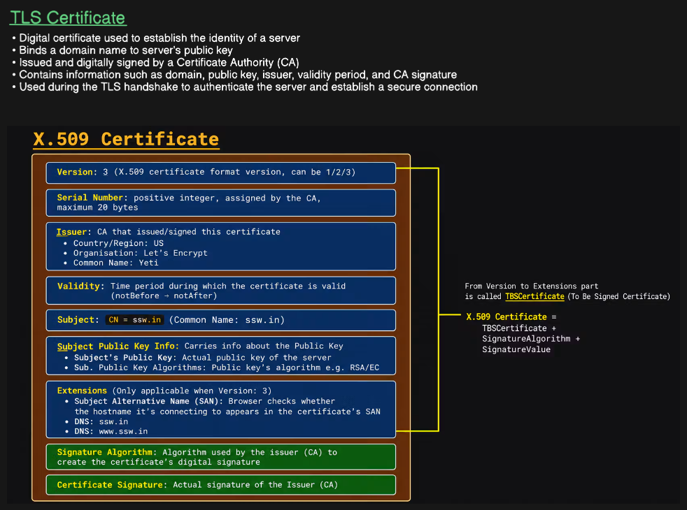
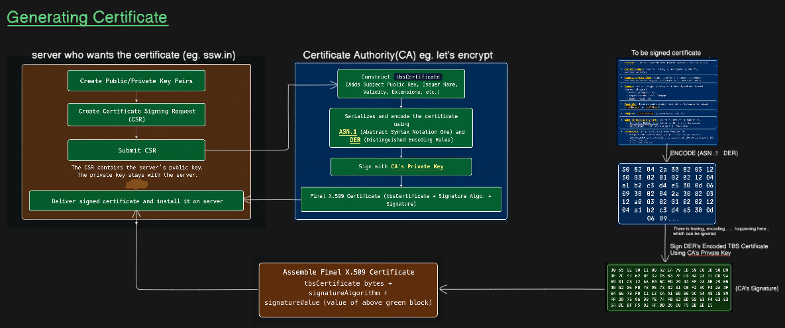
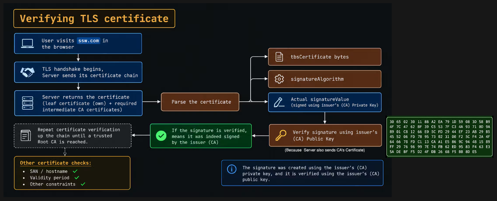
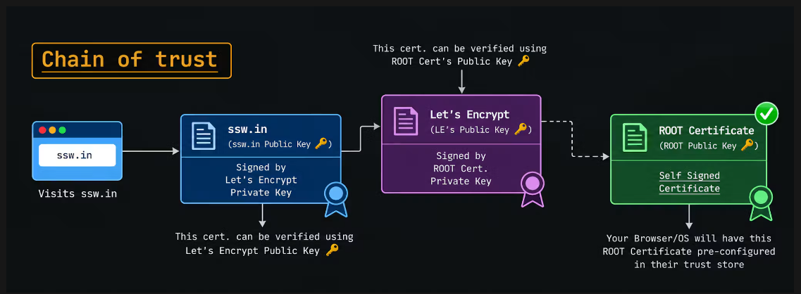
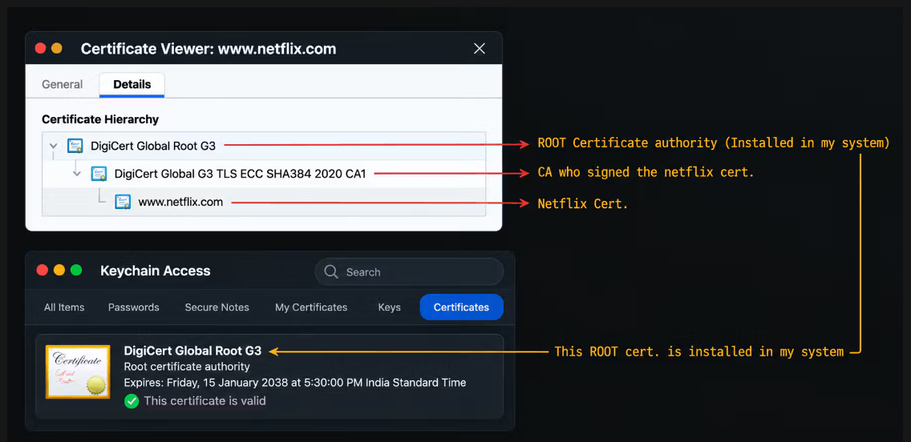

# Computer Networks: TLS Certificates & Public Key Infrastructure (PKI)

A detailed guide covering TLS digital certificates, the X.509 format structure, certificate lifecycle generation, cryptographic verification, and the Public Key Infrastructure (PKI) Chain of Trust.

## Table of Contents

* [1. TLS Certificate Foundations](#1-tls-certificate-foundations)
* [2. X.509 Certificate Structure](#2-x509-certificate-structure)
* [3. Generating & Signing a TLS Certificate](#3-generating--signing-a-tls-certificate)
* [4. Certificate Verification Workflow](#4-certificate-verification-workflow)
* [5. Chain of Trust Architecture](#5-chain-of-trust-architecture)
* [6. Real-World Case Study (Netflix)](#6-real-world-case-study-netflix)

---

## 1. TLS Certificate Foundations

A **TLS Certificate** is a digital credential used to verify the identity of a server and establish an encrypted connection over an untrusted network.



### Key Objectives
* **Identity Binding:** Binds a specific domain name (e.g., `ssw.in`) to the server's public key.
* **Authentication:** Allows clients (browsers) to cryptographically verify who they are communicating with during the TLS handshake.
* **Authority:** Issued and digitally signed by a trusted third-party **Certificate Authority (CA)** (e.g., Let's Encrypt, DigiCert).

---

## 2. X.509 Certificate Structure

TLS certificates adhere to the standardized **X.509** format. A certificate consists of two main parts: the **TBSCertificate** (To Be Signed) data fields and the **CA Signature**.

### Complete X.509 Structure Formula

$$
\text{X.509 Certificate} = \text{TBSCertificate} + \text{SignatureAlgorithm} + \text{SignatureValue}
$$

### TBSCertificate (To Be Signed Certificate) Breakdown

The `TBSCertificate` encompasses all subject and authority metadata:

| Field | Description | Example / Notes |
| :--- | :--- | :--- |
| **Version** | X.509 format version | Version `3` (X.509 v3) |
| **Serial Number** | Unique positive integer assigned by CA | Maximum size: 20 bytes |
| **Issuer** | CA identity that signed the certificate | Country: `US`, Org: `Let's Encrypt` |
| **Validity** | Time range during which cert is valid | Defined as `notBefore` $\rightarrow$ `notAfter` |
| **Subject** | Entity holding the certificate | `CN = ssw.in` (Common Name) |
| **Subject Public Key Info** | Server's public key & algorithm | Public Key + Algorithm (e.g., RSA/EC) |
| **Extensions** (v3) | Additional constraints & alt names | **SAN** (`DNS: ssw.in`, `DNS: www.ssw.in`) |

### Signature Metadata
* **Signature Algorithm:** The cryptographic algorithm used by the CA to sign (e.g., `sha256WithRSAEncryption` or `ecdsa-with-SHA384`).
* **Certificate Signature (`SignatureValue`):** The actual digital signature computed by the CA over the DER-encoded `TBSCertificate`.

---

## 3. Generating & Signing a TLS Certificate

The lifecycle of getting a certificate signed by a CA follows a structured sequence.



### Step 1: Server Side (`ssw.in`)
1. **Create Key Pair:** The server generates its own Public Key and Private Key locally.
2. **Create CSR:** Generates a **Certificate Signing Request (CSR)** containing its public key and domain information.
3. **Submit CSR:** Sends the CSR to the CA.
   > 🔐 **Security Note:** The server's **Private Key NEVER leaves the server**. Only the Public Key is sent inside the CSR.

### Step 2: CA Side (e.g., Let's Encrypt)
1. **Construct `tbsCertificate`:** Assembles the public key from the CSR with issuer details, validity, and extensions.
2. **Serialization & Encoding:** Encodes the structure into binary format using **ASN.1** (Abstract Syntax Notation One) and **DER** (Distinguished Encoding Rules).
3. **Signing:** Computes a cryptographic hash of the DER-encoded `tbsCertificate` and encrypts it with the **CA's Private Key**.
4. **Assemble X.509 Certificate:** Combines `tbsCertificate` + `signatureAlgorithm` + `signatureValue`.

### Step 3: Deployment
* The CA delivers the final signed X.509 Certificate back to the server owner, who installs it on the web server.

---

## 4. Certificate Verification Workflow

When a client connects to a server, it verifies the server's certificate before trusting the connection.



### Verification Steps
1. **Handshake Initiation:** User connects to domain; server responds with its certificate (leaf certificate + required intermediate CAs).
2. **Parse Certificate:** The client splits the certificate into `tbsCertificate` bytes, `signatureAlgorithm`, and `signatureValue`.
3. **Cryptographic Signature Verification:**
   * The client takes the `signatureValue` and decrypts/verifies it using the **Issuer's (CA) Public Key**.
   * If the hash matches the locally hashed `tbsCertificate`, the signature is valid.
4. **Chain Verification:** The browser repeats verification up the certificate chain until it reaches a trusted **Root CA**.

### Additional Critical Checks
* ✅ **Hostname / SAN Matching:** Verifies that the connected domain matches entries in the Subject Alternative Name field.
* ✅ **Validity Window:** Verifies current time falls strictly between `notBefore` and `notAfter`.
* ✅ **Revocation Status & Usage Constraints:** Verifies cert hasn't been revoked via CRL/OCSP.

---

## 5. Chain of Trust Architecture

To prevent every browser from needing millions of server certificates stored locally, PKI uses a hierarchical **Chain of Trust**.



```text
[ Browser / OS Trust Store ]
             │
             ▼
    ┌─────────────────┐
    │  Root CA Cert   │  <-- Self-Signed (Pre-installed in OS/Browser)
    └────────┬────────┘
             │ Signed using Root CA Private Key
             ▼
    ┌─────────────────┐
    │ Intermediate CA │  <-- Verified using Root CA Public Key
    └────────┬────────┘
             │ Signed using Intermediate CA Private Key
             ▼
    ┌─────────────────┐
    │ Leaf Cert Domain│  <-- Verified using Intermediate CA Public Key
    └─────────────────┘      (e.g., ssw.in)
```

1. **Leaf Certificate (`ssw.in`):** The server's certificate containing its public key. Signed by the Intermediate CA's Private Key. Verified using the **Intermediate CA's Public Key**.
2. **Intermediate CA (`Let's Encrypt`):** Isolates the Root CA from day-to-day signing. Signed by the Root CA's Private Key. Verified using the **Root CA's Public Key**.
3. **Root CA:** Top of the trust chain. It is **self-signed** and pre-installed directly inside your **OS / Browser Trust Store**.

---

## 6. Real-World Case Study (Netflix)

Here is how the Chain of Trust manifests in production when inspecting a real HTTPS connection in a web browser and OS Keyring.



### Inspection Breakdown (`www.netflix.com`)

1. **Leaf Certificate:** `www.netflix.com` (Issued to Netflix).
2. **Intermediate CA:** `DigiCert Global G3 TLS ECC SHA384 2020 CA1` (The CA that issued and signed the Netflix certificate).
3. **Root CA:** `DigiCert Global Root G3` (The top-level root authority).

### OS System Integration
* As shown in macOS **Keychain Access**, `DigiCert Global Root G3` is pre-installed in the system trust store (`Root certificate authority`, valid through 2038).
* Because the OS implicitly trusts this Root CA, it trusts the Intermediate CA, which in turn allows it to securely validate `www.netflix.com`.