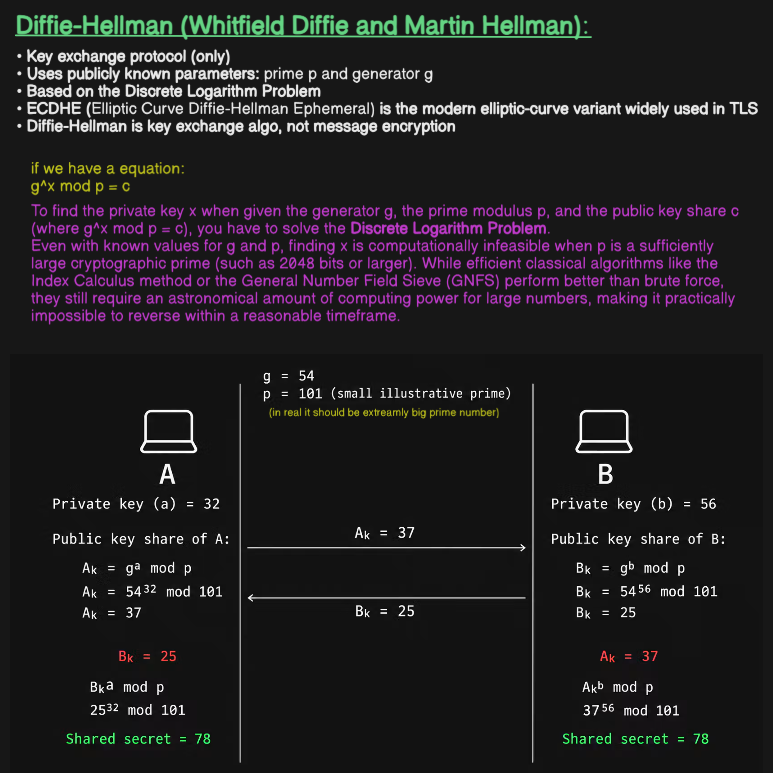

# Computer Networks: Diffie-Hellman Key Exchange

A complete guide covering the Diffie-Hellman (DH) key exchange protocol, the mathematical hardness of the Discrete Logarithm Problem, and a step-by-step numerical example.

## Table of Contents

* [1. Diffie-Hellman Protocol Foundations](#1-diffie-hellman-protocol-foundations)

* [2. Mathematical Security: Discrete Logarithm Problem](#2-mathematical-security-discrete-logarithm-problem)

* [3. Step-by-Step Mathematical Walkthrough](#3-step-by-step-mathematical-walkthrough)

## 1. Diffie-Hellman Protocol Foundations

Developed by Whitfield Diffie and Martin Hellman, **Diffie-Hellman** is a fundamental cryptographic protocol designed specifically for **secure key exchange**.

### Key Principles

* **Key Exchange Only:** Diffie-Hellman is strictly a key exchange protocol—it is **not** used to encrypt or decrypt arbitrary messages directly.

* **Public Parameters:** Both parties agree on two publicly known, unencrypted parameters:

  * Prime modulus $p$

  * Generator / Base $g$

* **Modern Variant:** **ECDHE** (Elliptic Curve Diffie-Hellman Ephemeral) is the modern, highly efficient elliptic-curve variation used in modern TLS (e.g., TLS 1.3) to provide **Perfect Forward Secrecy (PFS)**.

---

## 2. Mathematical Security: Discrete Logarithm Problem

The security of Diffie-Hellman relies entirely on the computational difficulty of solving the **Discrete Logarithm Problem**.

### The Core Equation

$$
g^x \pmod p = c
$$

Where:

* $g$ = Publicly known generator

* $p$ = Publicly known prime modulus

* $c$ = Public key share transmitted over the network

* $x$ = Secret private key exponent

### Why Is It Secure?

* **One-Way Direction:** Given $g, x,$ and $p$, calculating $c = g^x \pmod p$ is computationally trivial and fast.

* **Hard Reverse Direction:** Given public values $g, p,$ and the public share $c$, finding the secret exponent $x$ requires solving for $x$ in $\log_g(c) \pmod p$.

* **Computational Infeasibility:** When $p$ is a sufficiently large cryptographic prime (e.g., 2048 bits or larger), finding $x$ is computationally infeasible. Advanced algorithms like the **General Number Field Sieve (GNFS)** or Index Calculus perform far better than brute force, but still require an astronomical amount of computing power for large key sizes, making it practically impossible to reverse within a reasonable timeframe.

---

## 3. Step-by-Step Mathematical Walkthrough

Below is a complete mathematical exchange example between Party A and Party B.

### Public Parameters (Shared Openly)

* **Generator ($g$):** $54$

* **Prime Modulus ($p$):** $101$ *(Small illustrative prime; production uses 2048+ bit primes)*

---

### Key Generation & Public Exchange

| Party A | Transmission Over Network | Party B |
| :--- | :---: | :--- |
| **Choose Private Key ($a$):** $32$ | | **Choose Private Key ($b$):** $56$ |
| **Compute Public Share ($A_k$):** $A_k = g^a \pmod p$ $A_k = 54^{32} \pmod{101}$ $\mathbf{A_k = 37}$ | $\xrightarrow{\quad A_k = 37 \quad}$ | Receives $A_k = 37$ |
| Receives $B_k = 25$ | $\xleftarrow{\quad B_k = 25 \quad}$ | **Compute Public Share ($B_k$):** $B_k = g^b \pmod p$ $B_k = 54^{56} \pmod{101}$ $\mathbf{B_k = 25}$ |

---

### Shared Secret Calculation

Both parties calculate the shared secret key independently using their own private key and the other party's public share:

#### Party A's Computation:

$$
\text{Shared Secret} = (B_k)^a \pmod p = 25^{32} \pmod{101} = \mathbf{78}
$$

#### Party B's Computation:

$$
\text{Shared Secret} = (A_k)^b \pmod p = 37^{56} \pmod{101} = \mathbf{78}
$$

### Mathematical Proof of Equivalence

$$
(B_k)^a \pmod p = (g^b)^a \pmod p = g^{ab} \pmod p = (g^a)^b \pmod p = (A_k)^b \pmod p
$$

Both Party A and Party B arrive at the exact same shared secret (**78**) without ever transmitting their private keys ($a=32, b=56$) or the shared secret itself across the untrusted network!