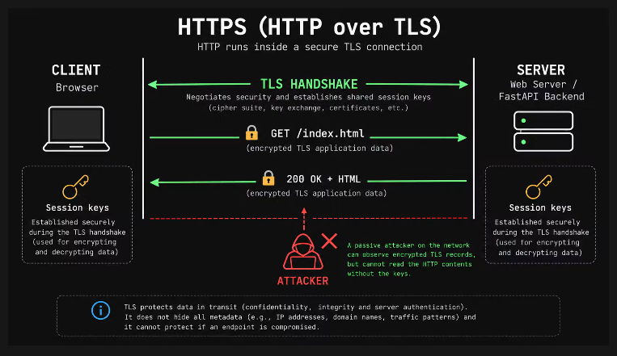
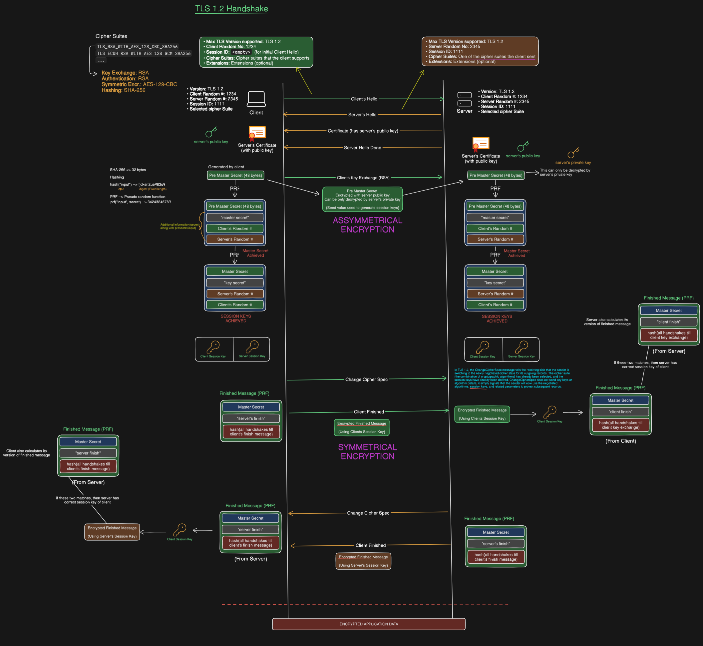

# Computer Networks: TLS 1.2 Detailed Handshake Protocol & Architecture

A comprehensive technical reference covering HTTPS architecture, cipher suite composition, asymmetric key exchanges, Pseudo-Random Function (PRF) key derivation, and the complete 4-phase TLS 1.2 handshake sequence.

---

## Table of Contents

- [1. High-Level HTTPS & TLS Architecture](#1-high-level-https--tls-architecture)
- [2. Cipher Suite Structure](#2-cipher-suite-structure)
- [3. Deep-Dive: TLS 1.2 Handshake Protocol](#3-deep-dive-tls-12-handshake-protocol)
  - [Phase 1: Negotiation & Parameter Setup](#phase-1-negotiation--parameter-setup)
  - [Phase 2: Asymmetric Key Exchange & Pre-Master Secret](#phase-2-asymmetric-key-exchange--pre-master-secret)
  - [Phase 3: Session Key Derivation (PRF)](#phase-3-session-key-derivation-prf)
  - [Phase 4: Handshake Verification & Session Transition](#phase-4-handshake-verification--session-transition)
- [4. Encrypted Application Data Phase](#4-encrypted-application-data-phase)
- [5. Threat Model & Security Guarantees](#5-threat-model--security-guarantees)

---

## 1. High-Level HTTPS & TLS Architecture



Hypertext Transfer Protocol Secure (**HTTPS**) is not a distinct protocol, but rather standard HTTP layered on top of an encrypted **Transport Layer Security (TLS)** tunnel.

### Fundamental Concepts

1. **Protocol Layering:**
   - **Application Layer:** HTTP/1.1 or HTTP/2 framing.
   - **Security Layer:** TLS Record & Handshake Protocols.
   - **Transport Layer:** Transmission Control Protocol (TCP).

2. **Session Key Paradigm:**
   - Asymmetric cryptography (RSA / ECDHE) is computationally heavy and used **only** during the handshake to authenticate identity and establish shared symmetric keys.
   - All bulk HTTP traffic (headers, body, payloads) is encrypted using **symmetrical session keys** derived at the end of the handshake.

---

## 2. Cipher Suite Structure

A **Cipher Suite** is a standardized string of identifiers defining the cryptographic algorithms selected by the client and server to secure the connection.

### Example Anatomy

```text
TLS_RSA_WITH_AES_128_CBC_SHA256
└───┬──┘ └───┬──────┘ └──┬──┘ └──┬───┘
    │        │           │       │
    │        │           │       └─ HMAC / Hashing / PRF Algorithm (SHA-256)
    │        │           └───────── Symmetric Bulk Cipher Mode (AES-128-CBC)
    │        └───────────────────── Authentication / Key Exchange (RSA)
    └────────────────────────────── Protocol Identifier (TLS)
```

| Component | Selected Algorithm | Purpose in TLS 1.2 |
| :--- | :--- | :--- |
| **Protocol** | TLS | Defines the framework version. |
| **Key Exchange** | RSA / ECDHE | Mechanism used to securely exchange or establish the 48-byte Pre-Master Secret. |
| **Authentication** | RSA / ECDSA | Method used to verify the server's identity via X.509 certificate digital signatures. |
| **Symmetric Cipher** | AES-128-CBC / AES-GCM | Symmetric block or stream cipher used for bulk encryption of HTTP application data. |
| **MAC / PRF** | SHA-256 | Cryptographic hash function used for message authentication codes and Key Derivation Functions (KDF). |

---

## 3. Deep-Dive: TLS 1.2 Handshake Protocol



The TLS 1.2 handshake involves a 2-Round-Trip Time (2-RTT) negotiation process before application data can flow securely.

---

### Phase 1: Negotiation & Parameter Setup

The client and server negotiate protocol versions, exchange random seeds, and select a mutually supported cipher suite.

#### 1. `ClientHello`
The client initiates the handshake by sending a `ClientHello` payload containing:
- **Client Version:** Highest TLS version supported (e.g., `TLS 1.2`).
- **Client Random:** A 32-byte cryptographically secure random value (`4 bytes timestamp + 28 bytes random`).
- **Session ID:** Left empty for initial connections, or populated with a previously stored ID for session resumption.
- **Cipher Suites:** Ordered list of cipher suites supported by the client.
- **Extensions:** Optional parameters (e.g., SNI - Server Name Indication, Supported Elliptic Curves).

#### 2. `ServerHello`
The server responds with its selection parameters:
- **Server Version:** Selected protocol version (e.g., `TLS 1.2`).
- **Server Random:** A 32-byte cryptographically secure random value generated by the server.
- **Session ID:** Unique identifier assigned to this connection (e.g., `1111`).
- **Selected Cipher Suite:** Single cipher suite chosen from the client's offered list.

---

### Phase 2: Asymmetric Key Exchange & Pre-Master Secret

#### 3. `Server Certificate`
- The server sends its X.509 certificate chain (Leaf Certificate + Intermediate CAs).
- Contains the **Server's Public Key** ($K_{\text{pub}}$).

#### 4. `ServerHelloDone`
- The server explicitly notifies the client that it has finished its initial negotiation messages.

#### 5. `ClientKeyExchange` (RSA Key Exchange Mode)
- The client generates a fresh 48-byte random value called the **Pre-Master Secret**.
- The client encrypts this value using the **Server's Public Key** ($K_{\text{pub}}$):

$$
\text{Encrypted Pre-Master Secret} = \text{RSA\_Encrypt}(K_{\text{pub}}, \text{Pre-Master Secret})
$$

- The client transmits the encrypted payload across the network.
- The server receives the message and decrypts it using its **Server Private Key** ($K_{\text{priv}}$):

$$
\text{Pre-Master Secret} = \text{RSA\_Decrypt}(K_{\text{priv}}, \text{Encrypted Pre-Master Secret})
$$

> 🔐 **Result:** Both client and server now possess the exact same 48-byte **Pre-Master Secret** without ever revealing it over the wire.

---

### Phase 3: Session Key Derivation (PRF)

Both client and server now independently feed the shared components into a cryptographic **Pseudo-Random Function (PRF)** powered by HMAC-SHA256 to compute symmetrical session keys.

```text
               ┌───────────────────────┐
               │   Pre-Master Secret   │ (48 bytes)
               └───────────┬───────────┘
                           │
                           ▼
  Client Random ──► ┌─────────────┐ ◄── "master secret" (label string)
  Server Random ──► │  PRF (HMAC) │
                    └──────┬──────┘
                           │
                           ▼
                 ┌──────────────────┐
                 │  Master Secret   │ (48 bytes)
                 └─────────┬────────┘
                           │
                           ▼
  Server Random ──► ┌─────────────┐ ◄── "key expansion" (label string)
  Client Random ──► │  PRF (HMAC) │
                    └──────┬──────┘
                           │
                           ▼
         ┌──────────────────────────────────┐
         │     Key Block (Session Keys)     │
         └────────────────┬─────────────────┘
                          │
          ┌───────────────┴───────────────┐
          ▼                               ▼
┌──────────────────┐            ┌──────────────────┐
│  Client Session  │            │  Server Session  │
│       Key        │            │       Key        │
└──────────────────┘            └──────────────────┘
```

#### Step 1: Master Secret Derivation
The 48-byte Master Secret is derived using:

$$
\text{Master Secret} = \text{PRF}(\text{Pre-Master Secret}, \text{"master secret"}, \text{Client Random} \parallel \text{Server Random})
$$

#### Step 2: Key Expansion (Key Block)
The Master Secret is expanded into a **Key Block** containing the symmetric encryption and MAC keys:

$$
\text{Key Block} = \text{PRF}(\text{Master Secret}, \text{"key expansion"}, \text{Server Random} \parallel \text{Client Random})
$$

#### Extracted Symmetric Session Keys
From the Key Block, the following distinct keys are assigned:
1. **Client Write MAC Key / Client Session Key:** Encrypts data sent from Client $\rightarrow$ Server.
2. **Server Write MAC Key / Server Session Key:** Encrypts data sent from Server $\rightarrow$ Client.

---

### Phase 4: Handshake Verification & Session Transition

Before application data is transmitted, both parties must prove that their handshake messages were not tampered with.

#### 1. `ChangeCipherSpec` (Client)
- Informs the server that all subsequent client messages will be encrypted using the derived symmetric session keys.

#### 2. `Client Finished`
- The client sends an encrypted verification payload computed over all preceding handshake messages:

$$
\text{Client Finished} = \text{PRF}(\text{Master Secret}, \text{"client finished"}, \text{Hash}(\text{All Handshake Messages}))
$$

- The server decrypts this message using the **Client Session Key**, computes the local PRF hash, and verifies equality.

#### 3. `ChangeCipherSpec` (Server)
- Informs the client that all subsequent server messages will be encrypted.

#### 4. `Server Finished`
- The server sends its encrypted verification payload:

$$
\text{Server Finished} = \text{PRF}(\text{Master Secret}, \text{"server finished"}, \text{Hash}(\text{All Handshake Messages}))
$$

- The client decrypts this message using the **Server Session Key** and verifies the match.

---

## 4. Encrypted Application Data Phase

Once both `Finished` messages are successfully verified, the TLS handshake is complete.

1. **Protocol Switch:** HTTP requests (`GET /index.html`) are wrapped inside TLS Record frames (`Content-Type: 23` for Application Data).
2. **Symmetric Encryption:** Payloads are encrypted with the symmetric bulk cipher (e.g., AES-128-CBC) using the derived session key.
3. **Data Integrity:** Each record includes an HMAC payload to detect tampering in transit.

---

## 5. Threat Model & Security Guarantees

### What TLS 1.2 Guarantees
- ✅ **Confidentiality:** Eavesdroppers cannot decrypt captured HTTP traffic without the symmetric session keys.
- ✅ **Integrity:** Any bit manipulation in transit invalidates the HMAC / AEAD tag, causing the packet to be rejected.
- ✅ **Server Authentication:** Digital signatures and trusted CA chains guarantee server identity.

### Structural Limitations
- ❌ **Metadata Visibility:** IP addresses, port numbers, packet sizes, and hostnames in the Server Name Indication (SNI) extension remain visible in plaintext.
- ❌ **Lack of Perfect Forward Secrecy (PFS) in Plain RSA:** If using basic RSA key exchange, compromising the server's private key at any point in the future allows an attacker to decrypt all historically recorded network captures. *(Solved by using ECDHE ephemeral key exchange)*.