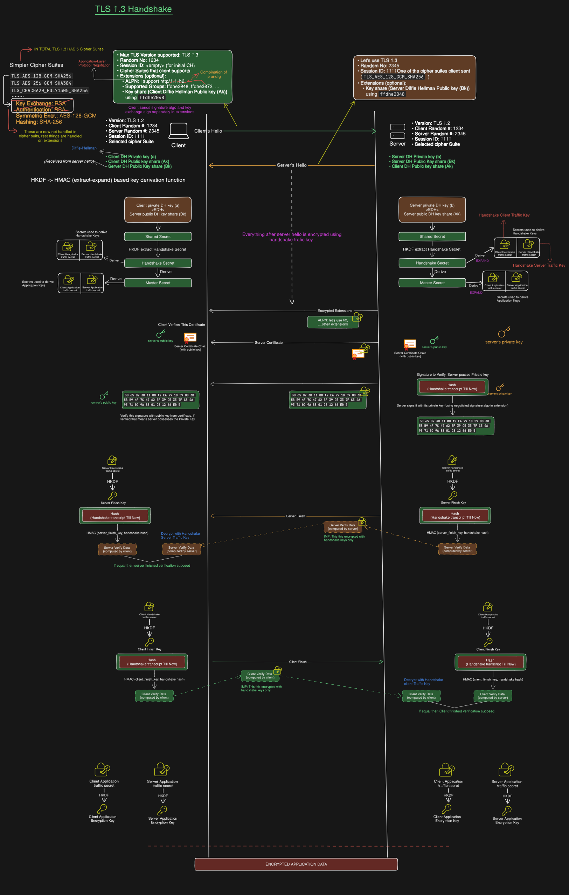
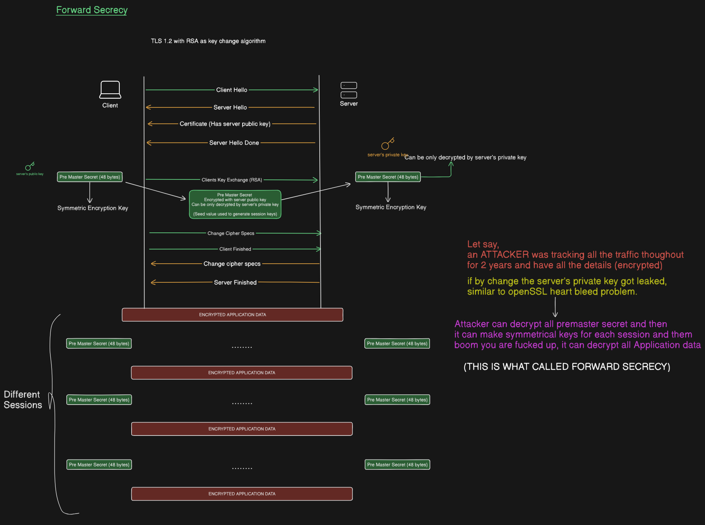
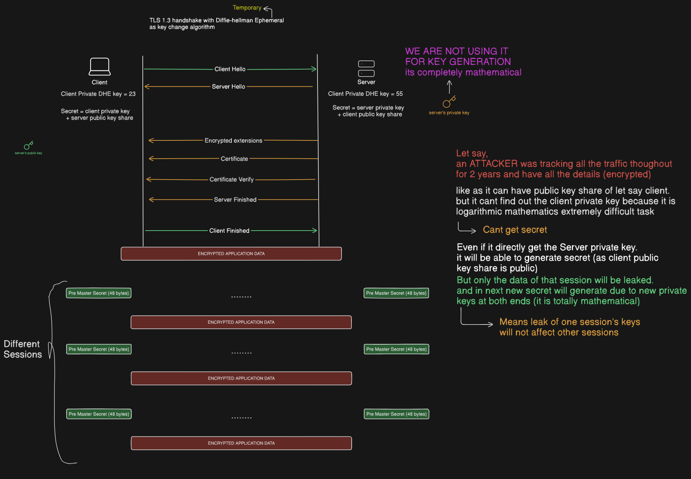

# Computer Networks: TLS 1.3 Architecture & Perfect Forward Secrecy (PFS)

A comprehensive deep-dive into TLS 1.3, highlighting its 1-RTT handshake performance improvements, the HKDF key derivation schedule, elimination of legacy cipher suites, and the mathematical mechanics of Perfect Forward Secrecy (PFS).

## Table of Contents

* [1. TLS 1.3 Evolution & Core Architectural Changes](#1-tls-13-evolution--core-architectural-changes)

* [2. Simplified Cipher Suites & Extension-Based Key Exchange](#2-simplified-cipher-suites--extension-based-key-exchange)

* [3. HKDF (HMAC-based Extract-and-Expand KDF) Key Schedule](#3-hkdf-hmac-based-extract-and-expand-kdf-key-schedule)

* [4. Detailed TLS 1.3 Handshake Protocol (1-RTT)](#4-detailed-tls-13-handshake-protocol-1-rtt)

* [5. Vulnerability of Static RSA Key Exchange (TLS 1.2)](#5-vulnerability-of-static-rsa-key-exchange-tls-12)

* [6. Perfect Forward Secrecy (PFS) via Ephemeral Diffie-Hellman](#6-perfect-forward-secrecy-pfs-via-ephemeral-diffie-hellman)

---

## 1. TLS 1.3 Evolution & Core Architectural Changes

TLS 1.3 (standardized in RFC 8446) represents a major redesign of the Transport Layer Security protocol, prioritizing **performance (reduced latency)** and **hardened security**.

### Major Differences Between TLS 1.2 and TLS 1.3

| Metric / Feature | TLS 1.2 | TLS 1.3 | 
| ----- | ----- | ----- | 
| **Handshake Latency** | 2-RTT (Round Trip Times) | **1-RTT** (0-RTT available for session resumption) | 
| **Encrypted Handshake** | Only messages after `Finished` | **Everything after `ServerHello` is encrypted** | 
| **Key Exchange** | Static RSA, DHE, or ECDHE | **Mandatory Ephemeral Key Exchange (ECDHE/DHE only)** | 
| **Key Derivation** | Custom PRF (Pseudo-Random Function) | Standardized **HKDF** (HMAC-based KDF) | 
| **Static RSA Support** | Supported (Vulnerable to key leaks) | **Completely Removed** | 
| **Cipher Suite Design** | Complex (Key Exchange + Auth + Cipher + Hash) | **Simplified** (Bulk Cipher + Hash only) | 

---

## 2. Simplified Cipher Suites & Extension-Based Key Exchange

In TLS 1.2, cipher suites were overloaded string definitions specifying key exchange, authentication, encryption, and hashing simultaneously. TLS 1.3 decouples key exchange and authentication from the cipher suite.

### Only 5 Standard Cipher Suites in TLS 1.3

1. `TLS_AES_128_GCM_SHA256`

2. `TLS_AES_256_GCM_SHA384`

3. `TLS_CHACHA20_POLY1305_SHA256`

4. `TLS_AES_128_CCM_SHA256`

5. `TLS_AES_128_CCM_8_SHA256`

### Decoupled Key Exchange via Extensions

Because key exchange and authentication algorithms are removed from the cipher suite name, they are negotiated via Client extensions:

* **`supported_groups`:** Lists supported elliptic curves/DH groups (e.g., `x25519`, `secp256r1`, `ffdhe2048`).

* **`key_share`:** Contains the client's pre-computed public key share ($A_k$) generated for the preferred group(s).

---

## 3. HKDF (HMAC-based Extract-and-Expand KDF) Key Schedule

TLS 1.3 replaces the custom PRF with **HKDF** (RFC 5869), producing distinct, cryptographically isolated keys for handshake verification and application data encryption.

```
                         ┌──────────────────────────┐
                         │   Diffie-Hellman Share   │
                         │     (Shared Secret)      │
                         └────────────┬─────────────┘
                                      │
                                      ▼
                             ┌──────────────────┐
                             │   HKDF-Extract   │
                             └────────┬─────────┘
                                      │
                                      ▼
                             ┌──────────────────┐
                             │ Handshake Secret │
                             └────────┬─────────┘
                                      │
               ┌──────────────────────┴──────────────────────┐
               ▼                                             ▼
  ┌─────────────────────────┐                   ┌─────────────────────────┐
  │ Client Handshake Traffic│                   │ Server Handshake Traffic│
  │           Key           │                   │           Key           │
  └─────────────────────────┘                   └─────────────────────────┘
               │                                             │
               └──────────────────────┬──────────────────────┘
                                      │
                                      ▼
                             ┌──────────────────┐
                             │  Master Secret   │
                             └────────┬─────────┘
                                      │
               ┌──────────────────────┴──────────────────────┐
               ▼                                             ▼
  ┌─────────────────────────┐                   ┌─────────────────────────┐
  │   Client Application    │                   │   Server Application    │
  │       Traffic Key       │                   │       Traffic Key       │
  └─────────────────────────┘                   └─────────────────────────┘

```

1. **Shared Secret:** Computed from the client and server Diffie-Hellman key shares ($g^{ab} \pmod p$).

2. **Handshake Secret:** Derived via `HKDF-Extract(Shared Secret)`. Generates:

   * **Client Handshake Traffic Key** (Encrypts `ClientFinished`)

   * **Server Handshake Traffic Key** (Encrypts `EncryptedExtensions`, `Certificate`, `CertificateVerify`, and `ServerFinished`)

3. **Master Secret:** Derived from the Handshake Secret. Generates:

   * **Client Application Traffic Key** (Encrypts outbound HTTP requests)

   * **Server Application Traffic Key** (Encrypts outbound HTTP responses)

---

## 4. Detailed TLS 1.3 Handshake Protocol (1-RTT)



### Round Trip 1 (1-RTT) Workflow

#### 1. `ClientHello` (Client $\rightarrow$ Server)
* **Version:** `TLS 1.2` (for backwards compatibility in record headers) + Extension `supported_versions: TLS 1.3`.

* **Random Seed:** 32-byte Client Random (`1234`).

* **Key Share Extension:** Proactively generates and sends the client's public Diffie-Hellman share ($A_k = g^a \pmod p$) using its preferred group (e.g., `ffdhe2048`).

#### 2. `ServerHello` (Server $\rightarrow$ Client)
* Negotiates `TLS 1.3` and selects a cipher suite (e.g., `TLS_AES_128_GCM_SHA256`).

* **Key Share Extension:** Sends the server's public Diffie-Hellman share ($B_k = g^b \pmod p$).

> 🔒 **Handshake Key Activation:**
> At this exact moment, both client and server possess each other's public key shares. They calculate the **Shared Secret** and derive the **Handshake Traffic Keys**. **Every subsequent packet in the handshake is encrypted!**

#### 3. `EncryptedExtensions` (Server $\rightarrow$ Client)
* Encrypted payload containing connection parameters such as ALPN (`h2`, `http/1.1`).

#### 4. `Certificate` & `CertificateVerify` (Server $\rightarrow$ Client)
* **Certificate:** Transmits the server's X.509 certificate chain.

* **CertificateVerify:** The server computes a digital signature over the entire handshake transcript up to this point using its **Long-Term Private Key**.

* **Client Validation:** The client verifies the signature using the **Public Key** inside the certificate, proving that the server owns the private key associated with the certificate.

#### 5. `ServerFinished` (Server $\rightarrow$ Client)
* Sends an HMAC tag calculated over the entire transcript using the `Server Finish Key`.

#### 6. `ClientFinished` (Client $\rightarrow$ Server)
* The client verifies `ServerFinished`, computes an HMAC over the transcript using the `Client Finish Key`, and sends it to the server.

#### 7. Application Data Flow
* Both parties transition from Handshake Secrets to Master Secrets and derive the **Client & Server Application Traffic Keys**.

---

## 5. Vulnerability of Static RSA Key Exchange (TLS 1.2)

To understand why TLS 1.3 removed RSA key exchange, consider the structural vulnerability present in static RSA setups.



### The Retroactive Decryption Scenario

1. **Static Pre-Master Transport:** In TLS 1.2 RSA mode, the 48-byte Pre-Master Secret is encrypted using the **Server's Public Key** and sent over the wire.

2. **Passive Eavesdropping:** An attacker passively records and archives all encrypted network traffic exchanged with the server over a multi-year period.

3. **Private Key Leakage:** If the server's long-term private key is leaked at any point in the future (e.g., via Heartbleed, server compromise, or insider threat):

4. **Total Compromise:** The attacker uses the leaked private key to decrypt the archived Pre-Master Secrets for **every historical session**, computes the symmetric session keys, and decrypts all past sensitive user traffic.

---

## 6. Perfect Forward Secrecy (PFS) via Ephemeral Diffie-Hellman

**Perfect Forward Secrecy (PFS)** guarantees that compromising a server's long-term private key does **not** compromise past session keys.



### How TLS 1.3 Enforces PFS

1. **Role Separation for Long-Term Keys:** In TLS 1.3, the server's long-term RSA/ECDSA key is used **strictly for digital signatures (`CertificateVerify`) to prove identity**, never to encrypt or derive session keys.

2. **Ephemeral Key Pairs:** Every individual connection creates short-lived, ephemeral private/public key pairs (e.g., Client DHE Private Key $a = 23$, Server DHE Private Key $b = 55$).

3. **Mathematical Derivation:** The shared secret is derived dynamically via modular exponentiation:

$$
\text{Shared Secret} = (B_k)^a \pmod p = (A_k)^b \pmod p = g^{ab} \pmod p
$$

4. **Key Destruction & Isolation:** As soon as the session ends, the ephemeral keys $a$ and $b$ are discarded from memory. 

### Security Outcome

* Even if an attacker records traffic for years and eventually steals the server's long-term private key, they **cannot calculate past session keys** because the long-term private key was never used in the Diffie-Hellman calculation.

* If an ephemeral key for a single session is somehow compromised, **only that specific session is exposed**. All other past and future sessions remain completely secure.